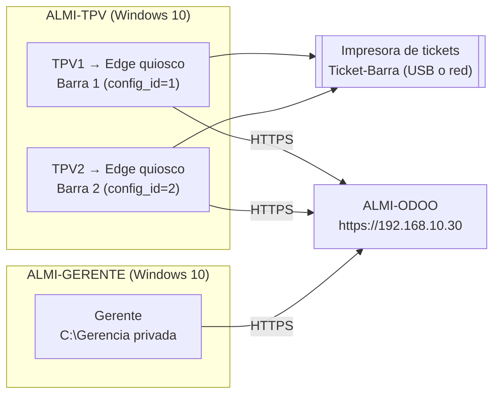
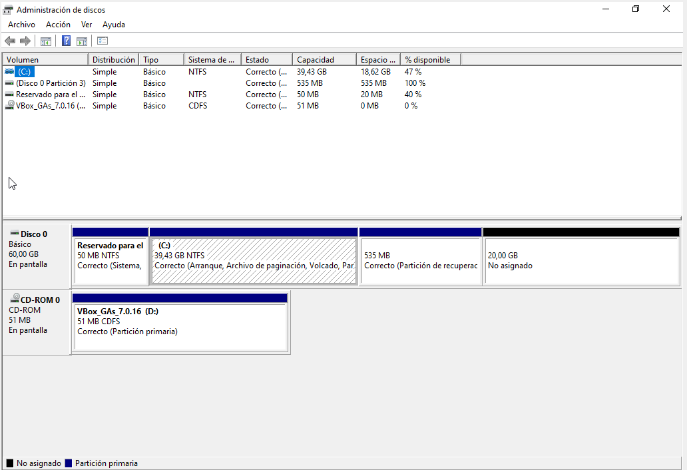
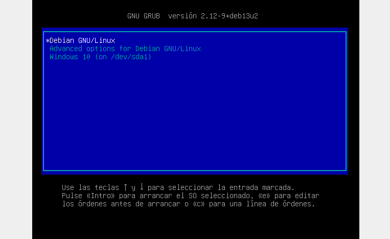
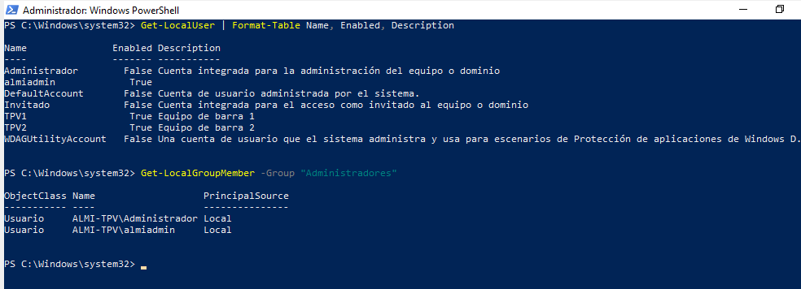
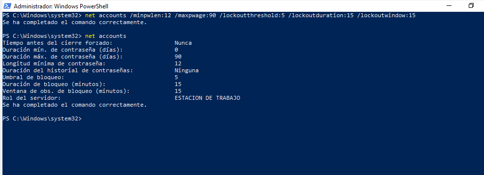
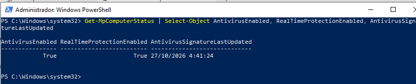
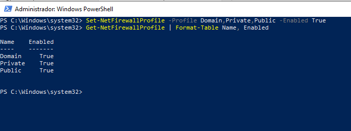

# 1. Windows: equipo del Gerente y TPV de barra

## Objetivo

Preparar los puestos de Windows del restaurante con **mínimo privilegio**: el equipo del despacho para el **Gerente** (ALMI-GERENTE) y una VM con los dos **TPV de barra** (ALMI-TPV, usuarios TPV1 y TPV2) que solo abren su TPV de Odoo en **modo quiosco** e imprimen el ticket en la **impresora de tickets física**. Incluye las necesidades, el hardware y el presupuesto de los equipos reales.

Tareas del tablero: P01 a P12.

## Requisitos

| Dato | ALMI-GERENTE | ALMI-TPV |
|---|---|---|
| Sistema | **Arranque dual**: Windows 10 Pro (o Education) con licencia + Debian 13 | Windows 10 Pro (o Education) con licencia |
| Memoria / CPU | 3072 MB / 2 | 3072 MB / 2 |
| Disco | 60 GB VDI dinámico: 40 GB Windows + 20 GB Debian | 40 GB VDI dinámico |
| Pantalla | 128 MB, VBoxSVGA | 128 MB, VBoxSVGA |
| Red | Red NAT ALMICHAIN (DHCP) | Red NAT ALMICHAIN (DHCP) |
| USB | Habilitado | Habilitado (impresora) |
| Usuarios | almiadmin (administrador), Gerente | almiadmin (administrador), TPV1, TPV2 |

> Decisión del equipo: ALMI-GERENTE lleva **arranque dual**, Windows 10 Pro y Debian 13 (usuario `almiadmin`), como pide la rúbrica. La recreativa es una VM aparte, ALMI-ARCADE (bloque 02). Las copias de seguridad de los dos sistemas del gerente están en el [bloque 08](../08-copias-so/README.md).
>
> El arranque dual y la VM de los TPV **ya están instalados en VirtualBox** (en clase; documento de Oier en el Drive del equipo): ver [Instalación hecha en clase](#instalación-hecha-en-clase-almi-dual-y-almi-tpv) con sus 77 capturas. En VirtualBox la VM del gerente se llama **ALMI-DUAL**; dentro, Windows se llama **ALMI-GERENTE** y Debian **almi-arcade**.

### Necesidades y equipos reales (P01-P03)

| Puesto | Quién | Para qué | Restricciones | En el laboratorio |
|---|---|---|---|---|
| Equipo del despacho | Gerente | Ofimática, Odoo (facturas, personal, inventario), correo | Usuario estándar, sin instalar programas | ALMI-GERENTE, usuario Gerente |
| TPV de barra 1 | Camareros | Solo cobrar en el TPV de Odoo e imprimir tickets | Quiosco: solo el TPV, sin escritorio ni USB | ALMI-TPV, usuario TPV1 |
| TPV de barra 2 | Camareros | Igual que el 1 | Igual que el 1 | ALMI-TPV, usuario TPV2 |
| Impresora de tickets (×2 en el real) | TPV | Imprimir el ticket de cada venta | Solo la usa el TPV | 1 impresora física compartida |

Requisitos mínimos para la compra: equipo del gerente con 4 núcleos, 16 GB de RAM y SSD NVMe de 500 GB; TPV táctil todo en uno de 15" con 8 GB de RAM y SSD de 128 GB; impresora térmica de 80 mm ESC/POS con corte automático, USB + Ethernet y salida para cajón. El presupuesto con modelo, precio, enlace y fecha está en [`../presupuesto/`](../presupuesto/).

| Software | Dónde | Licencia y coste |
|---|---|---|
| Windows 10 Pro | Gerente y TPV | De pago, por equipo |
| Microsoft Edge | Gerente y TPV | Incluido en Windows |
| Odoo Community (TPV y ERP) | Servidor ALMI-ODOO, por navegador | LGPL, gratis |
| Controlador de la impresora | TPV | Gratis, del fabricante |
| Microsoft Defender | Todos | Incluido en Windows |
| KeePassXC | Equipo del gerente | Libre, gratis |

## Arquitectura



En el restaurante real habría un PC del gerente y dos TPV físicos con una impresora cada uno; en el laboratorio las dos barras comparten la impresora.

## Instalación y configuración paso a paso

### 1. Crear las VM e instalar Windows (P04-P06)

1. VirtualBox → **Nueva** → nombre ALMI-GERENTE (y luego ALMI-TPV), ISO de Windows 10, **Omitir instalación desatendida**, datos de la tabla de requisitos, sin EFI.
2. Instalación personalizada en todo el disco, **cuenta sin conexión** `almiadmin` con contraseña de 12 caracteres o más (KeePassXC), privacidad en "No", diagnóstico "Requerido".
3. **Guest Additions** (Dispositivos → Insertar imagen de CD de las Guest Additions), activar Windows y **Windows Update** hasta que no haya más.
4. Nombre del equipo en PowerShell como administrador: `Rename-Computer -NewName "ALMI-GERENTE" -Restart` (o `ALMI-TPV`).
5. **Copiar los scripts** de la carpeta [`scripts/`](scripts/) a la VM, por ejemplo a `C:\Almi\scripts`: con una carpeta compartida de VirtualBox (Dispositivos → Carpetas compartidas, de solo lectura) o descargando el repositorio en ZIP desde GitHub con `almiadmin`.

> **Riesgo: Windows 10 ya no tiene soporte** (fin de soporte el 14 de octubre de 2025): no recibe parches de seguridad salvo con el programa de pago ESU. Se usa porque es el Windows de clase con licencia. En el restaurante real, los equipos nuevos irían con **Windows 11 Pro** (ver el presupuesto).

### 2. Seguridad general (P08)

[`scripts/1-seguridad.ps1`](scripts/1-seguridad.ps1) en las dos VM, en PowerShell como administrador (`Set-ExecutionPolicy -Scope Process Bypass` antes). Va **antes que los usuarios**, porque Windows comprueba la directiva de contraseñas cuando se crea o se cambia una contraseña, no después:

- Invitado desactivado.
- Contraseñas de 12 caracteres con complejidad, caducidad de 90 días y **bloqueo de 15 minutos tras 5 fallos**.
- UAC en "Notificarme siempre": un usuario estándar no puede instalar nada sin la contraseña de `almiadmin`.
- Defender y cortafuegos activos en los tres perfiles.
- **Sin SMBv1** y **sin Escritorio remoto**.
- Sin reproducción automática.
- En ALMI-GERENTE, bloqueo de pantalla a los 5 minutos.

Los scripts buscan los grupos por su SID (`S-1-5-32-544` Administradores, `S-1-5-32-545` Usuarios), así que funcionan igual con Windows en español o en inglés, y se paran si algo falla (`$ErrorActionPreference = "Stop"` y comprobación de `secedit`, `net accounts` e `icacls`).

### 3. Usuarios con mínimo privilegio (P07)

| Script | Dónde | Qué hace |
|---|---|---|
| [`scripts/2-usuarios-gerente.ps1`](scripts/2-usuarios-gerente.ps1) | ALMI-GERENTE | Usuario estándar **Gerente** y carpeta **`C:\Gerencia`** solo para Administradores, SYSTEM y Gerente |
| [`scripts/2-usuarios-tpv.ps1`](scripts/2-usuarios-tpv.ps1) | ALMI-TPV | Usuarios estándar **TPV1** y **TPV2** |

Las contraseñas se piden al ejecutar el script (no están escritas en él), tienen que tener 12 caracteres o más y cumplir la complejidad (si no, el script se para), y se guardan en KeePassXC.

TPV1 y TPV2 son cuentas de quiosco: **no pueden cambiar su contraseña y no les caduca**, a diferencia del resto (90 días). Si caducara, la barra se quedaría bloqueada en mitad del servicio; la cambia `almiadmin` cuando toca.

Prueba de que la directiva funciona: `New-LocalUser -Name prueba -Password (ConvertTo-SecureString "1234" -AsPlainText -Force)` tiene que dar error (*InvalidPasswordException*).

### 4. Impresora de tickets física (P09)

Se instala **antes** del quiosco, porque después TPV1 y TPV2 ya no pueden tocar nada.

1. Apuntar marca, modelo y si tiene red (RJ45).
2. **Por USB**: VM apagada → Configuración → USB → filtro con la impresora → arrancar → instalar el controlador del fabricante.
   **Por red**: impresora en la misma red que el PC → *Agregar impresora por dirección TCP/IP* con su IP (en el restaurante real, 192.168.20.50 en la VLAN de TPV).
3. Nombre de la impresora: **Ticket-Barra**. Papel de 80 mm, corte al final y apertura de cajón.
4. Página de prueba (foto del ticket).
5. Desmarcar *Permitir que Windows administre mi impresora predeterminada* y poner **Ticket-Barra como predeterminada en TPV1 y en TPV2** (es por usuario).

### 5. Quiosco de TPV1 y TPV2 (P10)

En ALMI-TPV con `almiadmin`: `mmc` → Editor de objetos de directiva de grupo para **TPV1** y para **TPV2** → guardar como `Directivas-TPV.msc`. En **Configuración de usuario → Plantillas administrativas** de cada uno, en **Habilitada**:

| Ruta | Directiva |
|---|---|
| Panel de control | Prohibir el acceso a Configuración de PC y a Panel de control |
| Sistema | Impedir el acceso al símbolo del sistema (también scripts) |
| Sistema | Impedir el acceso a herramientas de edición del Registro |
| Sistema → Opciones de Ctrl+Alt+Supr | Quitar Administrador de tareas |
| Sistema → Acceso de almacenamiento extraíble | Todas las clases de almacenamiento extraíble: denegar acceso a todo |
| Menú Inicio y barra de tareas | Quitar el menú Ejecutar del menú Inicio |
| Componentes de Windows → Explorador de archivos | Ocultar estas unidades especificadas en Mi PC (todas) |
| Componentes de Windows → Explorador de archivos | Impedir el acceso a las unidades desde Mi PC (todas) |
| Sistema | **Interfaz de usuario personalizada**: Edge en quiosco con su TPV |

Línea de la interfaz personalizada ([`scripts/quiosco-TPV1.txt`](scripts/quiosco-TPV1.txt)); en TPV2 cambia `config_id=2`:

```
"C:\Program Files (x86)\Microsoft\Edge\Application\msedge.exe" --kiosk https://192.168.10.30/pos/ui?config_id=1 --edge-kiosk-type=fullscreen --kiosk-printing --no-first-run
```

`--kiosk-printing` imprime el ticket directamente en la impresora predeterminada del usuario, sin cuadro de diálogo. Los `config_id` se han comprobado en Odoo: **Barra 1 = 1** y **Barra 2 = 2**.

`gpupdate /force`, cerrar sesión y entrar como TPV1: se abre Edge a pantalla completa con Barra 1. Antes hay que haber instalado el certificado de Odoo (apartado 6); si no, Edge enseña un aviso de seguridad que en modo quiosco no se puede saltar.

**Primer inicio en cada TPV**: la primera vez Odoo pide usuario y contraseña. Se entra con `barra1@almichain.local` en TPV1 y `barra2@almichain.local` en TPV2 (contraseñas en KeePassXC) y Edge guarda la sesión en el perfil del usuario de Windows. Si un día la sesión de Odoo caduca, vuelve a salir esa pantalla y el encargado la repite.

### 6. Certificado de Odoo

[`scripts/3-certificado-odoo.ps1`](scripts/3-certificado-odoo.ps1) en las dos VM, como `almiadmin`:

1. En ALMI-ODOO se apunta la huella: `sudo openssl x509 -in /etc/ssl/almichain/odoo.crt -noout -fingerprint -sha256`.
2. El script descarga la parte pública del certificado de `http://192.168.10.30/almichain-odoo.crt` (no usa SSH ni la contraseña del servidor), enseña su huella y **pide escribir la del servidor**. Si no coinciden, o si el certificado fuera de autoridad (`CA:TRUE`), no instala nada.
3. Si coinciden, lo instala en *Entidades de certificación raíz de confianza* del equipo. Edge muestra el candado sin avisos.

Comprobar la huella es lo que evita que alguien en la red sirva un certificado falso en ese momento. El certificado es de servidor (`CA:FALSE`), así que aunque esté en el almacén de raíces solo vale para Odoo.

## Instalación hecha en clase: ALMI-DUAL y ALMI-TPV

Hecho en **VirtualBox**, en la red NAT ALMICHAIN (192.168.10.0/24), a partir del documento del equipo *Documentación Reto 1 - ALMI-DUAL y ALMI-TPV* (Drive del equipo, 4 de noviembre). Las contraseñas no aparecen en ninguna captura: se escriben ocultas y se guardan en KeePassXC (`almichain.kdbx`).

| | ALMI-DUAL (equipo del gerente) | ALMI-TPV (barras) |
|---|---|---|
| Sistemas | Windows 10 + Debian 13, arranque con GRUB | Windows 10 |
| Hardware | 3072 MB, 2 CPU, 128 MB de vídeo, USB 1.1, red NAT ALMICHAIN | Igual |
| Disco | 60 GB: Windows (C:) 40 GB y Debian 21,5 GB (ext4, sin swap) | 40 GB, todo Windows |
| Nombre | ALMI-GERENTE (Windows) y almi-arcade (Debian) | ALMI-TPV |
| Usuarios | almiadmin (administrador) y la cuenta local *Gerente Almi-Chain* en Windows; almiadmin en Debian (root bloqueado, usa sudo) | almiadmin (administrador), TPV1 y TPV2 (usuarios estándar) |

**El orden importa**: primero Windows (dejando 20 GB sin asignar) y después Debian. Si se instala al revés, Windows sobrescribe el gestor de arranque y Debian desaparece del menú.

### Lo esencial, en capturas















### Todos los pasos

<details><summary><b>Pasos 1–6: Preparación: red NAT y KeePassXC (en el PC anfitrión, Ubuntu)</b></summary>

| Paso | Qué se hace | Captura |
|---|---|---|
| 1 | Creamos la red NAT de VirtualBox llamada ALMICHAIN con el rango 192.168.10.0/24 y el DHCP activado. Todas las máquinas del reto se conectarán a esta red. | [ver](capturas/paso-01-prep.png) |
| 2 | En Ubuntu instalamos KeePassXC, un gestor de contraseñas, con sudo apt install keepassxc. Así guardamos las claves del reto en un solo sitio seguro. | [ver](capturas/paso-02-prep.png) |
| 3 | Abrimos KeePassXC y creamos una base de datos nueva llamada almichain. | [ver](capturas/paso-03-prep.png) |
| 4 | En la configuración de cifrado dejamos los valores por defecto (formato KDBX 4, el recomendado) y pulsamos Continuar. | [ver](capturas/paso-04-prep.png) |
| 5 | Ponemos una contraseña maestra para la base de datos, la repetimos y pulsamos Hecho. | [ver](capturas/paso-05-prep.png) |
| 6 | Comprobamos que el archivo almichain.kdbx se ha guardado en la carpeta Documentos. | [ver](capturas/paso-06-prep.png) |

</details>

<details><summary><b>Pasos 7–29: ALMI-DUAL: Windows 10</b></summary>

| Paso | Qué se hace | Captura |
|---|---|---|
| 7 | En VirtualBox creamos la máquina virtual Windows10 ALMI-DUAL con la ISO de Windows 10 (Win10_22H2 en español). Marcamos Omitir instalación desatendida porque la instalaremos a mano. | [ver](capturas/paso-07-dual-win.png) |
| 8 | Hardware: 3072 MB de RAM y 2 procesadores. | [ver](capturas/paso-08-dual-win.png) |
| 9 | Disco duro virtual: creamos uno nuevo de 60 GB. Una parte será para Windows y otra para Debian. | [ver](capturas/paso-09-dual-win.png) |
| 10 | Ya creada la VM, en Configuración > Sistema revisamos la RAM (3072 MB) y el orden de arranque (óptica y disco duro). | [ver](capturas/paso-10-dual-win.png) |
| 11 | En Pantalla subimos la memoria de vídeo al máximo, 128 MB, para que la VM vaya más fluida. | [ver](capturas/paso-11-dual-win.png) |
| 12 | En Red conectamos el adaptador 1 a Red NAT y elegimos la red ALMICHAIN. | [ver](capturas/paso-12-dual-win.png) |
| 13 | En USB dejamos habilitado el controlador USB 1.1 (OHCI). | [ver](capturas/paso-13-dual-win.png) |
| 14 | Arrancamos la VM y empieza el instalador de Windows. Aparecen los 60 GB sin asignar. | [ver](capturas/paso-14-dual-win.png) |
| 15 | Creamos una partición principal de 40 GB para Windows y dejamos 20 GB sin asignar para instalar Debian después. | [ver](capturas/paso-15-dual-win.png) |
| 16 | Windows pregunta cómo configurar el equipo y elegimos Configurar para uso personal. | [ver](capturas/paso-16-dual-win.png) |
| 17 | Creamos el usuario administrador local: almiadmin. | [ver](capturas/paso-17-dual-win.png) |
| 18 | Abrimos PowerShell como administrador y ejecutamos net user almiadmin * para poner la contraseña del usuario. La primera vez no coincidieron las dos y la segunda salió bien (Se ha completado el comando correctamente). | [ver](capturas/paso-18-dual-win.png) |
| 19 | En las Directivas de seguridad local, apartado Opciones de seguridad, configuramos el límite de inactividad del equipo en 300 segundos: si nadie lo toca, se bloquea. | [ver](capturas/paso-19-dual-win.png) |
| 20 | Abrimos Este equipo. Aparece la unidad D: con los VirtualBox Guest Additions (se insertan desde el menú Dispositivos de VirtualBox). | [ver](capturas/paso-20-dual-win.png) |
| 21 | Dentro de la unidad D: ejecutamos VBoxWindowsAdditions. | [ver](capturas/paso-21-dual-win.png) |
| 22 | Se abre el instalador de Guest Additions 7.0.16. Pulsamos Next. | [ver](capturas/paso-22-dual-win.png) |
| 23 | Dejamos la carpeta de destino por defecto y pulsamos Next. | [ver](capturas/paso-23-dual-win.png) |
| 24 | Dejamos los componentes marcados por defecto y pulsamos Install. | [ver](capturas/paso-24-dual-win.png) |
| 25 | Al terminar pide reiniciar. Dejamos Reboot now y pulsamos Finish. | [ver](capturas/paso-25-dual-win.png) |
| 26 | En Configuración > Cuentas vemos la cuenta local GERENTE ALMI-CHAIN. | [ver](capturas/paso-26-dual-win.png) |
| 27 | Desde aquí podemos cambiar la contraseña de esa cuenta. En la captura, la clave actual escrita no era correcta y pide intentarlo de nuevo. | [ver](capturas/paso-27-dual-win.png) |
| 28 | En Configuración > Sistema > Acerca de comprobamos que el equipo se llama ALMI-GERENTE, tiene 3 GB de RAM, Windows de 64 bits y aparece como supervisado y protegido. | [ver](capturas/paso-28-dual-win.png) |
| 29 | En el Administrador de discos comprobamos que el disco de 60 GB tiene Windows (C:) de 39,43 GB y 20 GB sin asignar, listos para Debian. | [ver](capturas/paso-29-dual-win.png) |

</details>

<details><summary><b>Pasos 30–62: ALMI-DUAL: Debian 13 en el espacio libre</b></summary>

| Paso | Qué se hace | Captura |
|---|---|---|
| 30 | Apagamos la VM y, en Configuración > Almacenamiento, añadimos la ISO debian-13.0.0-amd64-netinst a la unidad óptica (puerto SATA 1). | [ver](capturas/paso-30-dual-debian.png) |
| 31 | Arrancamos con esa ISO y en el menú de Debian 13 elegimos Install. | [ver](capturas/paso-31-dual-debian.png) |
| 32 | Idioma de la instalación: Spanish - Español. | [ver](capturas/paso-32-dual-debian.png) |
| 33 | Ubicación: España. | [ver](capturas/paso-33-dual-debian.png) |
| 34 | Mapa de teclado: Español. | [ver](capturas/paso-34-dual-debian.png) |
| 35 | El instalador carga componentes adicionales. Solo hay que esperar. | [ver](capturas/paso-35-dual-debian.png) |
| 36 | Nombre de la máquina: almi-arcade. | [ver](capturas/paso-36-dual-debian.png) |
| 37 | Nombre de dominio: lo dejamos vacío y seguimos. | [ver](capturas/paso-37-dual-debian.png) |
| 38 | Nos pide la clave del superusuario (root). Se puede dejar vacía para bloquear root y usar el usuario normal con sudo. | [ver](capturas/paso-38-dual-debian.png) |
| 39 | Nos pide repetir la misma clave para verificarla. | [ver](capturas/paso-39-dual-debian.png) |
| 40 | Nombre completo del usuario: Administrador Almi. | [ver](capturas/paso-40-dual-debian.png) |
| 41 | Nombre de usuario de la cuenta: almiadmin. | [ver](capturas/paso-41-dual-debian.png) |
| 42 | Elegimos la contraseña del usuario (se muestra oculta con asteriscos). | [ver](capturas/paso-42-dual-debian.png) |
| 43 | La repetimos para verificarla. | [ver](capturas/paso-43-dual-debian.png) |
| 44 | Zona horaria: Península. | [ver](capturas/paso-44-dual-debian.png) |
| 45 | Método de particionado: Manual, porque el disco ya tiene Windows y no queremos borrarlo. | [ver](capturas/paso-45-dual-debian.png) |
| 46 | Vemos las 3 particiones de Windows (NTFS) y el espacio libre de 21,5 GB que dejamos antes. Lo seleccionamos. | [ver](capturas/paso-46-dual-debian.png) |
| 47 | Elegimos Crear una partición nueva. | [ver](capturas/paso-47-dual-debian.png) |
| 48 | Tamaño de la partición: los 21,5 GB completos. | [ver](capturas/paso-48-dual-debian.png) |
| 49 | Tipo de partición: Primaria. | [ver](capturas/paso-49-dual-debian.png) |
| 50 | Queda una partición #4 de 21,5 GB en ext4, montada en /. Elegimos Finalizar el particionado y escribir los cambios en el disco. | [ver](capturas/paso-50-dual-debian.png) |
| 51 | Avisa de que no hay espacio de intercambio (swap). Respondemos No y seguimos sin swap: es lo que pide el reto, porque la recreativa tiene que funcionar sin usar el disco como memoria. | [ver](capturas/paso-51-dual-debian.png) |
| 52 | Resume los cambios: se formateará solo la partición #4 como ext4. Confirmamos con Sí. | [ver](capturas/paso-52-dual-debian.png) |
| 53 | Se instala el sistema base. Esperamos a que termine. | [ver](capturas/paso-53-dual-debian.png) |
| 54 | Pregunta si queremos analizar otros medios de instalación: No. | [ver](capturas/paso-54-dual-debian.png) |
| 55 | País de la réplica (servidor) de Debian: España. | [ver](capturas/paso-55-dual-debian.png) |
| 56 | Réplica de Debian: deb.debian.org. | [ver](capturas/paso-56-dual-debian.png) |
| 57 | Selección de programas: solo marcamos Utilidades estándar del sistema. Sin entorno de escritorio, es una instalación en modo texto. | [ver](capturas/paso-57-dual-debian.png) |
| 58 | El instalador detecta Windows en el disco y pregunta si instalar el cargador GRUB: Sí. | [ver](capturas/paso-58-dual-debian.png) |
| 59 | Elegimos el disco /dev/sda para instalar GRUB. | [ver](capturas/paso-59-dual-debian.png) |
| 60 | Instalación completada. Pulsamos Continuar para reiniciar (con la ISO ya retirada). | [ver](capturas/paso-60-dual-debian.png) |
| 61 | Aparece el menú de arranque GRUB con dos opciones: Debian GNU/Linux y Windows 10. Esto es lo que hace la máquina dual. | [ver](capturas/paso-61-dual-debian.png) |
| 62 | Entramos en Debian con el usuario almiadmin en la máquina almi-arcade. Debian 13 funciona. | [ver](capturas/paso-62-dual-debian.png) |

</details>

<details><summary><b>Pasos 63–77: ALMI-TPV: usuarios y seguridad</b></summary>

| Paso | Qué se hace | Captura |
|---|---|---|
| 63 | Creamos la VM ALMI-TPV con la misma ISO de Windows 10 y Omitir instalación desatendida marcado. | [ver](capturas/paso-63-tpv.png) |
| 64 | En el instalador de Windows creamos la partición sobre los 40 GB del disco. | [ver](capturas/paso-64-tpv.png) |
| 65 | Creamos el usuario administrador local almiadmin. | [ver](capturas/paso-65-tpv.png) |
| 66 | En PowerShell (como administrador) guardamos la contraseña de TPV1 con Read-Host -AsSecureString, que la pide sin mostrarla en pantalla. | [ver](capturas/paso-66-tpv.png) |
| 67 | Creamos el usuario TPV1 (nombre completo TPV Barra 1, descripción Equipo de barra 1) con New-LocalUser, y lo añadimos al grupo Usuarios (usuario normal, sin permisos de administrador). | [ver](capturas/paso-67-tpv.png) |
| 68 | Hacemos lo mismo para pedir la contraseña de TPV2. | [ver](capturas/paso-68-tpv.png) |
| 69 | Creamos el usuario TPV2 (TPV Barra 2, Equipo de barra 2) y lo añadimos también al grupo Usuarios. | [ver](capturas/paso-69-tpv.png) |
| 70 | Comprobación de usuarios y administradores: con Get-LocalUser vemos TPV1 y TPV2 activos, y con Get-LocalGroupMember vemos que en el grupo Administradores solo están Administrador y almiadmin. Todo correcto. | [ver](capturas/paso-70-tpv.png) |
| 71 | Aplicamos la política de contraseñas con net accounts: mínimo 12 caracteres, caducan a los 90 días y la cuenta se bloquea 15 minutos tras 5 intentos fallidos. Sirve para proteger el TPV del restaurante y evitar que los empleados accedan al equipo sin control. | [ver](capturas/paso-71-tpv.png) |
| 72 | En la directiva de seguridad local activamos que la contraseña cumpla los requisitos de complejidad. | [ver](capturas/paso-72-tpv.png) |
| 73 | En el Control de cuentas de usuario (UAC) subimos el nivel a Notificarme siempre, para que cualquier cambio en el equipo pida confirmación. | [ver](capturas/paso-73-tpv.png) |
| 74 | Segunda comprobación de usuarios y administradores: sigue todo bien. | [ver](capturas/paso-74-tpv.png) |
| 75 | Comprobación del antivirus: con Get-MpComputerStatus vemos que el antivirus y la protección en tiempo real están activos (True) y con las firmas actualizadas. | [ver](capturas/paso-75-tpv.png) |
| 76 | Activación y comprobación del cortafuegos: con Set-NetFirewallProfile activamos los tres perfiles (Domain, Private y Public) y comprobamos que están en True. | [ver](capturas/paso-76-tpv.png) |
| 77 | En el menú Inicio ya aparecen los dos usuarios del TPV: TPV Barra 1 y TPV Barra 2. | [ver](capturas/paso-77-tpv.png) |

</details>

### Diferencias con los scripts de este bloque

La instalación de clase se hizo **a mano** (PowerShell, `net accounts` y directivas locales), no con los scripts de [`scripts/`](scripts/). El resultado de lo que se hizo coincide con ellos (mínimo privilegio, contraseñas, UAC, Defender y cortafuegos), pero **faltan**: la carpeta privada `C:\Gerencia`, SMBv1 y Escritorio remoto desactivados, el quiosco de TPV1 y TPV2, la impresora de tickets y el certificado de Odoo. Ejecutando [`1-seguridad.ps1`](scripts/1-seguridad.ps1) y los siguientes en estas VM se completa lo que falta.

Detalles de las capturas que conviene saber:

- **Paso 18**: la primera vez las dos contraseñas no coincidieron y la segunda sí (*Se ha completado el comando correctamente*).
- **Paso 27**: el intento de cambiar la contraseña del gerente falló porque la actual se escribió mal. No es una prueba de nada; queda pendiente la prueba 3.
- **Paso 51**: Debian se instaló sin swap a propósito.

## Seguridad aplicada

Resumen: solo `almiadmin` es administrador; Gerente, TPV1 y TPV2 son usuarios estándar; contraseñas largas con bloqueo; UAC al máximo; Defender y cortafuegos activos; sin SMBv1, sin Escritorio remoto ni reproducción automática; TPV en quiosco sin panel de control, consola, registro, administrador de tareas, USB ni unidades; carpeta del gerente privada; Odoo solo por HTTPS con certificado de confianza.

## Pruebas

| Nº | Qué se prueba | Cómo | Resultado esperado | Resultado obtenido | Captura |
|---|---|---|---|---|---|
| 1 | Solo almiadmin es administrador | `Get-LocalGroupMember -SID S-1-5-32-544` en las dos VM (lo hace [`scripts/4-comprobar-tpv.ps1`](scripts/4-comprobar-tpv.ps1), que además comprueba la impresora y que el 443 de Odoo responde y el 8069 no) | Solo almiadmin (y el Administrador integrado, desactivado) | **ALMI-TPV: correcto** (Administrador desactivado y almiadmin). ALMI-GERENTE: pendiente | [paso 70](capturas/paso-70-tpv.png), [74](capturas/paso-74-tpv.png) |
| 2 | El gerente no puede instalar programas | Como Gerente, ejecutar un instalador | Pide la contraseña de administrador | Pendiente — en clase | |
| 3 | Contraseña corta rechazada | Como Gerente, cambiar la contraseña por 1234; como almiadmin, `New-LocalUser -Name prueba -Password (ConvertTo-SecureString "1234" -AsPlainText -Force)` | Error de requisitos en los dos casos | Pendiente — en clase | |
| 4 | Bloqueo de cuenta | Fallar 5 veces la contraseña de Gerente | Cuenta bloqueada 15 minutos | Pendiente — en clase | |
| 5 | Carpeta privada | `icacls C:\Gerencia` | Solo Administradores, SYSTEM y Gerente | Pendiente — en clase | |
| 6 | TPV1 y TPV2 en quiosco | Iniciar sesión con cada uno | Solo Edge a pantalla completa con su barra | Pendiente — en clase | |
| 7 | TPV sin herramientas | Como TPV1, Ctrl + Alt + Supr | Sin Administrador de tareas | Pendiente — en clase | |
| 8 | TPV sin USB | Pendrive en la sesión de TPV2 | Acceso denegado | Pendiente — en clase | |
| 9 | Impresión física | Cobrar en Barra 1 y en Barra 2 | Dos tickets por la impresora sin preguntar | Pendiente — en clase | |
| 10 | Candado de Odoo | Abrir https://192.168.10.30 en Edge | Candado sin aviso | Pendiente — en clase | |
| 11 | Huella del certificado | Ejecutar `3-certificado-odoo.ps1` y escribir una huella equivocada | No instala nada | Pendiente — en clase | |
| 12 | Arranque dual | Encender ALMI-DUAL | GRUB con Debian y Windows 10; arrancan los dos | **Correcto** | [paso 61](capturas/paso-61-dual-debian.png), [62](capturas/paso-62-dual-debian.png), [28](capturas/paso-28-dual-win.png) |
| 13 | Directiva de contraseñas aplicada | `net accounts` en ALMI-TPV | 12 caracteres, 90 días, bloqueo 15 min tras 5 fallos | **Correcto** (aplicada; falta probar que rechaza una corta, prueba 3) | [paso 71](capturas/paso-71-tpv.png), [72](capturas/paso-72-tpv.png) |
| 14 | Defender y cortafuegos | `Get-MpComputerStatus` y `Get-NetFirewallProfile` en ALMI-TPV | Todo `True` | **Correcto** | [paso 75](capturas/paso-75-tpv.png), [76](capturas/paso-76-tpv.png) |

**Estado (10 de noviembre)**: las dos VM están **instaladas en VirtualBox** y probadas en lo que se ve en las capturas (pruebas 1 en ALMI-TPV, 12, 13 y 14). Falta lo que depende del resto de la configuración: usuario Gerente y su carpeta, quiosco, impresora y certificado de Odoo (pruebas 2 a 11). Los scripts de PowerShell se han revisado, pero **no se han ejecutado todavía** en estas VM.

## Problemas previstos y solución

Los dos primeros problemas son **previstos** (de la guía y de la experiencia de otros montajes), no encontrados. Cuando se monte en clase se apuntan aquí los que aparezcan de verdad.

| Problema | Solución |
|---|---|
| Windows 10 obliga a usar cuenta Microsoft en la instalación | Desconectar el cable de red de la VM (Configuración → Red → desmarcar *Cable conectado*) para que deje crear cuenta local |
| La impresora predeterminada es por usuario | Ponerla a mano en TPV1 y TPV2 antes de aplicar el quiosco |
| Los scripts de PowerShell con tildes se veían mal | Guardados en UTF-8 con BOM |
| Al instalar Debian después de Windows hay que no tocar las particiones de Windows | Particionado **manual**: crear la partición solo en el espacio libre (pasos 45-50) |
| Si se instala Debian primero, Windows borra GRUB | Instalar siempre Windows primero |

## Fuentes

- Microsoft Learn: New-LocalUser, net accounts, Directivas de grupo y Microsoft Edge en modo quiosco.
- Guías paso a paso del equipo, parte 2.
- *Documentación Reto 1 - ALMI-DUAL y ALMI-TPV* (Drive del equipo, 4 de noviembre de 2026).
