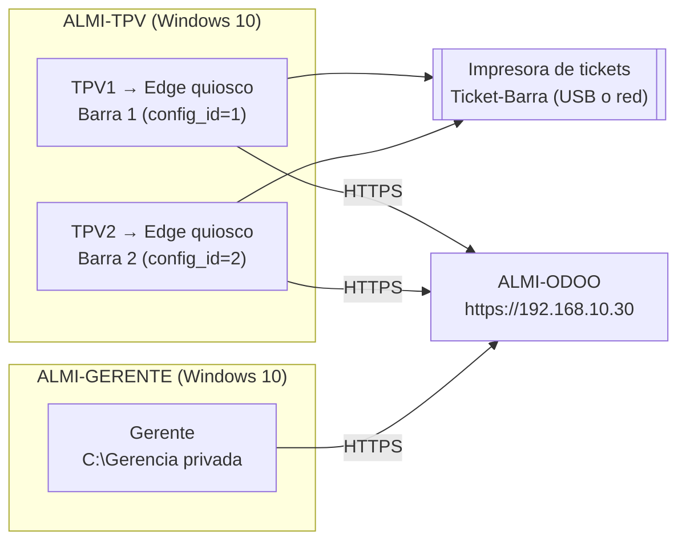

# 1. Windows: equipo del Gerente y TPV de barra

## Objetivo

Preparar los puestos de Windows del restaurante con **mínimo privilegio**: el equipo del despacho para el **Gerente** (ALMI-GERENTE) y una VM con los dos **TPV de barra** (ALMI-TPV, usuarios TPV1 y TPV2) que solo abren su TPV de Odoo en **modo quiosco** e imprimen el ticket en la **impresora de tickets física**. Incluye las necesidades, el hardware y el presupuesto de los equipos reales.

Tareas del tablero: P01 a P12.

## Requisitos

| Dato | ALMI-GERENTE | ALMI-TPV |
|---|---|---|
| Sistema | Windows 10 Pro (o Education) con licencia | Windows 10 Pro (o Education) con licencia |
| Memoria / CPU | 3072 MB / 2 | 3072 MB / 2 |
| Disco | 40 GB VDI dinámico | 40 GB VDI dinámico |
| Pantalla | 128 MB, VBoxSVGA | 128 MB, VBoxSVGA |
| Red | Red NAT ALMICHAIN (DHCP) | Red NAT ALMICHAIN (DHCP) |
| USB | Habilitado | Habilitado (impresora) |
| Usuarios | almiadmin (administrador), Gerente | almiadmin (administrador), TPV1, TPV2 |

> Decisión del equipo: al final no se hace doble arranque. La recreativa es una VM aparte, ALMI-ARCADE (bloque 02), y el equipo del gerente solo lleva Windows.

### Necesidades y equipos reales (P01-P03)

| Puesto | Quién | Para qué | Restricciones | En el laboratorio |
|---|---|---|---|---|
| Equipo del despacho | Gerente | Ofimática, Odoo (facturas, personal, inventario), correo | Usuario estándar, sin instalar programas | ALMI-GERENTE, usuario Gerente |
| TPV de barra 1 | Camareros | Solo cobrar en el TPV de Odoo e imprimir tickets | Quiosco: solo el TPV, sin escritorio ni USB | ALMI-TPV, usuario TPV1 |
| TPV de barra 2 | Camareros | Igual que el 1 | Igual que el 1 | ALMI-TPV, usuario TPV2 |
| Impresora de tickets (×2 en el real) | TPV | Imprimir el ticket de cada venta | Solo la usa el TPV | 1 impresora física compartida |

Requisitos mínimos para la compra: equipo del gerente con 4 núcleos, 16 GB de RAM y SSD NVMe de 500 GB; TPV táctil todo en uno de 15" con 8 GB de RAM y SSD de 128 GB; impresora térmica de 80 mm ESC/POS con corte automático, USB + Ethernet y salida para cajón. El presupuesto con modelo, precio, enlace y fecha está en [`../presupuesto/`](../presupuesto/).

| Software | Dónde | Licencia y coste |
|---|---|---|
| Windows 10 Pro | Gerente y TPV | De pago, por equipo |
| Microsoft Edge | Gerente y TPV | Incluido en Windows |
| Odoo Community (TPV y ERP) | Servidor ALMI-ODOO, por navegador | LGPL, gratis |
| Controlador de la impresora | TPV | Gratis, del fabricante |
| Microsoft Defender | Todos | Incluido en Windows |
| KeePassXC | Equipo del gerente | Libre, gratis |

## Arquitectura



En el restaurante real habría un PC del gerente y dos TPV físicos con una impresora cada uno; en el laboratorio las dos barras comparten la impresora.

## Instalación y configuración paso a paso

### 1. Crear las VM e instalar Windows (P04-P06)

1. VirtualBox → **Nueva** → nombre ALMI-GERENTE (y luego ALMI-TPV), ISO de Windows 10, **Omitir instalación desatendida**, datos de la tabla de requisitos, sin EFI.
2. Instalación personalizada en todo el disco, **cuenta sin conexión** `almiadmin` con contraseña de 12 caracteres o más (KeePassXC), privacidad en "No", diagnóstico "Requerido".
3. **Guest Additions** (Dispositivos → Insertar imagen de CD de las Guest Additions), activar Windows y **Windows Update** hasta que no haya más.
4. Nombre del equipo en PowerShell como administrador: `Rename-Computer -NewName "ALMI-GERENTE" -Restart` (o `ALMI-TPV`).

### 2. Usuarios con mínimo privilegio (P07)

Scripts de esta carpeta, en PowerShell como administrador (`Set-ExecutionPolicy -Scope Process Bypass` antes):

| Script | Dónde | Qué hace |
|---|---|---|
| [`scripts/1-usuarios-gerente.ps1`](scripts/1-usuarios-gerente.ps1) | ALMI-GERENTE | Usuario estándar **Gerente** y carpeta **C:\Gerencia** solo para Administradores, SYSTEM y Gerente |
| [`scripts/1-usuarios-tpv.ps1`](scripts/1-usuarios-tpv.ps1) | ALMI-TPV | Usuarios estándar **TPV1** y **TPV2** (no pueden cambiar su contraseña) |

Las contraseñas se piden al ejecutar el script (no están escritas en él) y se guardan en KeePassXC.

### 3. Seguridad general (P08)

[`scripts/2-seguridad.ps1`](scripts/2-seguridad.ps1) en las dos VM:

- Invitado desactivado.
- Contraseñas de 12 caracteres con complejidad, caducidad de 90 días y **bloqueo de 15 minutos tras 5 fallos**.
- UAC en "Notificarme siempre": un usuario estándar no puede instalar nada sin la contraseña de `almiadmin`.
- Defender y cortafuegos activos en los tres perfiles.
- **Sin SMBv1** y **sin Escritorio remoto**.
- Sin reproducción automática.
- En ALMI-GERENTE, bloqueo de pantalla a los 5 minutos.

### 4. Impresora de tickets física (P09)

Se instala **antes** del quiosco, porque después TPV1 y TPV2 ya no pueden tocar nada.

1. Apuntar marca, modelo y si tiene red (RJ45).
2. **Por USB**: VM apagada → Configuración → USB → filtro con la impresora → arrancar → instalar el controlador del fabricante.
   **Por red**: impresora en la misma red que el PC → *Agregar impresora por dirección TCP/IP* con su IP (en el restaurante real, 192.168.20.50 en la VLAN de TPV).
3. Nombre de la impresora: **Ticket-Barra**. Papel de 80 mm, corte al final y apertura de cajón.
4. Página de prueba (foto del ticket).
5. Desmarcar *Permitir que Windows administre mi impresora predeterminada* y poner **Ticket-Barra como predeterminada en TPV1 y en TPV2** (es por usuario).

### 5. Quiosco de TPV1 y TPV2 (P10)

En ALMI-TPV con `almiadmin`: `mmc` → Editor de objetos de directiva de grupo para **TPV1** y para **TPV2** → guardar como `Directivas-TPV.msc`. En **Configuración de usuario → Plantillas administrativas** de cada uno, en **Habilitada**:

| Ruta | Directiva |
|---|---|
| Panel de control | Prohibir el acceso a Configuración de PC y a Panel de control |
| Sistema | Impedir el acceso al símbolo del sistema (también scripts) |
| Sistema | Impedir el acceso a herramientas de edición del Registro |
| Sistema → Opciones de Ctrl+Alt+Supr | Quitar Administrador de tareas |
| Sistema → Acceso de almacenamiento extraíble | Todas las clases de almacenamiento extraíble: denegar acceso a todo |
| Menú Inicio y barra de tareas | Quitar el menú Ejecutar del menú Inicio |
| Componentes de Windows → Explorador de archivos | Ocultar estas unidades especificadas en Mi PC (todas) |
| Componentes de Windows → Explorador de archivos | Impedir el acceso a las unidades desde Mi PC (todas) |
| Sistema | **Interfaz de usuario personalizada**: Edge en quiosco con su TPV |

Línea de la interfaz personalizada ([`scripts/quiosco-TPV1.txt`](scripts/quiosco-TPV1.txt)); en TPV2 cambia `config_id=2`:

```
"C:\Program Files (x86)\Microsoft\Edge\Application\msedge.exe" --kiosk https://192.168.10.30/pos/ui?config_id=1 --edge-kiosk-type=fullscreen --kiosk-printing --no-first-run
```

`--kiosk-printing` imprime el ticket directamente en la impresora predeterminada del usuario, sin cuadro de diálogo. Los `config_id` se han comprobado en Odoo: **Barra 1 = 1** y **Barra 2 = 2**.

`gpupdate /force`, cerrar sesión y entrar como TPV1: se abre Edge a pantalla completa con Barra 1.

### 6. Certificado de Odoo

[`scripts/3-certificado-odoo.ps1`](scripts/3-certificado-odoo.ps1) en las dos VM, como `almiadmin`:

1. En ALMI-ODOO se apunta la huella: `sudo openssl x509 -in /etc/ssl/almichain/odoo.crt -noout -fingerprint -sha256`.
2. El script descarga la parte pública del certificado de `http://192.168.10.30/almichain-odoo.crt` (no usa SSH ni la contraseña del servidor), enseña su huella y **pide escribir la del servidor**. Si no coinciden, o si el certificado fuera de autoridad (`CA:TRUE`), no instala nada.
3. Si coinciden, lo instala en *Entidades de certificación raíz de confianza* del equipo. Edge muestra el candado sin avisos.

Comprobar la huella es lo que evita que alguien en la red sirva un certificado falso en ese momento. El certificado es de servidor (`CA:FALSE`), así que aunque esté en el almacén de raíces solo vale para Odoo.

## Seguridad aplicada

Resumen: solo `almiadmin` es administrador; Gerente, TPV1 y TPV2 son usuarios estándar; contraseñas largas con bloqueo; UAC al máximo; Defender y cortafuegos activos; sin SMBv1, sin Escritorio remoto ni reproducción automática; TPV en quiosco sin panel de control, consola, registro, administrador de tareas, USB ni unidades; carpeta del gerente privada; Odoo solo por HTTPS con certificado de confianza.

## Pruebas

| Nº | Qué se prueba | Cómo | Resultado esperado | Resultado obtenido | Captura |
|---|---|---|---|---|---|
| 1 | Solo almiadmin es administrador | `Get-LocalGroupMember -Group "Administradores"` en las dos VM | Solo almiadmin | | |
| 2 | El gerente no puede instalar programas | Como Gerente, ejecutar un instalador | Pide la contraseña de administrador | | |
| 3 | Contraseña corta rechazada | Como Gerente, cambiar la contraseña por 1234 | Error de requisitos | | |
| 4 | Bloqueo de cuenta | Fallar 5 veces la contraseña de Gerente | Cuenta bloqueada 15 minutos | | |
| 5 | Carpeta privada | `icacls C:\Gerencia` | Solo Administradores, SYSTEM y Gerente | | |
| 6 | TPV1 y TPV2 en quiosco | Iniciar sesión con cada uno | Solo Edge a pantalla completa con su barra | | |
| 7 | TPV sin herramientas | Como TPV1, Ctrl + Alt + Supr | Sin Administrador de tareas | | |
| 8 | TPV sin USB | Pendrive en la sesión de TPV2 | Acceso denegado | | |
| 9 | Impresión física | Cobrar en Barra 1 y en Barra 2 | Dos tickets por la impresora sin preguntar | | |
| 10 | Candado de Odoo | Abrir https://192.168.10.30 en Edge | Candado sin aviso | | |

Las capturas de este bloque se hacen en las VM de Windows de clase y se guardan en [`capturas/`](capturas/).

## Problemas encontrados y solución

| Problema | Solución |
|---|---|
| Windows 10 obliga a usar cuenta Microsoft en la instalación | Desconectar el cable de red de la VM (Configuración → Red → desmarcar *Cable conectado*) para que deje crear cuenta local |
| La impresora predeterminada es por usuario | Ponerla a mano en TPV1 y TPV2 antes de aplicar el quiosco |
| Los scripts de PowerShell con tildes se veían mal | Guardados en UTF-8 con BOM |

## Fuentes

- Microsoft Learn: New-LocalUser, net accounts, Directivas de grupo y Microsoft Edge en modo quiosco.
- Guías paso a paso del equipo, parte 2.
