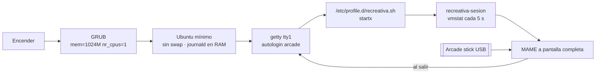
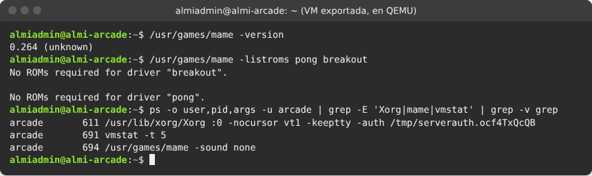
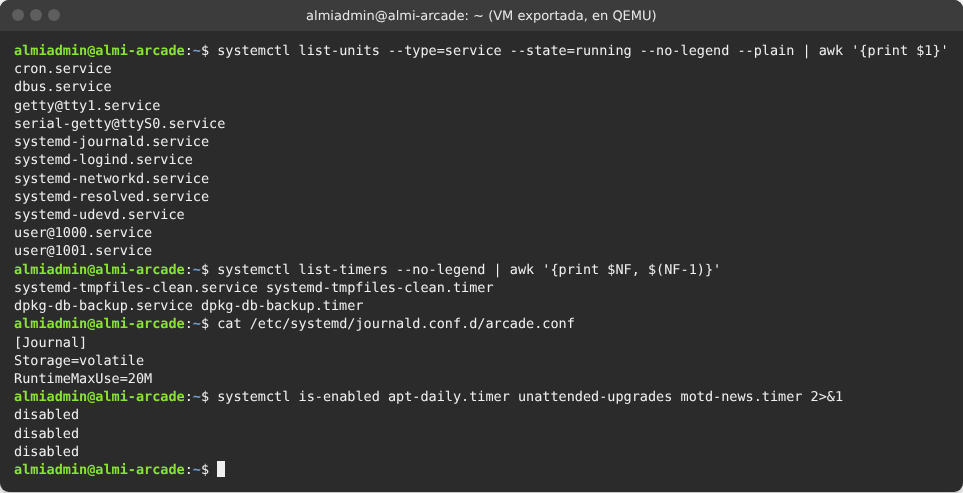
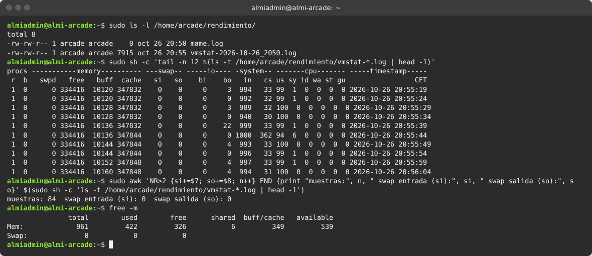

# 2. Recreativa con MAME (1 núcleo, 1 GB, sin swap)

## Objetivo

Una máquina recreativa con **MAME** para la sala del restaurante, en un equipo muy limitado: **1 núcleo y 1 GB de RAM, sin usar el disco como memoria (swap)**. Al encenderla entra sola en MAME, sin pedir contraseña, con un usuario sin privilegios. Se mide el rendimiento antes y después de optimizar y se monitoriza mientras se juega.

Tareas del tablero: A01 a A10.

## Requisitos

| Elemento | Valor |
|---|---|
| VM | **ALMI-ARCADE** · 1 CPU · 1024 MB · disco de 8 GB · **sin swap** · gráficos VMSVGA · Red NAT ALMICHAIN (DHCP) · USB activado (arcade stick) |
| Sistema | Ubuntu 24.04 LTS mínimo (sin escritorio) |
| Software | Servidor X mínimo (`xserver-xorg-core`, `xinit`), MAME 0.264, `alsa-utils` |
| Usuarios | `almiadmin` (administrador) y `arcade` (sin sudo, entra solo y abre MAME) |

> **Decisiones del equipo.** No se hace doble arranque con el equipo del gerente: la recreativa es una VM aparte con exactamente 1 núcleo y 1 GB. Se usa **Ubuntu 24.04 mínimo** en lugar de Debian: el resultado es el mismo (sistema sin escritorio, solo X y MAME) y comparte paquetes y comandos con los servidores del reto. Como la VM tiene ya 1 núcleo y 1 GB, en GRUB se deja además `mem=1024M nr_cpus=1` para que el límite no dependa de la configuración de VirtualBox.

## Arquitectura



## Instalación y configuración paso a paso

Los archivos están en [`config/`](config/) y [`scripts/`](scripts/).

### 1. VM e instalación (A01-A02)

1. VirtualBox → **Nueva** → ALMI-ARCADE, Ubuntu (64-bit), **1024 MB y 1 CPU**, disco de 8 GB. Pantalla: VMSVGA. Red NAT ALMICHAIN. USB activado.
2. Instalar **Ubuntu Server 24.04** en modo **minimized** (**Omitir instalación desatendida** en VirtualBox), disco entero, nombre `almi-arcade`, usuario `almiadmin`, **sin** OpenSSH.
3. **Quitar el swap**. Ubuntu 24.04 no crea una partición de intercambio sino un **archivo** `/swap.img`, y el instalador no deja quitarlo. Después de instalar:

   ```bash
   sudo swapoff -a
   sudo sed -i '/swap.img/d' /etc/fstab
   sudo rm -f /swap.img
   swapon --show        # sin salida
   free -m              # Swap: 0
   ```

### 2. 1 núcleo y 1 GB (A03)

`/etc/default/grub`:

```
GRUB_TIMEOUT=3
GRUB_CMDLINE_LINUX_DEFAULT="quiet mem=1024M nr_cpus=1"
```

`sudo update-grub` y reiniciar.


### 3. Usuarios y seguridad (A04)

```bash
sudo useradd -m -s /bin/bash -c "Recreativa" -G audio,video,input arcade
sudo passwd arcade
sudo chmod 700 /home/arcade /home/almiadmin
sudo apt install -y libpam-pwquality cracklib-runtime   # cracklib-runtime: el diccionario de contraseñas débiles
sudo sed -i 's/^# *minlen.*/minlen = 12/' /etc/security/pwquality.conf
sudo ufw default deny incoming && sudo ufw default allow outgoing && sudo ufw enable
```

`arcade` no está en el grupo `sudo`: no puede administrar nada.


### 4. Servidor gráfico mínimo y MAME (A05)

```bash
sudo apt install -y --no-install-recommends xserver-xorg-core xserver-xorg-input-libinput \
  xserver-xorg-video-fbdev xserver-xorg-video-vesa xinit x11-xserver-utils alsa-utils mame
mame -version
sudo mkdir -p /usr/local/share/games/mame/roms
```

**Juegos**: *Pong* y *Breakout* funcionan **sin ROMs** (MAME los emula a partir del esquema del circuito original). Para más juegos se descargan ROMs legales de mamedev.org (robby, gridlee, supertnk) a `/usr/local/share/games/mame/roms/` y se comprueban con `mame -verifyroms`. Las ROMs no se suben al repositorio.



### 5. Arranque directo a MAME (A06)

| Archivo | Dónde | Qué hace |
|---|---|---|
| [`config/autologin.conf`](config/autologin.conf) | `/etc/systemd/system/getty@tty1.service.d/override.conf` | `arcade` entra solo en la consola 1 |
| [`config/recreativa-profile.sh`](config/recreativa-profile.sh) | `/etc/profile.d/recreativa.sh` (de root, 644) | Cuando `arcade` entra en tty1, arranca X sin cursor con la sesión de la recreativa |
| [`config/recreativa-sesion`](config/recreativa-sesion) | `/usr/local/bin/recreativa-sesion` (de root, 755) | Desactiva el salvapantallas, guarda `vmstat` cada 5 s y abre MAME (sin sonido si la máquina no tiene tarjeta de sonido) |
| [`config/ui.ini`](config/ui.ini) | `/home/arcade/.mame/ui.ini` | El menú de MAME se abre con Pong seleccionado |
| [`config/mame.ini`](config/mame.ini) | `/home/arcade/.mame/mame.ini` | Configuración optimizada (apartado 6). Tiene que estar en ASCII y sin BOM |

Desde la carpeta del repositorio:

```bash
sudo mkdir -p /etc/systemd/system/getty@tty1.service.d
sudo install -m 644 config/autologin.conf /etc/systemd/system/getty@tty1.service.d/override.conf
sudo install -o root -g root -m 644 config/recreativa-profile.sh /etc/profile.d/recreativa.sh
sudo install -o root -g root -m 755 config/recreativa-sesion /usr/local/bin/recreativa-sesion
sudo install -d -o arcade -g arcade /home/arcade/.mame /home/arcade/rendimiento
sudo install -o arcade -g arcade -m 644 config/mame.ini config/ui.ini /home/arcade/.mame/
sudo systemctl daemon-reload && sudo reboot
```

Para administrar con MAME abierto: **Ctrl + Alt + F2** y entrar como `almiadmin`.


### 6. Optimización (A08)

| Cambio | Para qué |
|---|---|
| Sin swap y `mem=1024M nr_cpus=1` | Lo pide el reto: no usar el disco como memoria |
| `journald` en memoria, máximo 20 MB | No escribir en disco mientras se juega |
| Solo 2 consolas de texto (`NAutoVTs=2`) | Menos procesos |
| Desactivados `apt-daily`, `unattended-upgrades`, `man-db`, `e2scrub`, `fstrim`, `motd-news` y SSH | Nada trabajando en segundo plano durante la partida. Las actualizaciones las hace `almiadmin` a mano una vez por semana |
| Sin `systemd-networkd-wait-online` | Arranque más rápido |
| [`config/mame.ini`](config/mame.ini) del usuario arcade | `video soft`, `waitvsync 0`, `autoframeskip 1`, `samplerate 22050`, `skip_gameinfo 1`, `joystick 1` |

Comandos:

```bash
sudo mkdir -p /etc/systemd/journald.conf.d
printf '[Journal]\nStorage=volatile\nRuntimeMaxUse=20M\n' | sudo tee /etc/systemd/journald.conf.d/arcade.conf
sudo sed -i 's/^#NAutoVTs=.*/NAutoVTs=2/' /etc/systemd/logind.conf
for u in apt-daily.timer apt-daily-upgrade.timer man-db.timer e2scrub_all.timer fstrim.timer motd-news.timer unattended-upgrades.service; do
  sudo systemctl disable --now "$u"
done
sudo systemctl disable --now ssh 2>/dev/null   # si se instaló
sudo systemctl mask systemd-networkd-wait-online.service
```

Resultado en la VM exportada, probada en QEMU: 11 servicios en marcha en la captura, de los que 3 no estarían en uso normal: `serial-getty@ttyS0` (la consola serie que se usó para la prueba; la VM exportada ya no la activa) y `user@1000`/`user@1001` (las sesiones abiertas para la captura). 2 temporizadores, el registro en memoria y SSH y las actualizaciones automáticas desactivados.




### 7. Benchmark y monitorización (A07, A09)

[`scripts/benchmark.sh`](scripts/benchmark.sh) (instalado como `benchmark-recreativa`; se lanza con `sudo benchmark-recreativa`) ejecuta `mame -bench 60` tres veces por juego como el usuario `arcade` y da la media. 100 % es la velocidad real de la máquina original; más de 100 % es que sobra potencia.

> **Dónde se midió.** Las cifras de esta tabla se midieron con MAME 0.264 **en el ordenador donde se preparó el proyecto, no dentro de la VM**, limitando MAME a 1 núcleo con `taskset -c 0`. Sirven para comparar antes y después del `mame.ini`, pero no son la velocidad de la recreativa en VirtualBox. La medida dentro de ALMI-ARCADE en el PC de clase está **pendiente** (prueba 8). Dentro de QEMU sin aceleración no tiene sentido medir: todo el procesador está emulado.

Resultados con MAME 0.264 limitado a **1 núcleo** (en el anfitrión), con la configuración por defecto (antes) y con el `mame.ini` optimizado (después):

| Medida | Antes de optimizar | Después de optimizar |
|---|---|---|
| Pong (`-bench 60`, media de 3) | 297,3 % (307,95 · 298,59 · 285,23) | 315,0 % (311,16 · 317,15 · 316,58) |
| Breakout (`-bench 60`, media de 3) | 97,6 % (93,54 · 88,63 · 110,77) | 114,3 % (114,05 · 114,59 · 109,14) |
| Memoria total visible | 961 MB | 961 MB |
| Swap | 0 | 0 |

*Breakout* es el juego más exigente (simula el circuito discreto componente a componente) y es el que más nota la optimización: pasa de ir justo (por debajo de 100 % en alguna pasada) a ir sobrado en todas.

La sesión (`recreativa-sesion`) guarda un registro de `vmstat` en `/home/arcade/rendimiento/` mientras se juega. Las columnas `si` y `so` (memoria que entra y sale del swap) tienen que estar siempre a 0.

En la prueba, con MAME abierto durante 7 minutos (84 muestras): **`swpd`, `si` y `so` siempre a 0** y 422 MB de RAM usada de 961. La CPU sale al 100 % porque esta prueba se hizo arrancando el disco de la VM en **QEMU sin aceleración por hardware** (todo el procesador emulado), no en VirtualBox; con VT-x el uso tiene que ser mucho menor (pendiente de medir en clase). Las cifras de velocidad buenas son las del benchmark de arriba.




## Seguridad aplicada

- `arcade` sin sudo, contraseña de 12 caracteres, carpeta privada. Lo que se arranca al entrar está **fuera de su carpeta** y es de root (`/etc/profile.d/recreativa.sh` y `/usr/local/bin/recreativa-sesion`): dentro de `/home/arcade` no serviría, porque el dueño de una carpeta puede borrar o renombrar cualquier archivo que haya en ella, aunque sea de root.
- Cortafuegos con toda la entrada bloqueada y **sin servidor SSH**.
- Las ROMs, solo lectura para `arcade` en una carpeta del sistema.

## Pruebas

| Nº | Qué se prueba | Cómo | Resultado esperado | Resultado obtenido | Captura |
|---|---|---|---|---|---|
| 1 | 1 núcleo | `nproc` | 1 | 1 | [02](capturas/02-nucleo-memoria-swap.png) |
| 2 | 1 GB de RAM | `free -m` | Total menor de 1024 MB | 961 MB | [02](capturas/02-nucleo-memoria-swap.png) |
| 3 | Sin swap | `swapon --show` | Sin salida | Sin salida; Swap 0 | [02](capturas/02-nucleo-memoria-swap.png) |
| 4 | No se usa swap al jugar | Registro de vmstat | `si` y `so` siempre 0 | 0 y 0 en 84 muestras | [06](capturas/06-vmstat.png) |
| 5 | Arranque directo a MAME | Encender | MAME sin pedir contraseña | Autologin de arcade y MAME abierto | [01a](capturas/01a-autologin-arcade.png) [01](capturas/01-arranque-mame.png) |
| 6 | arcade sin privilegios | `groups arcade`; `sudo -l` como arcade | Sin sudo | No está en sudo | [03](capturas/03-usuarios-seguridad.png) |
| 7 | Juegos disponibles | `mame -listroms pong breakout` | No necesitan ROMs | "No ROMs required" | [04](capturas/04-mame-version-juegos.png) |
| 8 | Mejora de rendimiento | Tabla del benchmark | Igual o mayor velocidad después | En el anfitrión con 1 núcleo: Pong +6 %, Breakout +17 %. **Dentro de la VM en VirtualBox: pendiente — en clase** | — |
| 9 | Stick en MAME | Ver bloque 03 | Se juega con el stick | Pendiente — en clase (hace falta el Arduino) | |

Las pruebas 1 a 7 se hicieron arrancando el disco de `ALMI-ARCADE.ova` en **QEMU** (no en VirtualBox, que no estaba disponible donde se preparó el repositorio).

## Problemas encontrados y solución

| Problema | Causa | Solución |
|---|---|---|
| MAME se quedaba colgado al arrancar, con la CPU al 100 % y sin abrir ventana | El `mame.ini` tenía comentarios con tildes delante de la marca BOM que pone `mame -createconfig`, y el lector de MAME entra en un bucle | Comentarios del `mame.ini` solo en ASCII y sin BOM |
| MAME se cerraba al momento con *Segmentation fault* y la sesión se reiniciaba en bucle | MAME 0.264 falla al abrir el sonido si la VM no tiene tarjeta de sonido | La sesión comprueba `/proc/asound/cards` y, si no hay tarjeta, arranca MAME con `-sound none`. En VirtualBox conviene activar el audio (Intel HD Audio) |
| X arrancaba solo la primera vez ("drmSetMaster failed: Permission denied") | Faltaba `libpam-systemd`: la sesión de arcade no se registraba en logind y X sin root no podía usar la pantalla | Instalar `libpam-systemd` (viene en una instalación normal de Ubuntu) |
| X no arranca con "Failed to load module fbdev/vesa" | Sin aceleración gráfica disponible, X no tenía controlador de respaldo | Instalar `xserver-xorg-video-fbdev` y `xserver-xorg-video-vesa`; en VirtualBox usar VMSVGA |
| No había ROMs legales descargables desde clase en el primer momento | | Pong y Breakout no necesitan ROMs; el resto se añade desde mamedev.org |

## Fuentes

- Documentación de MAME: opciones de línea de órdenes y `-bench` — https://docs.mamedev.org/
- ROMs gratuitas para uso no comercial — https://www.mamedev.org/roms/
- `man systemd-journald.conf`, `man agetty`, `man vmstat`
- Guías paso a paso del equipo, parte 3.
