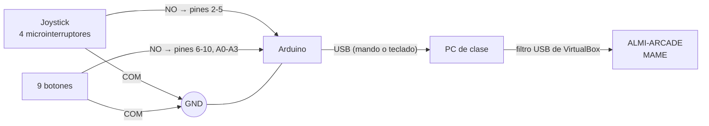

# 3. Arcade stick con Arduino

## Objetivo

Construir el mando de la recreativa: un **joystick de 8 direcciones y 9 botones** (6 de juego, Moneda, Start y Menú) conectados a una placa **Arduino** que el ordenador reconoce como **mando USB** o como **teclado USB**, y configurarlo en MAME dentro de la VM ALMI-ARCADE.

Tareas del tablero: S01 a S09.

## Requisitos

| Elemento | Detalle |
|---|---|
| Placa | La que da el profesor (no es un Uno). Ver la tabla de caminos |
| Joystick | Arcade de 8 direcciones con 4 microinterruptores |
| Botones | 6 de 30 mm (juego) + 3 de 24 mm (Moneda, Start, Menú), con microinterruptor |
| Cables | Faston de 2,8 mm y cable USB de la placa |
| Software | Arduino IDE 2 (AppImage) en Zorin; librería ArduinoJoystickLibrary (camino A) o Keyboard (camino B) |

### Qué camino seguir según la placa

| Placa | Chip | ¿Mando o teclado USB? | Camino |
|---|---|---|---|
| Arduino Leonardo, Micro, Pro Micro y clones | ATmega32U4 | Sí, de serie | **A** (mando) o **B** (teclado) |
| Arduino Uno R4 Minima / WiFi | Renesas RA4M1 | Sí, como teclado | **B** (teclado) |
| Uno R3, Mega, Nano | ATmega328P / 2560 | No de serie | **C** (plan B) |

Para saber cuál es: nombre impreso en la placa y `lsusb` al conectarla.

## Arquitectura y cableado

Cada microinterruptor tiene **COM** (común), **NO** (normalmente abierto) y **NC** (no se usa). Todos los COM en cadena a **GND**; cada NO a su pin. No hacen falta resistencias: se usan las internas de la placa (`INPUT_PULLUP`, pulsado = LOW).

| Función | Pin | Camino A (mando) | Camino B (tecla) | En MAME |
|---|---|---|---|---|
| Arriba | 2 | Eje Y = -1 | Flecha arriba | Mover arriba |
| Abajo | 3 | Eje Y = +1 | Flecha abajo | Mover abajo |
| Izquierda | 4 | Eje X = -1 | Flecha izquierda | Mover izquierda |
| Derecha | 5 | Eje X = +1 | Flecha derecha | Mover derecha |
| Botón 1 | 6 | Botón 1 | Ctrl izquierdo | Botón 1 |
| Botón 2 | 7 | Botón 2 | Alt izquierdo | Botón 2 |
| Botón 3 | 8 | Botón 3 | Espacio | Botón 3 |
| Botón 4 | 9 | Botón 4 | Shift izquierdo | Botón 4 |
| Botón 5 | 10 | Botón 5 | Z | Botón 5 |
| Botón 6 | A0 | Botón 6 | X | Botón 6 |
| Moneda | A1 | Botón 7 | 5 | Meter moneda |
| Start | A2 | Botón 8 | 1 | Empezar (jugador 1) |
| Menú | A3 | Botón 9 | Tab | Menú de MAME |

El joystick empuja el microinterruptor del lado contrario: si al mover arriba sale "Abajo", se intercambian esos dos cables.

## Programas

| Programa | Para qué |
|---|---|
| [`sketches/prueba_cableado/prueba_cableado.ino`](sketches/prueba_cableado/prueba_cableado.ino) | Escribe en el Monitor Serie (9600) qué se pulsa. Sirve para comprobar los 13 cables antes de nada |
| [`sketches/arcade_stick_mando/arcade_stick_mando.ino`](sketches/arcade_stick_mando/arcade_stick_mando.ino) | **Camino A**: mando USB con ejes X/Y y 9 botones. Solo envía cuando algo cambia |
| [`sketches/arcade_stick_teclado/arcade_stick_teclado.ino`](sketches/arcade_stick_teclado/arcade_stick_teclado.ino) | **Camino B**: teclado USB con las teclas por defecto de MAME. **Modo seguro**: si se conecta con Menú pulsado no envía teclas, para poder reprogramar la placa |

Los tres programas compilan sin errores para Arduino Leonardo (ATmega32U4) con la librería ArduinoJoystickLibrary (camino A) y la librería Keyboard (camino B).

## Instalación paso a paso

1. **Arduino IDE 2** en Zorin: AppImage de arduino.cc, `sudo apt install -y libfuse2`, `chmod +x`, `sudo usermod -aG dialout $USER` y volver a iniciar sesión.
2. **Tools → Board**: Leonardo, Micro (o Leonardo para un Pro Micro de 5 V) o Uno R4. **Tools → Port**: `/dev/ttyACM0`. Probar con *Blink*.
3. Cablear según la tabla con la placa desconectada.
4. Subir `prueba_cableado` y comprobar las 13 entradas en el Monitor Serie.
5. Camino A: **Sketch → Include Library → Add .ZIP Library** con ArduinoJoystickLibrary (github.com/MHeironimus/ArduinoJoystickLibrary) y subir `arcade_stick_mando`. Camino B: subir `arcade_stick_teclado`.
6. Probar en Zorin: `sudo apt install -y joystick evtest`; camino A con `jstest /dev/input/js0`, camino B con `sudo evtest`. En Windows, `joy.cpl`.
7. **Pasar el stick a la recreativa**: VM ALMI-ARCADE apagada → **Configuración → USB → +** → elegir el Arduino. Al arrancar, la placa pasa a la VM.
8. **Controles en MAME**: con el juego abierto, **Tab** → *Input (this Machine)* o *Input (general)* → elegir cada acción y pulsar el botón del stick. MAME lo guarda en `~/.mame/cfg/`. En el camino B no hace falta: ya usa las teclas de MAME.

### Camino C (plan B) si la placa es un Uno R3, Mega o Nano

Esas placas no pueden ser mando USB de serie. Opciones: (1) pedir un Pro Micro (unos 6-8 €) o (2) mantener el programa de prueba que escribe por el puerto serie y un pequeño script en la VM que convierta lo que llega en pulsaciones de teclado (`python3-evdev` con `uinput`). Se documenta cuál se usa.

## Pruebas

| Nº | Qué se prueba | Cómo | Resultado esperado | Resultado obtenido | Captura |
|---|---|---|---|---|---|
| 1 | Cableado | Monitor Serie con `prueba_cableado` | Sale el nombre correcto de las 13 entradas | Pendiente — en clase | |
| 2 | Reconocido como mando/teclado | `lsusb` y `jstest` / `evtest` | Aparece el dispositivo y responde | Pendiente — en clase | |
| 3 | Las 4 direcciones | `jstest` (ejes) o editor de texto (flechas) | Cada dirección mueve su eje o flecha | Pendiente — en clase | |
| 4 | Los 9 botones | `jstest` o `evtest` | Cada botón su número o tecla | Pendiente — en clase | |
| 5 | Funciona en la VM | Filtro USB y `lsusb` dentro de ALMI-ARCADE | Aparece en la VM | Pendiente — en clase | |
| 6 | Se juega en MAME | Pong o Breakout con el stick | Moneda, Start y movimiento funcionan | Pendiente — en clase | |

**Estado**: los tres programas compilan, pero el stick **no se ha montado ni probado** todavía (falta el material y la placa). Las capturas y fotos del montaje irán en [`capturas/`](capturas/).

## Seguridad aplicada

- El stick solo llega a la recreativa: en VirtualBox se pasa con un **filtro USB** a ALMI-ARCADE y no a las demás VM.
- **Modo seguro** del programa de teclado (camino B): si se conecta con *Menú* pulsado no envía ninguna tecla, para poder volver a programar la placa si un botón se queda pegado.
- El programa de teclado solo envía las 13 teclas de la tabla (no puede escribir texto). Ojo: Botón 1 y Botón 2 son Ctrl y Alt, así que pulsados a la vez con otra tecla forman combinaciones (es la distribución por defecto de MAME). En la recreativa no hay escritorio, así que no tienen efecto fuera de MAME.

## Problemas previstos y solución

El stick todavía no se ha montado, así que estos problemas son **previstos**, no encontrados:

| Problema | Solución |
|---|---|
| Al mover arriba sale "Abajo" (o izquierda/derecha cambiadas) | El joystick empuja el microinterruptor del lado contrario: se intercambian esos dos cables |
| La placa es un Uno R3, Mega o Nano | No puede ser mando USB de serie: camino C |
| Un botón pegado o un programa que no deja de enviar teclas impide reprogramar la placa | Conectarla con *Menú* pulsado (modo seguro) o pulsar *reset* justo cuando el IDE empieza a subir el programa (en un Pro Micro, dos veces seguidas) |

## Fuentes

- ArduinoJoystickLibrary — https://github.com/MHeironimus/ArduinoJoystickLibrary
- Arduino Keyboard library — https://docs.arduino.cc/language-reference/en/functions/usb/Keyboard/
- MAME, configuración de controles — https://docs.mamedev.org/usingmame/defaultkeys.html
- Guías paso a paso del equipo, parte 4.
