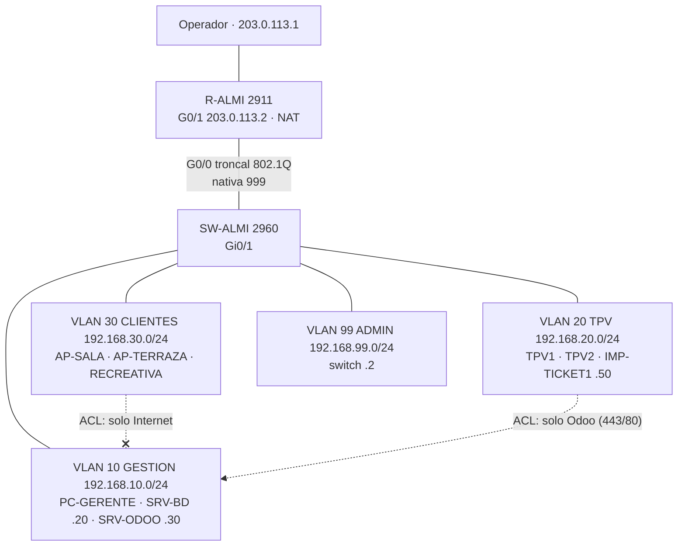

# 4. Red: WAN, plano, Packet Tracer y repetidor WDS

## Objetivo

Diseñar la red del restaurante: elegir la línea **WAN**, hacer el **plan de direccionamiento con VLAN**, el **plano del local**, la red completa en **Packet Tracer** (switch, router, operador, servidores, TPV, Wi-Fi) con seguridad, y configurar los **dos routers físicos**: el principal seguro y el secundario como **repetidor WDS**.

Tareas del tablero: R01 a R10.

## Necesidades de comunicación (R01)

| Equipo | Cantidad | Conexión | VLAN | Necesita |
|---|---|---|---|---|
| Equipo del gerente | 1 | Cable | 10 Gestión | Odoo, servidores, Internet |
| Servidor BD (ALMI-BD) | 1 | Cable | 10 Gestión | Red interna |
| Servidor ERP (ALMI-ODOO) | 1 | Cable | 10 Gestión | Red interna, Internet (correo) |
| TPV de barra | 2 | Cable | 20 TPV | Solo Odoo e Internet |
| Impresora de tickets | 2 | USB al TPV (o cable) | 20 TPV | Solo su TPV |
| Recreativa | 1 | Cable | 30 Clientes | Nada (opcional Internet) |
| Wi-Fi de clientes | 2 puntos (principal + repetidor) | Inalámbrico | 30 Clientes | Solo Internet |
| Router, switch y puntos de acceso | — | — | 99 Administración | Solo los administra almiadmin |

## Línea WAN (R02)

Criterios: fibra simétrica de 300 Mb/s o más, **IP fija**, soporte 24 h y respaldo móvil 4G/5G para que el TPV no se quede sin línea. La comparativa de operadores (precio, enlace y fecha) está en el [presupuesto](../presupuesto/README.md#red-r02-r04).

## Plan de direccionamiento (R03)

| VLAN | Nombre | Red | Puerta de enlace | DHCP | Direcciones fijas |
|---|---|---|---|---|---|
| 10 | GESTION | 192.168.10.0/24 | 192.168.10.1 | .100 – .199 | BD .20, Odoo .30 |
| 20 | TPV | 192.168.20.0/24 | 192.168.20.1 | .100 – .199 | Impresoras .50 y .51 |
| 30 | CLIENTES | 192.168.30.0/24 | 192.168.30.1 | .100 – .250 | — |
| 99 | ADMIN | 192.168.99.0/24 | 192.168.99.1 | Sin DHCP | Switch .2 |
| 998 | SIN-USO | — | — | — | Puertos libres apagados |
| 999 | NATIVA | — | — | — | Nativa del troncal, sin equipos |
| WAN | Operador | 203.0.113.0/30 | 203.0.113.1 | — | Router del local .2 |

La VLAN 10 coincide con la Red NAT ALMICHAIN de VirtualBox (192.168.10.0/24): los servidores tienen la misma IP en el laboratorio y en el diseño.

## Plano y esquema lógico (R04)

**Plano del local: pendiente.** Se hará en draw.io (`diagramas/red-plano.drawio` y `.png`) con la vista del local, el rack, las tomas T01…, los cables Cat 6 U/UTP T568B, el router Wi-Fi en la sala y el repetidor WDS en la terraza con su cobertura. Todavía **no está** en el repositorio.

**Esquema lógico** (VLAN, direcciones y reglas entre redes):

## Packet Tracer (R05-R06)

Equipos: R-ALMI y ISP (Router 2911), SW-ALMI (2960-24TT), INTERNET (Server-PT), PC-GERENTE, SRV-BD, SRV-ODOO, TPV1, TPV2, IMP-TICKET1, AP-SALA, AP-TERRAZA, RECREATIVA y dos portátiles con WPC300N.

| Puerto del switch | Equipo | VLAN | Seguridad |
|---|---|---|---|
| Fa0/1-3 | Gerente, BD, Odoo | 10 | port-security, 1 MAC sticky, shutdown |
| Fa0/5-7 | TPV1, TPV2, impresora | 20 | port-security, 1 MAC sticky, shutdown |
| Fa0/10-12 | AP-SALA, AP-TERRAZA, recreativa | 30 | portfast |
| Gi0/1 | R-ALMI | troncal 10,20,30,99 | nativa 999 |
| Resto | — | 998 | apagados |

Configuraciones por línea de comandos, listas para pegar en la pestaña **CLI** (lo que se hace con el ratón está justo después):

| Archivo | Equipo | Qué configura |
|---|---|---|
| [`packet-tracer/SW-ALMI.txt`](packet-tracer/SW-ALMI.txt) | Switch | VLAN, puertos de acceso con seguridad, troncal, puertos sin uso apagados, IP de gestión en VLAN 99, SSH v2 solo desde las VLAN 10 y 99 |
| [`packet-tracer/R-ALMI.txt`](packet-tracer/R-ALMI.txt) | Router | Subinterfaces 802.1Q, DHCP por VLAN (solo en el rango del plan), NAT con sobrecarga, ACL de clientes y de TPV, SSH v2 solo desde las VLAN 10 y 99 (`access-class`), bloqueo tras 3 intentos fallidos |
| [`packet-tracer/ISP.txt`](packet-tracer/ISP.txt) | Operador | Enlace WAN y red de "Internet" 198.51.100.0/24 |

Listas de acceso del router:

- **CLIENTES-SOLO-INTERNET** (entrada en G0/0.30): los clientes del Wi-Fi no llegan a Gestión, TPV ni Administración.
- **TPV-SOLO-ODOO** (entrada en G0/0.20): los TPV solo llegan a Odoo (192.168.10.30) por **443** (y 80, que redirige a HTTPS); el resto de Gestión y Administración, bloqueado.

### Lo que se configura con el ratón (no tiene CLI en Packet Tracer)

**Servidor INTERNET** (simula una web de fuera): **Desktop → IP Configuration → Static**: IP 198.51.100.10, máscara 255.255.255.0, puerta 198.51.100.1, DNS 198.51.100.10. **Services → DNS**: activado, nombre `www.ejemplo.com` → 198.51.100.10. **Services → HTTP**: activado.

**Equipos con IP fija** (Desktop → IP Configuration → Static):

| Equipo | IP | Máscara | Puerta de enlace | DNS |
|---|---|---|---|---|
| SRV-BD | 192.168.10.20 | 255.255.255.0 | 192.168.10.1 | 198.51.100.10 |
| SRV-ODOO | 192.168.10.30 | 255.255.255.0 | 192.168.10.1 | 198.51.100.10 |
| IMP-TICKET1 | 192.168.20.50 | 255.255.255.0 | 192.168.20.1 | — |

En SRV-ODOO se dejan activados **Services → HTTP** y **HTTPS** (simulan la web de Odoo). La ACL de los TPV deja pasar los dos puertos, así que la prueba 6 se puede hacer con `http://` y con `https://`.

**Equipos con DHCP**: PC-GERENTE, TPV1, TPV2 y RECREATIVA → **Desktop → IP Configuration → DHCP**. Tiene que salir una IP de su VLAN (por ejemplo 192.168.20.100 en TPV1).

**Wi-Fi de clientes**:

1. AP-SALA y AP-TERRAZA → **Config → Port 1**: SSID `AlmiChain-Clientes`, **WPA2-PSK**, clave de 12 caracteres o más, cifrado **AES** (los dos iguales).
2. CLIENTE1 y CLIENTE2 → **Physical**: apagar, quitar el módulo de cable, poner **WPC300N**, encender.
3. **Config → Wireless0**: mismo SSID, WPA2-PSK, la misma clave, IP por **DHCP**. Tiene que salir una IP 192.168.30.x.

El archivo de Packet Tracer se guardará como `packet-tracer/almichain.pkt` (indicando la versión de Packet Tracer). **Todavía no está en el repositorio**: la red no se ha montado aún.

## Routers reales (R07-R08)

**R1, principal**: reset de fábrica, contraseña de administración nueva, firmware actualizado, SSID `AlmiChain-Clientes`, **canal fijo** (1, 6 u 11, el menos usado: `nmcli -f SSID,CHAN,SIGNAL dev wifi list`), ancho de 20 MHz, **WPA2-PSK AES**, **WPS desactivado**, **administración remota y UPnP desactivados**, aislamiento de clientes si lo tiene.

**R2, repetidor WDS**: reset, contraseña nueva, **IP de LAN en la red de R1 fuera de su rango DHCP** (p. ej. 192.168.0.2), **DHCP desactivado**, **mismo canal** que R1, **Habilitar puente WDS** → buscar `AlmiChain-Clientes` → WPA2-PSK con la clave de R1. En Estado tiene que poner WDS **Run/Conectado**. Si el modelo no tiene WDS, se usa el modo repetidor/extensor y se documenta.

Guía detallada: [`routers/configuracion-routers.md`](routers/configuracion-routers.md).

## Seguridad aplicada

- **Segmentación por VLAN**: gestión, TPV, clientes y administración separadas; la VLAN nativa del troncal (999) y la de los puertos sin uso (998) no llevan tráfico.
- **ACL en el router**: los clientes del Wi-Fi solo salen a Internet; los TPV solo llegan a Odoo por 443 y 80.
- **Puertos del switch**: *port-security* con 1 MAC aprendida (*sticky*) y apagado si cambia; puertos sin uso apagados.
- **Administración**: solo por SSH v2 con usuario local, solo desde las VLAN 10 y 99 (`access-class`), bloqueo tras 3 intentos fallidos, cierre por inactividad y contraseñas cifradas (`enable secret`, `service password-encryption`).
- **Wi-Fi**: WPA2-PSK con AES y clave de 12 caracteres o más; WPS, administración remota y UPnP desactivados; aislamiento de clientes si el router lo permite.
- Contraseñas de los equipos de red en KeePassXC, nunca en los archivos del repositorio (`<contraseña>`).

## Pruebas (R09-R10)

| Nº | Qué se prueba | Cómo | Resultado esperado | Resultado obtenido | Captura |
|---|---|---|---|---|---|
| 1 | VLAN | `show vlan brief` en SW-ALMI | Puertos en 10, 20, 30 y 998 | | |
| 2 | Troncal | `show interfaces trunk` | Gi0/1, nativa 999, VLAN 10,20,30,99 | | |
| 3 | DHCP | `show ip dhcp binding` en R-ALMI | IPs a PCs y portátiles | | |
| 4 | Cliente a Internet | CLIENTE1 → http://www.ejemplo.com | Abre la web | | |
| 5 | Cliente aislado | CLIENTE1 `ping 192.168.10.30` y `192.168.20.100` | Fallan | | |
| 6 | TPV solo a Odoo | TPV1 → http://192.168.10.30 y `ping 192.168.10.20` | Abre Odoo; el ping falla | | |
| 7 | Gerente | `ping 192.168.10.20` y `198.51.100.10` | Responden | | |
| 8 | NAT y ACL | `show ip nat translations` y `show access-lists` | Traducciones y coincidencias en los deny | | |
| 9 | SSH | PC-GERENTE `ssh -l almiadmin 192.168.10.1` | Entra en R-ALMI | | |
| 9b | SSH bloqueado desde fuera de gestión | CLIENTE1 `ssh -l almiadmin 192.168.30.1` y TPV1 `ssh -l almiadmin 192.168.20.1` | Conexión rechazada | | |
| 10 | Routers seguros | Contraseña de fábrica y WPS | No entra con la de la pegatina; WPS desactivado | | |
| 11 | Cliente en R2 recibe IP de R1 | `ip -4 addr` y `ip route` | Red de R1, puerta = R1 | | |
| 12 | Repetidor sin pérdidas | `ping -c 20` a R1 y a 8.8.8.8 | 0 % de pérdidas | | |
| 13 | Velocidad y cobertura | `iperf3 -c` en 4 puntos | Por R2 ~la mitad (normal en WDS); en el punto más lejano R2 da más señal | | |

## Problemas encontrados y previstos

La red todavía no se ha montado en Packet Tracer ni con los routers físicos. El primer problema se encontró al revisar la configuración de la guía; los otros dos son **previstos** (documentación de los fabricantes y de la guía), no observados.

| Problema | Solución |
|---|---|
| (Encontrado al revisar) La ACL de la guía dejaba a los TPV solo el puerto 80, pero Odoo va por HTTPS | Se añade `permit tcp 192.168.20.0 0.0.0.255 host 192.168.10.30 eq 443` antes del `deny` |
| WDS no funciona con WPA3 en la mayoría de routers domésticos | WPA2-PSK con AES en los dos |
| Con canal automático el WDS se cae | Canal fijo e igual en R1 y R2 |

## Fuentes

- Cisco Packet Tracer: configuración de VLAN, router-on-a-stick, DHCP, NAT y ACL extendidas.
- Manual del fabricante de los routers (modo WDS).
- Guías paso a paso del equipo, parte 5.
