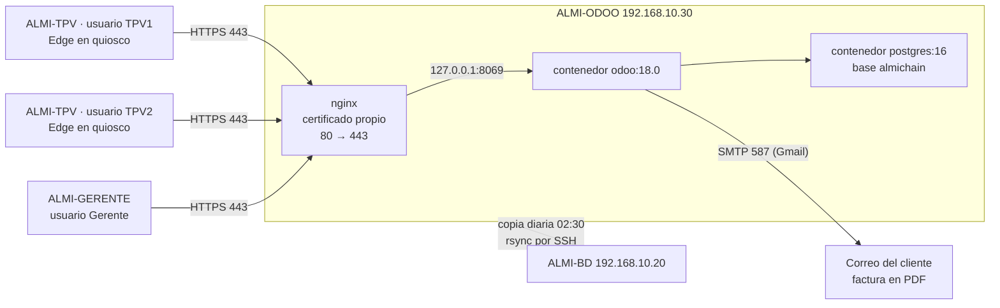
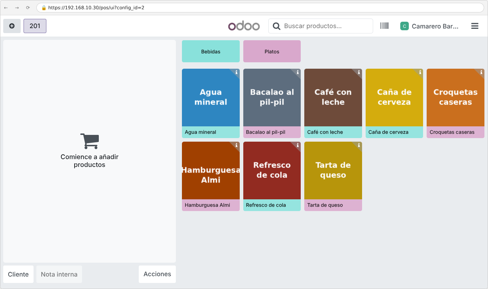

# 5. ERP Odoo + TPV

## Objetivo

El restaurante necesita un ERP con facturación, clientes (CRM), personal, marketing, inventario y TPV. Se ha elegido **Odoo 18 Community**, instalado con **Docker** en la VM **ALMI-ODOO** y publicado solo por **HTTPS** con nginx. Los dos TPV de la barra son los puntos de venta **Barra 1** y **Barra 2** de Odoo. Cuando se cobra una venta a un cliente, Odoo **crea y publica la factura**, la **deja preparada para enviarla por correo** con el PDF y **descuenta el stock**, sin que nadie toque nada. El envío real por Gmail está pendiente: falta poner la contraseña de aplicación de la cuenta del equipo (apartado 6, prueba 5).

Tareas del tablero: E01 a E13.

## Requisitos

| Elemento | Valor |
|---|---|
| VM | ALMI-ODOO · 3 GB de RAM · 2 núcleos · disco de 25 GB · Red NAT ALMICHAIN |
| Sistema | Ubuntu Server 24.04 LTS |
| IP | 192.168.10.30/24 · puerta de enlace 192.168.10.1 · DNS 1.1.1.1 y 9.9.9.9 |
| Software | Docker y Docker Compose (paquetes de Ubuntu), imágenes `odoo:18.0` y `postgres:16`, nginx 1.24 |
| Usuario de administración | `almiadmin` (contraseña en KeePassXC) |
| Licencias | Odoo Community LGPL, Ubuntu, Docker, nginx y PostgreSQL: todo libre y gratis |

### Por qué Odoo (E01)

| ERP | Licencia | TPV integrado | Contabilidad española | Instalación con Docker |
|---|---|---|---|---|
| **Odoo Community** | LGPL, gratis | Sí (Punto de venta, modo bar/restaurante) | Sí (plan contable español) | Imagen oficial |
| Dolibarr | GPL, gratis | Sí (TakePOS) | Sí | Imágenes de la comunidad |
| ERPNext | GPL, gratis | Sí (POS) | Parcial | Oficial, pero más pesada |

Odoo tiene en un solo programa todo lo que pide el enunciado (facturas, CRM, personal, marketing, inventario y TPV), permite automatizar sin programar un módulo (reglas de automatización) y su imagen de Docker hace la instalación repetible. Además es el ERP que indicó el profesor.

## Arquitectura



- Odoo solo escucha en `127.0.0.1:8069`: desde la red **solo se entra por nginx con HTTPS**.
- La contraseña de PostgreSQL está en `/opt/odoo/.env` (solo la lee root) y no sale del servidor.
- Los datos están en volúmenes de Docker (`odoo-db` y `odoo-data`), así que se puede actualizar la imagen sin perder nada.

## Instalación y configuración paso a paso

Los archivos que se usan están en [`config/`](config/) y [`scripts/`](scripts/). Las contraseñas de los ejemplos (`<…>`) se sustituyen por las del gestor de contraseñas.

### 1. Ubuntu Server (E02)

1. VirtualBox → **Nueva** → ALMI-ODOO, ISO de Ubuntu Server 24.04, Linux / Ubuntu (64-bit), **Omitir instalación desatendida** (si no, VirtualBox crea el usuario `vboxuser`), 3072 MB, 2 CPU, 25 GB. Red: **Red NAT ALMICHAIN**.
2. Instalador: teclado español, red manual (192.168.10.30/24, puerta 192.168.10.1, DNS 1.1.1.1,9.9.9.9), disco entero, nombre `almi-odoo`, usuario `almiadmin`, **Install OpenSSH server**.
3. Al terminar: `sudo apt update && sudo apt full-upgrade -y`. El instalador usa LVM y solo da a la raíz la mitad del disco; para usarlo entero: `sudo lvextend -l +100%FREE -r /dev/ubuntu-vg/ubuntu-lv` (comprobar con `df -h /`).
4. Cortafuegos con las redes del diseño ([plan de direccionamiento](../04-red/README.md)): la administración por SSH solo desde la VLAN 10 (gestión, donde están los servidores y el gerente) y la 99 (administración); la web de Odoo desde la VLAN 10 y la VLAN 20 (TPV). La VLAN 30 de clientes no llega a nada:

```bash
sudo ufw default deny incoming
sudo ufw default allow outgoing
for red in 192.168.10.0/24 192.168.99.0/24; do sudo ufw allow from $red to any port 22 proto tcp; done
for red in 192.168.10.0/24 192.168.20.0/24; do sudo ufw allow from $red to any port 80,443 proto tcp; done
sudo ufw enable
sudo ufw status verbose
```

> En el laboratorio todas las VM están en la misma Red NAT 192.168.10.0/24, así que el TPV entra por la regla de la VLAN 10. La regla de la VLAN 20 es la del restaurante real.


### 2. Docker y Odoo (E03)

```bash
sudo apt install -y docker.io docker-compose-v2
sudo systemctl enable --now docker
sudo mkdir -p /opt/odoo/config
sudo chmod 700 /opt/odoo
echo "DB_PASSWORD=$(openssl rand -base64 24)" | sudo tee /opt/odoo/.env
sudo chmod 600 /opt/odoo/.env
```

El formato de ese archivo está en [`config/env.example`](config/env.example) (sin la contraseña real).

`almiadmin` **no** se mete en el grupo `docker` (ese grupo equivale a ser root): siempre `sudo docker`.

Se copian [`config/docker-compose.yml`](config/docker-compose.yml) a `/opt/odoo/docker-compose.yml` y [`config/odoo.conf`](config/odoo.conf) a `/opt/odoo/config/odoo.conf`, **cambiando el texto entre `< >` de `admin_passwd` por la contraseña maestra** (`openssl rand -base64 24`, guardada en KeePassXC). Si se deja la plantilla tal cual, esa frase pública sería la contraseña. **La primera vez se comentan con `;` las líneas `list_db` y `dbfilter`**: si no, Odoo no enseña el formulario para crear la base (apartado 4). Y se arranca:

```bash
sudo chmod 644 /opt/odoo/config/odoo.conf
sudo docker compose --project-directory /opt/odoo up -d
```

> Como `/opt/odoo` tiene permisos 700, `almiadmin` no puede hacer `cd /opt/odoo`. Por eso todos los comandos usan `--project-directory /opt/odoo` con `sudo`.


### 3. HTTPS interno con nginx (E04)

Certificado propio para el servidor (válido 825 días) y nginx delante de Odoo. La configuración completa está en [`config/nginx-odoo.conf`](config/nginx-odoo.conf): redirige el puerto 80 al 443, solo permite TLS 1.2 y 1.3 y pasa a Odoo las cabeceras `X-Forwarded-*` (por eso `odoo.conf` lleva `proxy_mode = True`).

El certificado es **de servidor y no de autoridad** (`CA:FALSE`, uso `serverAuth`). Es importante porque en los Windows se instala en el almacén de raíces de confianza: si fuera `CA:TRUE` (lo que hace `openssl req -x509` por defecto), quien tuviera su clave privada podría firmar certificados de **cualquier** web y los Windows del restaurante se los creerían. Con `CA:FALSE` solo sirve para este servidor.

```bash
sudo apt install -y nginx
sudo mkdir -p /etc/ssl/almichain
sudo openssl req -x509 -nodes -newkey rsa:2048 -days 825 \
  -keyout /etc/ssl/almichain/odoo.key -out /etc/ssl/almichain/odoo.crt \
  -subj "/C=ES/ST=Bizkaia/L=Bilbao/O=Almi-Chain/CN=192.168.10.30" \
  -addext "basicConstraints=critical,CA:FALSE" \
  -addext "keyUsage=critical,digitalSignature,keyEncipherment" \
  -addext "extendedKeyUsage=serverAuth" \
  -addext "subjectAltName=IP:192.168.10.30,DNS:almi-odoo,DNS:localhost,IP:127.0.0.1"
sudo chmod 600 /etc/ssl/almichain/odoo.key
sudo openssl x509 -in /etc/ssl/almichain/odoo.crt -noout -fingerprint -sha256   # se apunta: se comprueba en los Windows
sudo cp nginx-odoo.conf /etc/nginx/sites-available/odoo
sudo ln -s /etc/nginx/sites-available/odoo /etc/nginx/sites-enabled/odoo
sudo rm /etc/nginx/sites-enabled/default
sudo nginx -t && sudo systemctl reload nginx
```


nginx publica también la parte **pública** del certificado en `http://192.168.10.30/almichain-odoo.crt` (nunca la clave). En los dos Windows se descarga e instala como de confianza con [`../01-windows-gerente-tpv/scripts/3-certificado-odoo.ps1`](../01-windows-gerente-tpv/scripts/3-certificado-odoo.ps1), que **pide la huella SHA-256** apuntada en el servidor y no lo instala si no coincide. Así no hace falta entrar por SSH al servidor desde los TPV (la red no lo permite) y Edge muestra el candado sin avisos.

### 4. Base de datos `almichain` (E05)

En el navegador, `https://192.168.10.30` → formulario de creación: contraseña maestra, base `almichain`, correo del administrador, idioma **Spanish (ES)**, país **Spain**, sin datos de demostración.


Después se oculta el gestor de bases de datos para que nadie pueda borrarlas o copiarlas desde la web. Al final de `odoo.conf` se quitan los `;` de las dos líneas:

```ini
list_db = False
dbfilter = ^almichain$
```

```bash
sudo docker compose --project-directory /opt/odoo restart odoo
```


### 5. Aplicaciones, empresa, usuarios, productos, TPV y regla (E05 a E10)

Todo esto se hizo en la interfaz de Odoo siguiendo la guía y se dejó también en un script, [`scripts/configurar_odoo.py`](scripts/configurar_odoo.py), que lo rehace por XML-RPC en unos minutos si hay que reinstalar (las contraseñas se pasan como variables de entorno, no están en el script):

```bash
export ODOO_URL=https://192.168.10.30 ODOO_CA=/etc/ssl/almichain/odoo.crt
export ODOO_ADMIN_LOGIN=... ODOO_ADMIN_PASS=... ODOO_GERENTE_PASS=... ODOO_BARRA1_PASS=... ODOO_BARRA2_PASS=...
python3 scripts/configurar_odoo.py
```

**Aplicaciones**: Facturación, Punto de venta, CRM, Empleados, Marketing por correo electrónico, Inventario y Reglas de automatización.


**Empresa**: Almi Bites Restaurantes, Bilbao, EUR, con el logotipo de la web.


**Usuarios con mínimo privilegio** (E06):

| Usuario | Inicio de sesión | Permisos |
|---|---|---|
| Gerente | gerente@almichain.local | Facturación: Facturación · TPV: Administrador · CRM: Administrador · Empleados: Administrador · Inventario: Administrador · Marketing: Usuario · **sin Ajustes** |
| Camarero Barra 1 | barra1@almichain.local | Solo Punto de venta: Usuario |
| Camarero Barra 2 | barra2@almichain.local | Solo Punto de venta: Usuario |


**Empleados**: Gorka Larrea (Gerente, Dirección, usuario Gerente), Nerea Olabarria (Camarera, Sala, usuario Camarero Barra 1), Asier Landa (Camarero, Sala, usuario Camarero Barra 2) y Miren Agirre (Cocinera, Cocina).


**Productos** (E07): 4 bebidas y 4 platos, tipo Bienes con **Rastrear inventario**, **IVA 10 % (hostelería) con el precio con IVA incluido**, disponibles en el TPV en las categorías Bebidas y Platos, 50 unidades de stock inicial. **Clientes**: Ane Etxeberria, Jon Arrieta y Lucía Martín.


**TPV** (E08): **Barra 1** (`config_id=1`) y **Barra 2** (`config_id=2`), cada uno con **Tarjeta** y su propia caja de **Efectivo** (Odoo no deja compartir un método de efectivo entre dos TPV), cabecera y pie del recibo e **impresión automática** sin vista previa.


**Correo saliente** (E09): servidor `smtp.gmail.com`, puerto 587, STARTTLS, usuario `almichain.reto@gmail.com`. La **contraseña de aplicación** de Gmail se escribe a mano en Odoo y se guarda en KeePassXC.


**Factura automática** (E10): regla **TPV - Facturar pedidos con cliente** sobre *Pedidos de TPV*, que se dispara cuando el estado pasa a **Pagado**, con el filtro `[('partner_id', '!=', False), ('to_invoice', '=', False), ('account_move', '=', False)]`: el pedido tiene cliente, el camarero **no** ha marcado ya *Factura* en el TPV (si lo marca, Odoo la hace él) y todavía no tiene factura. Así nunca sale una factura doble:

```python
for order in records:
    if order.partner_id and not order.account_move:
        order.action_pos_order_invoice()
```


### 6. Prueba de principio a fin (E12)

Con el usuario **Camarero Barra 1** se abre la caja de **Barra 1**, se marcan una caña, un refresco y una hamburguesa, se elige la clienta **Ane Etxeberria** y se cobra en efectivo. Después, con **Camarero Barra 2**, una venta en **Barra 2** a **Jon Arrieta**.

**Barra 1** (Camarero Barra 1, clienta Ane Etxeberria):


**Barra 2** (Camarero Barra 2, cliente Jon Arrieta):





Resultado visto por el **Gerente**:


### 7. Copia de seguridad de Odoo (E11)

Script [`scripts/copia-odoo.sh`](scripts/copia-odoo.sh) en `/usr/local/bin/`, todos los días a las **02:30** con cron de root. Guarda la base de datos (`pg_dump` en formato propio), los adjuntos (`filestore`), las huellas SHA-256, borra las copias de más de 7 días y lo manda todo a **ALMI-BD** por SSH con una clave que solo sirve para eso (ver [07-bd-raid-copias](../07-bd-raid-copias/README.md#7-copias-cruzadas-automáticas-b09)).


Prueba de restauración en una base nueva `almichain_restaurada`: tiene el mismo número de pedidos que la original.


### 8. Máquina virtual exportada

ALMI-ODOO está exportada como `ALMI-ODOO.ova` (ver [docs/maquinas-virtuales.md](../docs/maquinas-virtuales.md)). Se probó arrancándola desde cero: en el primer arranque ([`scripts/primer-arranque-odoo.sh`](scripts/primer-arranque-odoo.sh)) genera sus propios secretos, carga las imágenes de Docker que lleva dentro (no necesita Internet), restaura la base `almichain` con los datos de este bloque, arranca Odoo y aplica el cortafuegos. Al terminar, Odoo responde por HTTPS con los 2 pedidos de la prueba.


## Seguridad aplicada

- **Solo HTTPS**: nginx redirige el 80 al 443 (salvo la descarga de la parte pública del certificado); Odoo solo escucha en 127.0.0.1. Certificado de servidor (`CA:FALSE`) instalado como de confianza en los Windows tras comprobar su huella.
- **Cortafuegos** ufw: entrada denegada salvo SSH desde las VLAN 10 y 99, y HTTP/HTTPS desde las VLAN 10 y 20.
- **Secretos propios en cada VM importada**: en el primer arranque se generan la contraseña de PostgreSQL, la contraseña maestra de Odoo, el certificado con su clave y las claves de host SSH. La OVA no los lleva.
- **Gestor de bases de datos oculto** (`list_db = False`) y contraseña maestra larga.
- **Mínimo privilegio** en Odoo: los camareros solo usan el TPV; el gerente no tiene Ajustes; solo el administrador configura.
- **Secretos fuera del repositorio**: `.env`, `odoo.conf` real, clave del certificado y contraseñas en KeePassXC.
- `almiadmin` sin grupo `docker`; `/opt/odoo` y las copias con permisos 700.
- Copias diarias en otra máquina (regla 3-2-1 junto con las de la BD).

## Pruebas

| Nº | Qué se prueba | Cómo | Resultado esperado | Resultado obtenido | Captura |
|---|---|---|---|---|---|
| 1 | Odoo solo por HTTPS | `curl -I http://192.168.10.30/` | 301 a https y candado | 301 Moved Permanently → https | [04](capturas/04-nginx-https.png) |
| 2 | Puerto 8069 cerrado desde fuera | `nc -zv 192.168.10.30 8069` (en Windows: `Test-NetConnection`) | Conexión rechazada | Connection refused | [05](capturas/05-certificado.png) |
| 3 | Gestor de bases de datos oculto | Abrir `/web/database/manager` | No se abre | "The database manager has been disabled" | [08](capturas/08-gestor-bd-oculto.png) |
| 4 | Camareros sin facturación | Entrar como Camarero Barra 1 | Sin menús de Facturación, Inventario ni CRM | Solo Punto de venta (y apps comunes: Conversaciones, Calendario, Contactos, Empleados) | [31](capturas/31-camarero-solo-tpv.png) |
| 5 | Caso real completo | Venta con cliente en Barra 1 y Barra 2 | Pedido facturado, factura publicada, correo con PDF y stock bajado | Factura, publicación y stock: correcto. **Correo: solo comprobado que queda en la cola con el PDF**; el envío real está pendiente de poner la contraseña de aplicación de Gmail | [27](capturas/27-pedidos-tpv.png) [28](capturas/28-facturas-publicadas.png) [30](capturas/30-stock-despues-de-vender.png) [33](capturas/33-cola-de-correos.png) |
| 6 | Ticket impreso | Cobrar en cada barra | Ticket con cabecera y pie | Ticket generado en pantalla con cabecera y pie. **Impresión en la impresora física: pendiente — en clase** (bloque 01) | [ticket 1](capturas/25-barra1-4-ticket.png) [ticket 2](capturas/26-barra2-4-ticket.png) |
| 7 | Copia y restauración | Restaurar en `almichain_restaurada` | Mismo número de pedidos | 2 y 2 | [35](capturas/35-restauracion-odoo.png) |
| 8 | VM exportada | Arrancar `ALMI-ODOO.ova` desde cero | Odoo por HTTPS con los datos del reto | HTTPS 200 y 2 pedidos | [36](capturas/36-vm-ova-primer-arranque.png) |

## Problemas encontrados y solución

| Problema | Causa | Solución |
|---|---|---|
| `cd /opt/odoo` da *Permission denied* | La carpeta tiene permisos 700 (solo root) a propósito | Usar `sudo docker compose --project-directory /opt/odoo …` |
| El cliente recibía **dos correos** por factura (uno sin PDF y con "Ref n/a") | En Odoo 18, al facturar un pedido del TPV a un cliente con correo, Odoo ya envía la factura en PDF. La regla 2 de la guía ("enviar al publicar") lo duplicaba, y además saltaba antes de que la factura tuviera número | Se quitó la regla 2. Queda solo la regla 1 (facturar) y el envío lo hace Odoo |
| Al abrir caja salía "configure la dirección de correo del remitente" | Los usuarios de los camareros no tenían correo en su contacto | Poner correo a cada usuario (gerente@, barra1@, barra2@almichain.local) |
| Los PDF de las facturas tardaban un minuto | wkhtmltopdf, dentro del contenedor, pedía los estilos a `https://192.168.10.30` | Parámetro del sistema `report.url = http://127.0.0.1:8069` |
| No se podía compartir el efectivo entre Barra 1 y Barra 2 | Odoo exige un método de efectivo por TPV | Un diario de caja por barra: "Efectivo Barra 1" y "Efectivo Barra 2" |
| La ACL de Packet Tracer de la guía solo dejaba el puerto 80 a los TPV | Odoo se usa por HTTPS | Se añade `eq 443` en la ACL `TPV-SOLO-ODOO` (bloque 04) |
| El camarero puede abrir la lista de facturas si escribe la dirección a mano | El grupo "Punto de venta: Usuario" necesita leer facturas para reimprimirlas | No tiene menú de Facturación ni puede modificarlas. Se documenta como riesgo aceptado ([captura 32](capturas/32-camarero-ve-facturas-riesgo-aceptado.png)) |

## Fuentes

- Documentación de Odoo 18: Punto de venta, Facturación y Reglas de automatización — https://www.odoo.com/documentation/18.0/
- Imagen oficial de Odoo en Docker Hub — https://hub.docker.com/_/odoo
- nginx como proxy inverso de Odoo — https://www.odoo.com/documentation/18.0/administration/on_premise/deploy.html
- Guías paso a paso del equipo: [`00-gestion/Guias-paso-a-paso-Reto1-Almi-Chain.docx`](../00-gestion/Guias-paso-a-paso-Reto1-Almi-Chain.docx), parte 6
