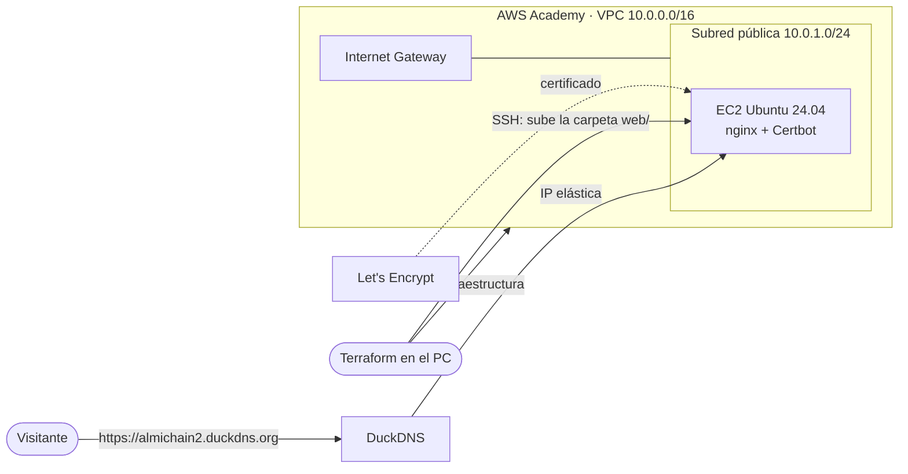

# 6. Web en AWS con Terraform, DuckDNS y HTTPS

## Objetivo

La web informativa del restaurante **Almi Bites** (carta, galería, mapa con **geolocalización** y formulario de contacto), preparada para publicarse en **AWS Academy** con **Terraform**, dominio gratuito de **DuckDNS** y **HTTPS** de Let's Encrypt en **https://almichain2.duckdns.org**. Con `terraform destroy` y `terraform apply` se rehace todo igual (despliegue reproducible).

> **Estado**: el código está completo y revisado (el HCL se ha comprobado con un analizador, el script de arranque con `bash -n` y shellcheck, y la configuración de nginx con `nginx -t`), pero **en este repositorio no hay todavía pruebas del despliegue**: ni salida de `terraform apply`, ni capturas, ni el informe de Lighthouse. Donde se preparó el repositorio no había Terraform ni acceso a AWS Academy. El despliegue y la tabla de pruebas se completan en clase (tareas W05-W09).

Tareas del tablero: W01 a W09. El código también está en su propio repositorio, [krako829/almichain-web-terraform](https://github.com/krako829/almichain-web-terraform); esta carpeta es una copia para tener todo el reto junto.

## Requisitos

| Elemento | Valor |
|---|---|
| Nube | AWS Academy Learner Lab (región `us-east-1`), coste 0 € |
| Herramientas en el PC | Terraform 1.x, credenciales del lab en `~/.aws/credentials` |
| Dominio | `almichain2.duckdns.org` (token de DuckDNS en KeePassXC) |
| Servidor | EC2 Ubuntu 24.04 con nginx y Certbot, IP elástica |

## Arquitectura



Terraform crea **13 recursos**: VPC, Internet Gateway, subred, tabla de rutas y su asociación, grupo de seguridad (22, 80, 443), clave privada, par de claves, fichero `.pem`, IP elástica, EC2, asociación de la IP y la subida de la web. Al arrancar, la EC2 instala nginx, actualiza la IP en DuckDNS, pide el certificado y fuerza HTTPS.

## Archivos

| Archivo | Qué es |
|---|---|
| [`versions.tf`](versions.tf) | Versión de Terraform y proveedores (aws, tls, local) |
| [`variables.tf`](variables.tf) | Variables (subdominio, token, correo, región, tipo de instancia) |
| [`main.tf`](main.tf) | Toda la infraestructura |
| [`outputs.tf`](outputs.tf) | IP, URL y comando SSH al terminar |
| [`user_data.sh.tftpl`](user_data.sh.tftpl) | Script de arranque del servidor (nginx, DuckDNS, HTTPS) |
| [`terraform.tfvars.example`](terraform.tfvars.example) | Plantilla de datos personales (el `terraform.tfvars` real no se sube) |
| [`web/`](web/) | La web: `index.html`, `estilos.css`, `geo.js` (geolocalización) e imágenes |
| [`docs/`](docs/) | Arquitectura, guía de despliegue, explicación del código, pruebas y mantenimiento |

## Despliegue paso a paso

Guía completa: [`docs/02-guia-despliegue.md`](docs/02-guia-despliegue.md). Resumen:

```bash
# Cada sesión del lab: credenciales nuevas (AWS Details → AWS CLI → Show)
nano ~/.aws/credentials

# Primera vez
cp terraform.tfvars.example terraform.tfvars && nano terraform.tfvars
terraform init

# Desplegar (tarda unos 5 minutos)
terraform plan       # Plan: 13 to add
terraform apply      # yes

# Prueba de despliegue reproducible
terraform destroy
terraform apply
```

## Seguridad aplicada

- Solo HTTPS (HTTP redirige), certificado válido de Let's Encrypt con renovación automática.
- Grupo de seguridad con solo 22, 80 y 443; clave SSH generada por Terraform y guardada fuera del repositorio.
- `terraform.tfvars` (token de DuckDNS), `*.tfstate` y `*.pem` en `.gitignore`.

## Pruebas

Detalladas en [`docs/04-pruebas.md`](docs/04-pruebas.md). Las capturas se hacen con la web desplegada desde la sesión del lab.

| Nº | Qué se prueba | Resultado esperado | Resultado obtenido | Captura |
|---|---|---|---|---|
| 1 | `terraform plan` | 13 to add | Pendiente — en clase | |
| 2 | `terraform apply` | Apply complete, url = https://almichain2.duckdns.org | Pendiente — en clase | |
| 3 | HTTPS con candado | Certificado de Let's Encrypt válido | Pendiente — en clase | |
| 4 | HTTP redirige a HTTPS | 301 a https | Pendiente — en clase | |
| 5 | DNS | `nslookup almichain2.duckdns.org` = IP elástica | Pendiente — en clase | |
| 6 | SSL Labs | Nota A | Pendiente — en clase | |
| 7 | Geolocalización | El botón pide permiso y calcula la distancia al restaurante | Pendiente — en clase | |
| 8 | Vista móvil | Menú y secciones bien en 390 px | Pendiente — en clase | |
| 9 | Lighthouse | 90 o más en las 4 categorías | Pendiente — en clase | |
| 10 | Destruir y volver a crear | La web vuelve igual | Pendiente — en clase | |

## Fuentes

- Terraform AWS Provider — https://registry.terraform.io/providers/hashicorp/aws/latest/docs
- DuckDNS — https://www.duckdns.org/install.jsp
- Certbot — https://certbot.eff.org/
- API de geolocalización — https://developer.mozilla.org/es/docs/Web/API/Geolocation_API
