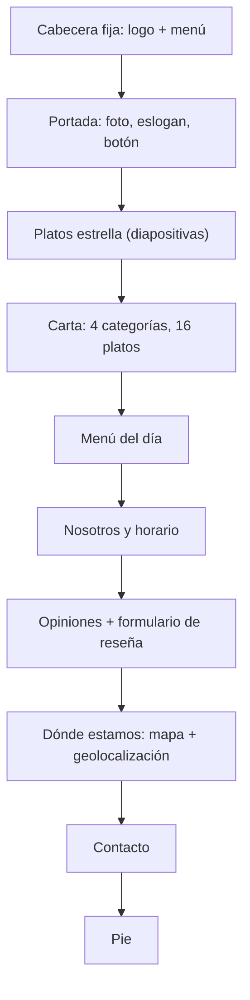

# Diseño de la web Almi Bites

Basado en el documento *Documentación de la web Almi Bites* de Julen Vazquez (Drive del equipo, 6 de noviembre de 2026), autor de la web. Aquí se explica **cómo está diseñada** la página que hay en [`../web/`](../web/) y por qué.

## Qué es

Web de presentación de **Almi Bites**, un restaurante de cocina de mercado y raciones para compartir. Es informativa: los formularios de contacto y de reseñas son solo maquetación y no envían datos (no hay parte de servidor).

## Tecnologías

| Tecnología | Para qué |
|---|---|
| HTML5 | Estructura y contenido, con etiquetas semánticas |
| CSS3 | Diseño: Flexbox, Grid, variables CSS y *media queries* |
| Google Fonts | Bricolage Grotesque (títulos) y DM Sans (texto) |
| OpenStreetMap | Mapa incrustado con la ubicación |
| JavaScript | **Solo** [`geo.js`](../web/geo.js), la geolocalización que pide el enunciado (distancia del visitante al restaurante). Lo demás funciona sin JavaScript |
| Visual Studio Code + Live Server | Desarrollo y prueba en local |

## Secciones

1. **Cabecera** fija con el logo y el menú de navegación.
2. **Portada**: foto del restaurante, eslogan «Pequeños bocados, grandes ratos» y botón.
3. **Platos estrella**: pase de diapositivas con tres platos.
4. **Nuestra carta**: 16 platos en cuatro categorías (Para picar, Frescos, Principales y Postres) con descripción y precio, y una línea de bebidas.
5. **Menú del día**: primero, segundo y postre a 14,90 €.
6. **Nosotros y horario**.
7. **Opiniones**: tres reseñas con estrellas y un formulario para dejar una.
8. **Dónde estamos**: dirección, mapa y botón de geolocalización.
9. **Contacto**: formulario con nombre, correo y mensaje.
10. **Pie**: copyright, dirección, teléfono y correo.

## Colores

La paleta sale del logo. Todos los colores son variables en `:root` de [`estilos.css`](../web/estilos.css), así que se cambian en un solo sitio.

| Color | Valor | Uso |
|---|---|---|
| Crema | `#faf4ec` | Fondo general |
| Marrón / marrón oscuro | `#4a2416` / `#2e140b` | Textos, botones y pie |
| Ámbar / ámbar claro | `#c8771e` / `#efb04a` | Detalles, precios y estrellas |
| Ámbar para texto | `#9a5a12` | Texto ámbar sobre fondo claro (se oscureció tras Lighthouse para cumplir el contraste AA) |
| Verde hoja | `#4f7a2b` | Menú del día y reseñas |
| Arena | `#f3eadb` | Fondos alternos de sección |

## Elementos interactivos sin JavaScript

- **Pase de diapositivas**: tres botones de radio ocultos con sus etiquetas; al marcar uno, el selector `:checked` desplaza los platos con `transform: translateX`.
- **Estrellas del formulario**: cinco botones de radio en una fila invertida (`row-reverse`), así al elegir una estrella se iluminan también las anteriores.
- **Navegación**: enlaces internos `#id` con `scroll-behavior: smooth`.

## Responsive

Unidades relativas, `clamp()` para los tamaños de texto, rejillas con CSS Grid y una *media query* a **760 px**: en pantallas pequeñas la carta, el menú del día, las opiniones y «Nosotros» pasan a una columna.

## Accesibilidad y rendimiento

- `lang="es"` y `meta viewport`.
- Enlace **«Saltar al contenido»** para el teclado y foco visible.
- Etiquetas semánticas: `header`, `nav`, `main`, `section`, `footer`.
- Texto alternativo en las imágenes y `label` en todos los campos.
- Contraste suficiente y respeto a `prefers-reduced-motion`.
- Un único CSS, un único JS pequeño, mapa con `loading="lazy"` y foto de portada en `.webp`.

Resultado medido: Lighthouse en local, móvil, **92 / 100 / 96 / 100** ([`../pruebas/`](../pruebas/)).

## Limitaciones

- Los formularios no envían datos.
- Platos, precios, horarios, teléfono y opiniones son de ejemplo.
- **Falta el diseño previo** que pide la rúbrica: un boceto o maqueta hecho con una herramienta (Figma, Penpot, Canva…) antes de programar, con móvil, tablet y escritorio. Este documento explica el diseño de la web ya hecha, pero no sustituye a ese boceto.
