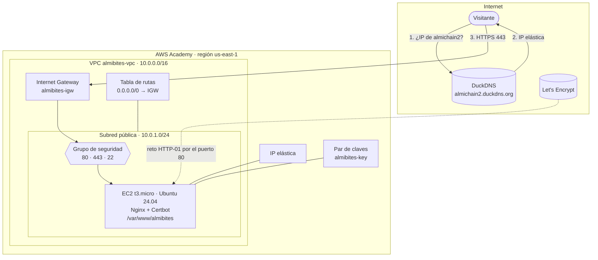
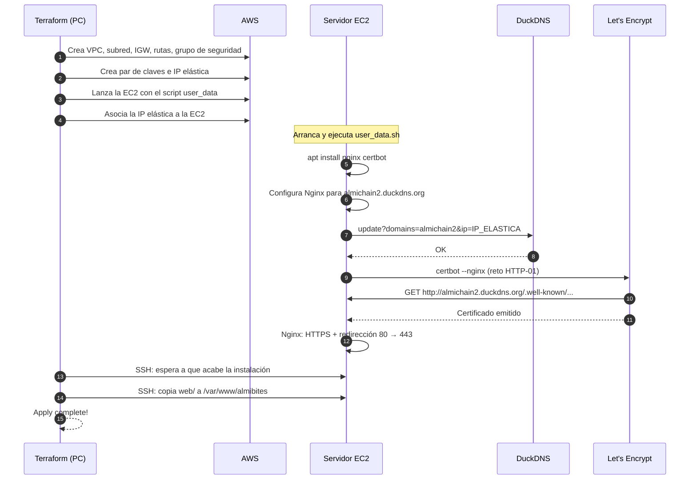

# 1. Arquitectura

[← Volver al README](../README.md)

## Visión general

La web es estática: HTML, CSS, una imagen de fondo, el logo y un pequeño JavaScript para la geolocalización. Se sirve desde un único servidor **EC2** con **Nginx**, dentro de una **VPC propia** en AWS Academy. El dominio **almichain2.duckdns.org** apunta a una **IP elástica** (fija) asociada a ese servidor. El certificado HTTPS lo emite **Let's Encrypt** gratis.

## Componentes

| Componente | Recurso Terraform | Para qué sirve |
|---|---|---|
| VPC `10.0.0.0/16` | `aws_vpc.principal` | Red privada propia del proyecto, aislada del resto de la cuenta |
| Subred pública `10.0.1.0/24` | `aws_subnet.publica` | Donde vive el servidor. Es "pública" porque su tabla de rutas sale a Internet por el IGW |
| Internet Gateway | `aws_internet_gateway.igw` | Puerta de entrada y salida entre la VPC e Internet |
| Tabla de rutas | `aws_route_table.publica` + asociación | Manda todo el tráfico que no es de la VPC (`0.0.0.0/0`) al Internet Gateway |
| Grupo de seguridad | `aws_security_group.web` | Firewall del servidor: solo deja entrar por 80 (HTTP), 443 (HTTPS) y 22 (SSH) |
| Par de claves | `tls_private_key.ssh` + `aws_key_pair.web` | Clave SSH que Terraform genera para entrar al servidor y subir la web |
| IP elástica | `aws_eip.web` + asociación | IP pública fija. No cambia aunque el lab apague y encienda la máquina |
| Servidor EC2 | `aws_instance.web` | Ubuntu 24.04 en un `t3.micro` con Nginx y Certbot |
| Subida de la web | `terraform_data.subir_web` | Copia la carpeta `web/` al servidor por SSH |

## Qué pasa cuando se ejecuta `terraform apply`

## Por qué se eligió cada cosa

**Terraform.** El reto pide desplegar la web con Terraform. Así toda la infraestructura queda escrita en ficheros: se puede revisar, repetir y borrar sin hacer nada a mano en la consola.

**VPC propia en vez de la VPC por defecto.** Es lo que hemos practicado en clase (VPC, subred, gateway y tabla de rutas). Además, el proyecto no depende de que la cuenta tenga una VPC por defecto.

**EC2 + Nginx.** Es la forma más directa de servir una web con HTTPS en AWS Academy. Las alternativas "gestionadas" (CloudFront + ACM, Amplify, S3 website) necesitan permisos o servicios que el Learner Lab limita, o un dominio propio validado por DNS.

**IP elástica.** El Learner Lab apaga las máquinas al terminar cada sesión. Sin IP elástica, cada vez que se encendiera tendría una IP pública distinta y DuckDNS apuntaría a una IP vieja.

**DuckDNS.** Es gratis y el reto lo pide. Tiene una API sencilla (`https://www.duckdns.org/update?...`) para cambiar la IP desde un script.

**Let's Encrypt con Certbot.** Certificados gratis, reconocidos por todos los navegadores, y con renovación automática. AWS Certificate Manager no sirve aquí porque sus certificados solo se pueden usar con balanceadores o CloudFront, no directamente en una EC2.

**Subir la web por SSH.** Terraform genera su propia clave SSH, entra en el servidor y copia la carpeta `web/`. Así todo el despliegue (infraestructura **y** contenido) sale de un único `terraform apply`, sin pasos manuales, y la EC2 no necesita permisos IAM extra. Además, Terraform calcula una huella de los ficheros de la web: solo la vuelve a subir cuando cambia algo.

**Geolocalización con la API del navegador.** El botón *¿A cuánto estoy?* usa `navigator.geolocation`. Los navegadores solo permiten esa API en páginas **HTTPS**, así que es justo lo que demuestra que el HTTPS funciona. El mapa es de OpenStreetMap, que es gratis y no necesita clave.

## Seguridad

- El servidor solo tiene abiertos los puertos 80, 443 y 22.
- El puerto 80 solo redirige a HTTPS; Let's Encrypt lo necesita para validar el dominio.
- SSH solo admite la clave generada por Terraform (Ubuntu no permite contraseñas por SSH).
- Nginx envía cabeceras de seguridad: `X-Content-Type-Options`, `X-Frame-Options`, `Referrer-Policy` y `Permissions-Policy` (solo la propia web puede pedir la ubicación). También oculta su versión (`server_tokens off`).
- Los datos sensibles (token de DuckDNS, clave privada, estado de Terraform) están fuera del repositorio gracias al `.gitignore`.
