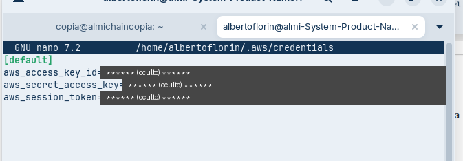
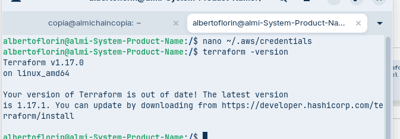
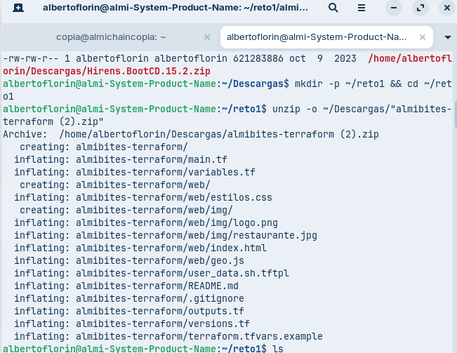
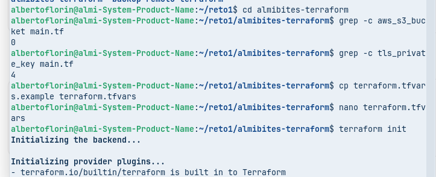
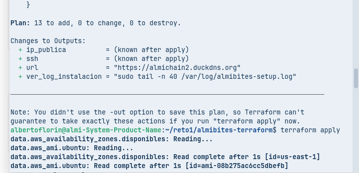
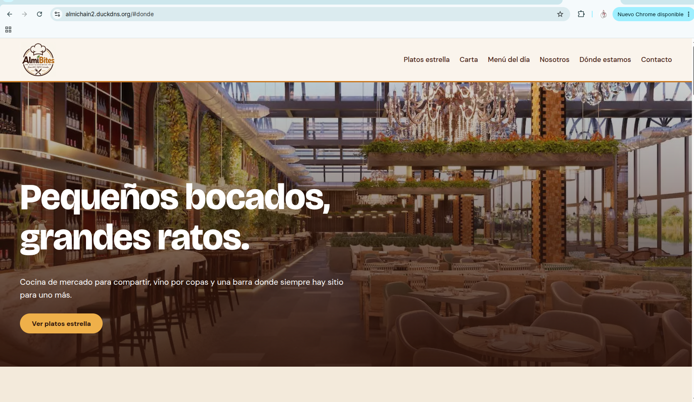
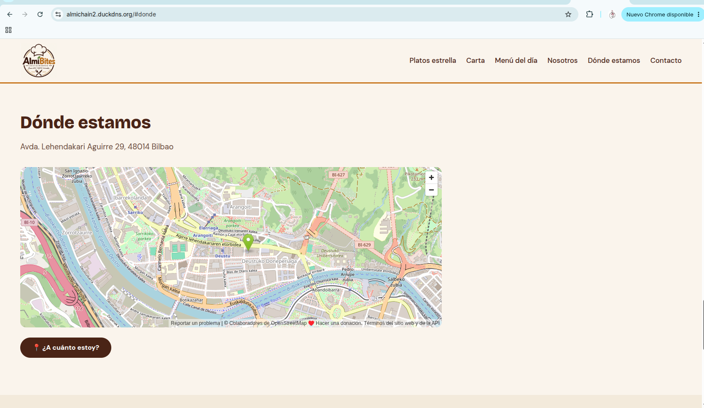

# 6. Evidencias del despliegue

[← Volver al README](../README.md)

Capturas del despliegue real de la web en AWS Academy, hecho el **10 de noviembre de 2026** por Alberto desde un PC de clase con Zorin OS, en la región **us-east-1**. Las imágenes están en [`../capturas/`](../capturas/).

---

## Paso 1. Credenciales de AWS Academy

Con el Learner Lab iniciado, se copia el bloque de **AWS Details → AWS CLI** en `~/.aws/credentials`. Así Terraform puede crear recursos en la cuenta del lab.



> Las claves se han ocultado en la captura. Son temporales: caducan al terminar la sesión del lab.

---

## Paso 2. Terraform instalado

`terraform -version` confirma que Terraform está instalado (v1.17.0).



---

## Paso 3. Descomprimir el proyecto

El proyecto se descomprime en `~/reto1`. Se ven todos los ficheros: el código de Terraform (`main.tf`, `variables.tf`, `outputs.tf`, `versions.tf`), el script de arranque del servidor (`user_data.sh.tftpl`), la plantilla de variables y la carpeta `web/` con la página, los estilos, la geolocalización (`geo.js`) y las imágenes.

```bash
mkdir -p ~/reto1 && cd ~/reto1
unzip -o ~/Descargas/"almibites-terraform (2).zip"
```



---

## Paso 4. Comprobar la versión, configurar e inicializar

1. Se comprueba que es la versión correcta del proyecto, la que genera la clave SSH (`tls_private_key`).
2. Se crea `terraform.tfvars` a partir de la plantilla y se rellenan el subdominio (`almichain2`), el token de DuckDNS, el correo y la región.
3. `terraform init` descarga los proveedores `aws`, `tls` y `local`.

```bash
cd almibites-terraform
grep -c tls_private_key main.tf
cp terraform.tfvars.example terraform.tfvars
nano terraform.tfvars
terraform init
```



---

## Paso 5. `terraform plan` y `terraform apply`

`terraform plan` muestra los **13 recursos** que se van a crear (`13 to add, 0 to change, 0 to destroy`) y las salidas: IP pública, comando SSH y URL `https://almichain2.duckdns.org`.

`terraform apply` empieza consultando la zona de disponibilidad (`us-east-1`) y la imagen más reciente de Ubuntu 24.04. Luego crea la red, el servidor y la IP elástica, espera a que el servidor instale Nginx y consiga el certificado HTTPS, y sube la web.

```bash
terraform plan
terraform apply
```



---

## Paso 6. La web publicada

La web de **Almi Bites** se sirve en **almichain2.duckdns.org**, con el dominio de DuckDNS apuntando a la IP elástica del servidor.



---

## Paso 7. Dónde estamos y geolocalización

La sección **Dónde estamos** muestra la dirección (Avda. Lehendakari Aguirre 29, 48014 Bilbao) y el mapa de OpenStreetMap con el marcador del restaurante. Debajo está el botón **📍 ¿A cuánto estoy?**: usa la geolocalización del navegador, que solo funciona sobre HTTPS, para calcular la distancia del visitante al restaurante y darle la ruta.



---

## Resumen

| Requisito del reto | Evidencia |
|---|---|
| Despliegue con Terraform | Pasos 4 y 5: `init`, `plan` (13 recursos) y `apply` |
| Infraestructura en AWS | Paso 5: VPC, subred, gateway, grupo de seguridad, IP elástica y EC2 creados por Terraform |
| Dominio | Pasos 6 y 7: `almichain2.duckdns.org` |
| HTTPS | Paso 6: la web abre en `almichain2.duckdns.org` como conexión segura (sin aviso de "No es seguro"); el certificado lo instala Certbot durante el `apply` |
| Geolocalización | Paso 7: mapa con la ubicación del restaurante y botón **¿A cuánto estoy?** |
