# 7. Base de datos, RAID y copias de seguridad

## Objetivo

Diseñar e implantar la base de datos de un local de Almi-Chain (clientes, reservas, mesas, comandas, carta, ingredientes, proveedores, personal y facturas) en un servidor **MariaDB** cuyos datos están en un **RAID 1**, con usuarios de mínimo privilegio, **copias automáticas** a otro servidor y **pruebas de restauración** y de **fallo de disco**.

Tareas del tablero: B01 a B12.

## Requisitos

| Elemento | Valor |
|---|---|
| VM | ALMI-BD · 2 GB de RAM · 2 núcleos · disco de sistema de 15 GB + **dos discos de 10 GB** para el RAID · Red NAT ALMICHAIN |
| Sistema | Ubuntu Server 24.04 LTS · IP 192.168.10.20/24 |
| Software | MariaDB 10.11, mdadm, rsync, cron |
| Usuario de administración | `almiadmin` (contraseña en KeePassXC) |

## Modelo de datos

Modelo del equipo hecho en dbdiagram.io: [`../diagramas/modelo-er-equipo.pdf`](../diagramas/modelo-er-equipo.pdf).

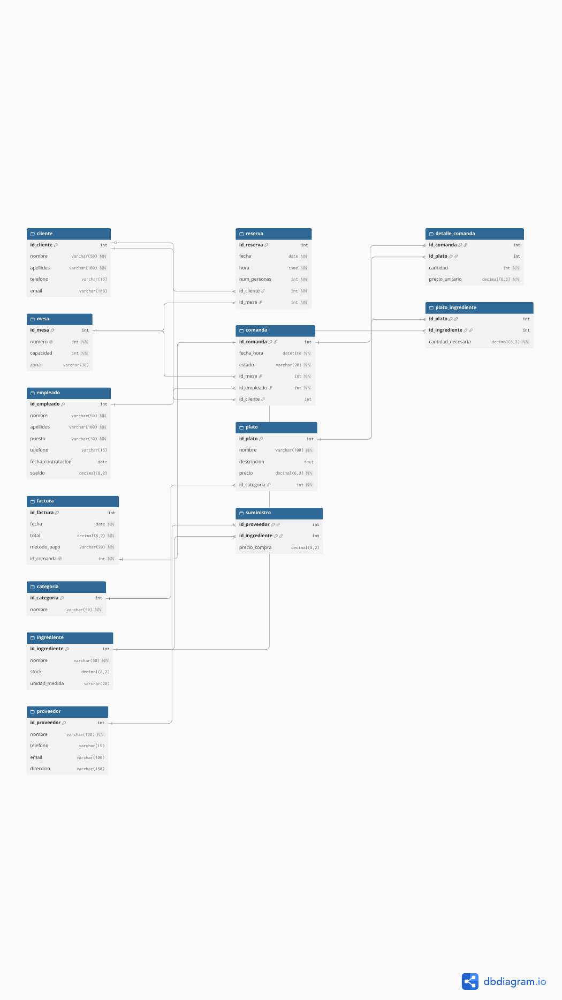

13 tablas y una vista:

| Tabla | Clave primaria | Claves ajenas | Notas |
|---|---|---|---|
| cliente | id_cliente | — | email único |
| mesa | id_mesa | — | número único; zona sala/terraza/barra |
| empleado | id_empleado | — | puesto, sueldo > 0 |
| categoria | id_categoria | — | nombre único |
| plato | id_plato | id_categoria | precio > 0 |
| ingrediente | id_ingrediente | — | stock ≥ 0 |
| proveedor | id_proveedor | — | |
| reserva | id_reserva | id_cliente, id_mesa | una mesa no se reserva dos veces a la misma hora |
| comanda | id_comanda | id_mesa, id_empleado, id_cliente (opcional) | estado abierta/servida/pagada/anulada |
| detalle_comanda | (id_comanda, id_plato) | id_comanda, id_plato | N:M comanda-plato; guarda el precio del momento |
| plato_ingrediente | (id_plato, id_ingrediente) | id_plato, id_ingrediente | N:M, la receta |
| suministro | (id_proveedor, id_ingrediente) | id_proveedor, id_ingrediente | N:M, precio de compra |
| factura | id_factura | id_comanda (única) | 1:1 con la comanda |
| **v_importe_comanda** (vista) | | | importe de cada comanda |

**Normalización**: todas las columnas son atómicas (1FN); las tablas con clave compuesta (detalle_comanda, plato_ingrediente, suministro) solo tienen atributos que dependen de la clave entera (2FN); no hay dependencias entre atributos que no son clave, por ejemplo el nombre de la categoría está en `categoria` y no repetido en `plato` (3FN). El importe de la comanda no se guarda: se calcula con la vista, para que no pueda quedar desactualizado.

Archivos SQL en [`sql/`](sql/):

| Archivo | Qué hace |
|---|---|
| [`01-esquema.sql`](sql/01-esquema.sql) | Base `almichain` en utf8mb4, 13 tablas InnoDB con claves, restricciones CHECK, índices y la vista |
| [`02-datos.sql`](sql/02-datos.sql) | Datos de ejemplo ficticios |
| [`03-usuarios.sql`](sql/03-usuarios.sql) | Los 3 usuarios (las contraseñas se pasan al ejecutarlo, no están en el archivo) |
| [`04-consultas.sql`](sql/04-consultas.sql) | 9 consultas de prueba |
| [`05-recuentos.sql`](sql/05-recuentos.sql) | Recuento de filas para comparar antes y después de restaurar |

## Instalación y configuración paso a paso

### 1. VM con tres discos (B04)

Instalación base de Ubuntu Server igual que ALMI-ODOO (bloque 05, paso 1) con IP **192.168.10.20** y nombre `almi-bd`. Con la VM apagada: **Configuración → Almacenamiento → Controlador SATA → Añadir disco duro → Crear** → `ALMI-BD-raid1`, VDI, 10 GB. Repetir con `ALMI-BD-raid2`.

### 2. RAID 1 (B05)

Los pasos están también en el script [`scripts/crear-raid.sh`](scripts/crear-raid.sh), que comprueba que los discos están vacíos antes de tocar nada:

```bash
sudo apt install -y mdadm
sudo mdadm --create /dev/md0 --level=1 --raid-devices=2 /dev/sdb /dev/sdc
cat /proc/mdstat                       # esperar a [UU] y 100 %
sudo mkfs.ext4 -L datos-bd /dev/md0
sudo systemctl stop mariadb
sudo mount /dev/md0 /mnt && sudo rsync -aAX /var/lib/mysql/ /mnt/ && sudo umount /mnt
echo "UUID=$(sudo blkid -s UUID -o value /dev/md0) /var/lib/mysql ext4 defaults,nofail 0 2" | sudo tee -a /etc/fstab
sudo mount /var/lib/mysql && sudo chown mysql:mysql /var/lib/mysql
sudo mdadm --detail --scan | sudo tee -a /etc/mdadm/mdadm.conf
sudo update-initramfs -u
sudo systemctl start mariadb
```

`nofail` hace que, si el RAID fallara del todo, el servidor arranque igualmente y se pueda reparar por SSH.

> En la VM exportada (.ova) el RAID se crea solo la primera vez que arranca, con el servicio `almi-crear-raid`, porque los dos discos se entregan vacíos. El registro queda en `/var/log/almi-crear-raid.log`.

### 3. MariaDB segura (B06)

```bash
sudo apt install -y mariadb-server
sudo mariadb-secure-installation
```

Se quitan los usuarios anónimos, la base `test` y el acceso remoto de root; root solo entra por el socket local (`unix_socket`). MariaDB escucha solo en `127.0.0.1`.

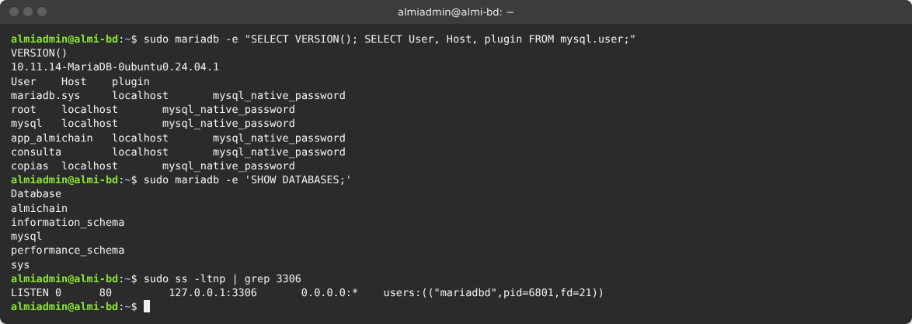

### 4. Esquema, datos y usuarios (B07)

```bash
cd ~/sql
sudo mariadb < 01-esquema.sql
sudo mariadb < 02-datos.sql
sudo mariadb -e "SET @p_app='…'; SET @p_consulta='…'; SET @p_copias='…'; SOURCE 03-usuarios.sql;"
```

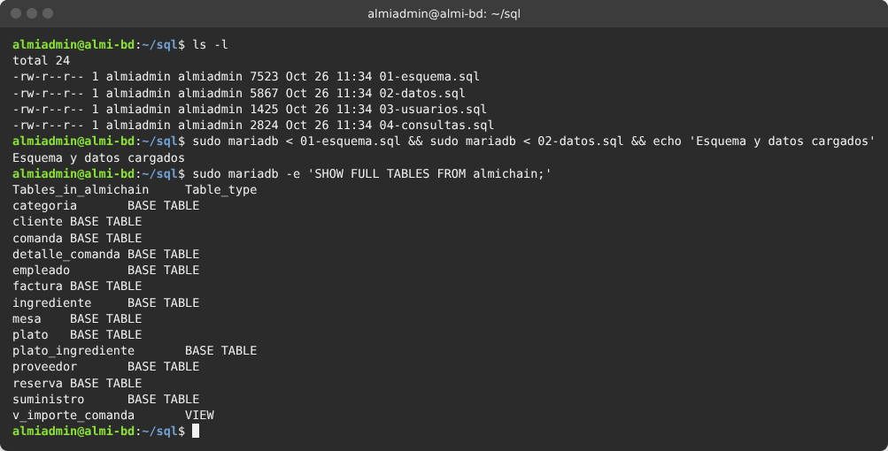

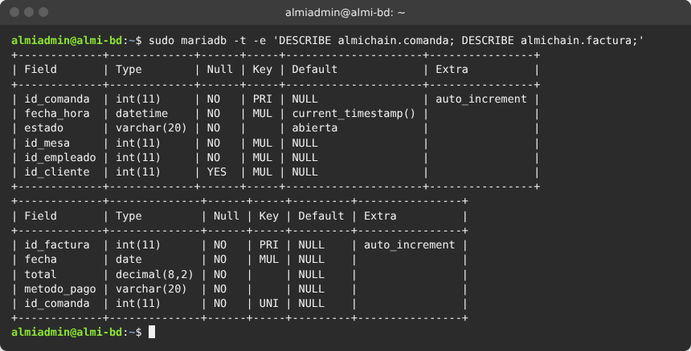

| Usuario | Permisos | Para qué |
|---|---|---|
| `app_almichain` | SELECT, INSERT, UPDATE, DELETE en `almichain.*` | La aplicación: trabaja con los datos, no puede cambiar la estructura |
| `consulta` | SELECT, SHOW VIEW en `almichain.*` | Informes de gerencia: solo lectura |
| `copias` | SELECT, SHOW VIEW, TRIGGER, LOCK TABLES, EVENT | Lo mínimo que necesita `mariadb-dump` |

Todos solo desde `localhost`.

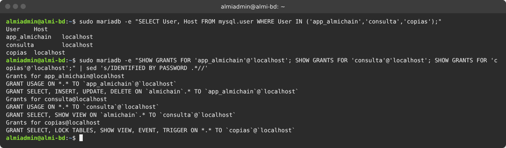

### 5. Consultas (B07)

Las 9 consultas de [`04-consultas.sql`](sql/04-consultas.sql), ejecutadas con el usuario de solo lectura `consulta`:

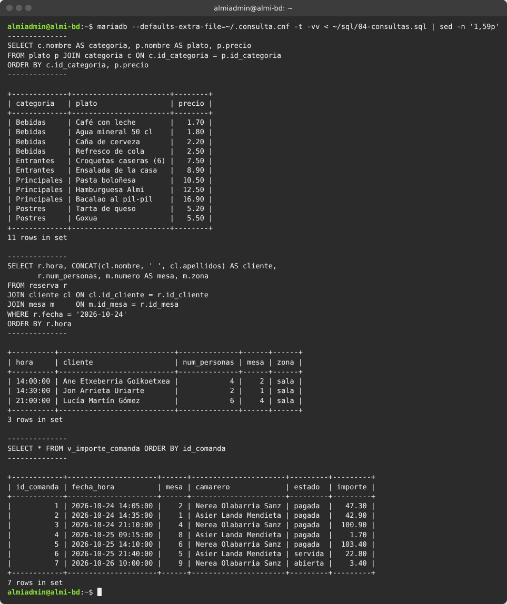

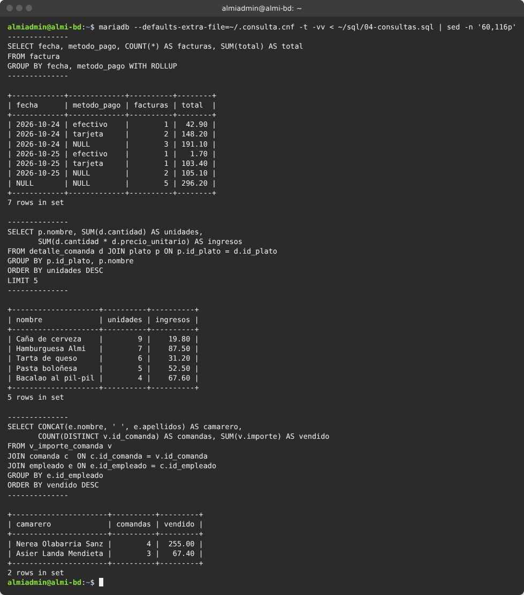

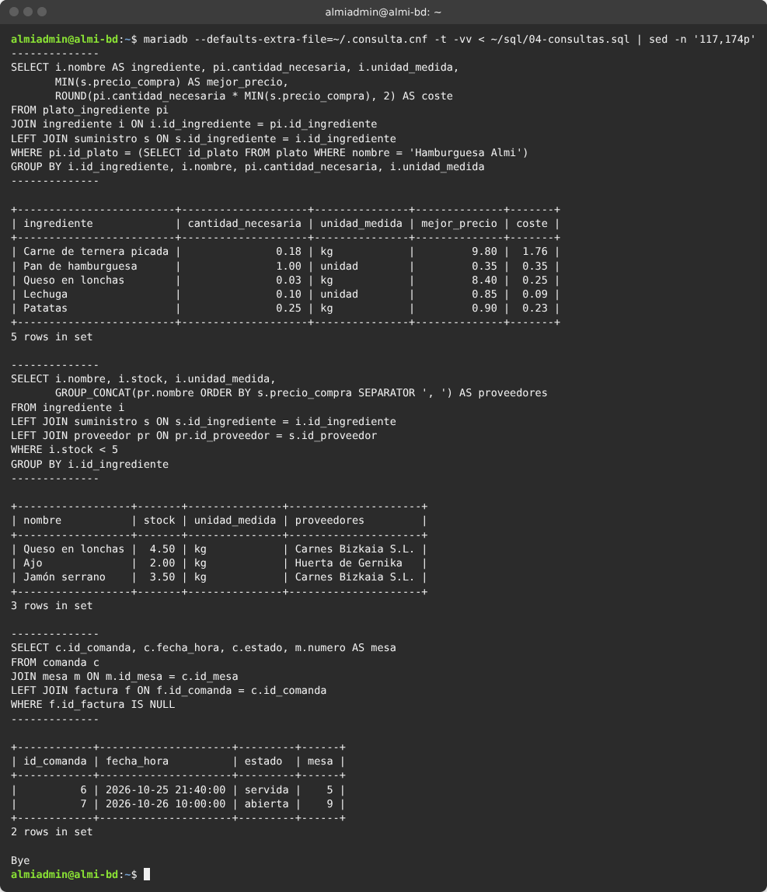

El usuario `consulta` no puede borrar ni modificar:

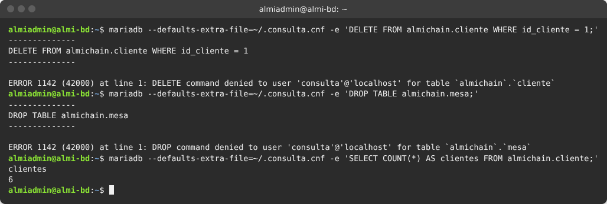

### 6. Plan de copias (B08)

| Qué | Cómo | Cuándo | Retención | Dónde |
|---|---|---|---|---|
| Base `almichain` (MariaDB) | `mariadb-dump --single-transaction` comprimido + huella SHA-256 | Diaria, 02:00 | 7 diarias + 4 semanales (domingo) | ALMI-BD `/var/backups/mariadb` y **copia en ALMI-ODOO** |
| Base y adjuntos de Odoo | `pg_dump -Fc` + `tar` del filestore + huellas | Diaria, 02:30 | 7 días | ALMI-ODOO `/var/backups/odoo` y **copia en ALMI-BD** |
| Configuración y scripts | Repositorio Git | En cada cambio | Historial completo | GitHub |

**Regla 3-2-1**: 3 copias (datos en el RAID + copia local + copia en el otro servidor), en 2 soportes distintos (dos máquinas) y 1 fuera del local (el repositorio para la configuración; para los datos, se recomienda al restaurante un disco externo semanal o un almacenamiento en la nube cifrado).

### 7. Copias cruzadas automáticas (B09) {#copias-cruzadas}

En **los dos** servidores:

- Usuario `copias` sin contraseña (`passwd -l`) que solo recibe archivos en `/srv/copias-remotas/` (permisos 700).
- Clave SSH `/root/.ssh/copias_ed25519` para enviar. En el `authorized_keys` del otro servidor la clave va limitada a la IP de origen y sin terminal: `from="192.168.10.20",restrict ssh-ed25519 …`.
- Contraseña del usuario `copias` de MariaDB en `/root/.my.cnf` (permisos 600).

Script [`scripts/copia-bd.sh`](scripts/copia-bd.sh) en `/usr/local/bin/`, en el cron de root a las 02:00:

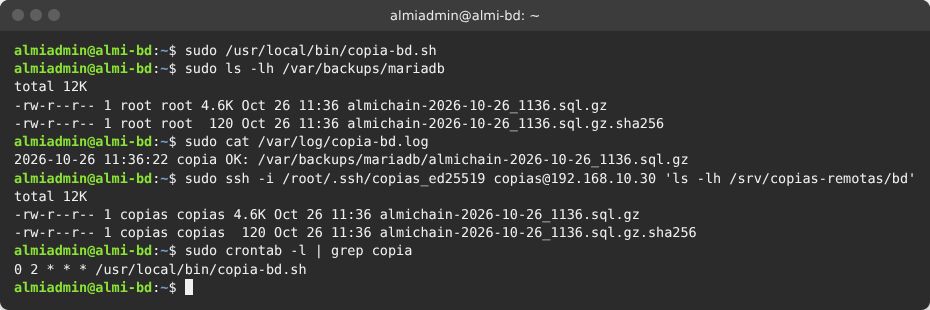

## Pruebas de restauración (B10)

Se simula un desastre: se borra la base de datos entera y se recupera de la copia.

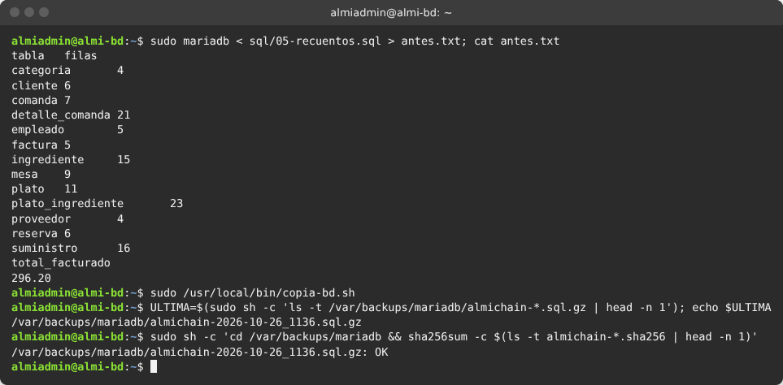

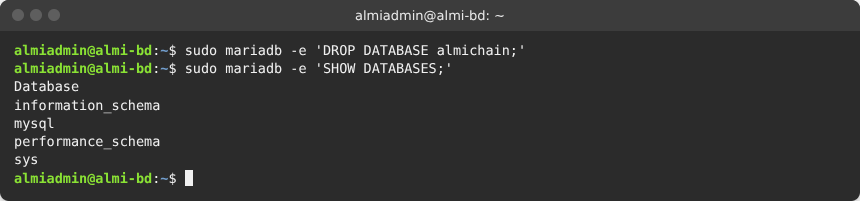

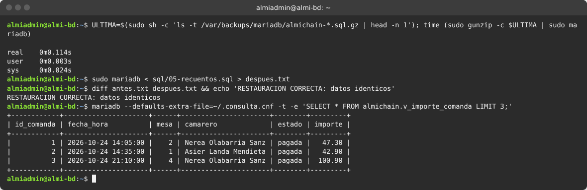

**Tiempo de recuperación (RTO)**: menos de 1 segundo con esta cantidad de datos. **Pérdida máxima de datos (RPO)**: 24 horas (copia diaria).

## Prueba de fallo de disco (B11)

Hecha en la VM ALMI-BD con sus dos discos de 10 GB.

**RAID creado** (el servicio `almi-crear-raid` lo crea en el primer arranque): los dos discos forman `md0`, montado en `/var/lib/mysql` por UUID y guardado en `mdadm.conf`.

![RAID 1 con sdb y sdc en [UU], montado en /var/lib/mysql](capturas/13-raid-creado.png)

**Prueba A, un disco se rompe con el servidor en marcha.** Se marca `sdc` como roto: el RAID pasa a `[U_]` (*clean, degraded*) y la base de datos **sigue funcionando y se puede escribir** (se inserta un cliente "Prueba RAID").

```bash
sudo mdadm /dev/md0 --fail /dev/sdc
cat /proc/mdstat
sudo mariadb -e "INSERT INTO almichain.cliente (nombre, apellidos, telefono) VALUES ('Prueba', 'RAID', '699999999');"
```

![Disco sdc marcado como roto: [U_] y MariaDB sigue escribiendo](capturas/14-raid-fallo-disco.png)

**Cambio del disco y reconstrucción**: se quita del RAID y se vuelve a añadir (en un servidor real sería el disco nuevo); mdadm copia los datos del disco bueno al nuevo.

```bash
sudo mdadm /dev/md0 --remove /dev/sdc
sudo mdadm /dev/md0 --add /dev/sdc
watch cat /proc/mdstat
```

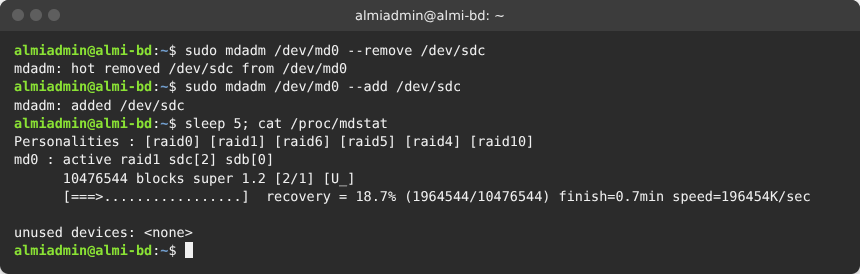

![Reconstrucción terminada: [UU], 0 discos fallidos y el dato escrito con un solo disco sigue ahí](capturas/16-raid-reconstruido.png)

**Después de reiniciar** el RAID se monta solo, MariaDB arranca y el servicio de creación no se vuelve a ejecutar:

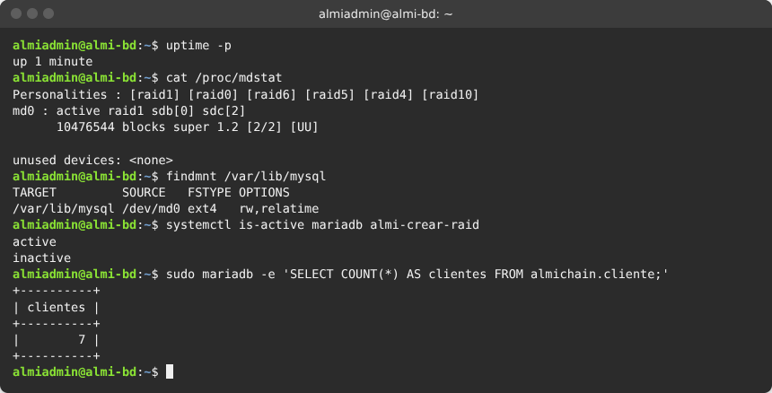

**Prueba B, quitar el disco de verdad** (en VirtualBox): VM apagada → **Configuración → Almacenamiento** → quitar `ALMI-BD-raid2` → arrancar → `cat /proc/mdstat` muestra un solo disco y MariaDB responde → apagar, añadir un disco nuevo de 10 GB, arrancar y `sudo mdadm /dev/md0 --add /dev/sdc` → reconstrucción hasta `[UU]`.

## Seguridad aplicada

- MariaDB solo escucha en 127.0.0.1; root solo por socket local; sin usuarios anónimos ni base `test`.
- Tres usuarios con el mínimo privilegio necesario; ninguno con permisos globales de escritura.
- Contraseñas fuera del repositorio (variables al cargar `03-usuarios.sql`, `/root/.my.cnf` con permisos 600).
- Copias con permisos 700, huella SHA-256 y enviadas con una clave SSH que solo sirve desde la IP del otro servidor y sin terminal.
- Cortafuegos ufw: solo SSH (22) desde 192.168.0.0/16.
- RAID 1: si falla un disco, la base de datos sigue funcionando.

## Pruebas

| Nº | Qué se prueba | Cómo | Resultado esperado | Resultado obtenido | Captura |
|---|---|---|---|---|---|
| 1 | MariaDB segura | `SELECT User, Host FROM mysql.user` | Sin anónimos ni root remoto | Solo root, mysql y mariadb.sys en localhost | [01](capturas/01-mariadb-segura.png) |
| 2 | Solo escucha en local | `ss -ltnp \| grep 3306` | 127.0.0.1:3306 | 127.0.0.1:3306 | [01](capturas/01-mariadb-segura.png) |
| 3 | Esquema completo | `SHOW FULL TABLES` | 13 tablas y 1 vista | 13 BASE TABLE y 1 VIEW | [02](capturas/02-esquema-cargado.png) |
| 4 | Mínimo privilegio | `SHOW GRANTS` de los 3 usuarios | Como en la tabla de usuarios | Correcto | [04](capturas/04-usuarios-privilegios.png) |
| 5 | Consultas | `04-consultas.sql` como `consulta` | 9 resultados correctos | 9 resultados | [05](capturas/05-consultas-1-a-3.png) [06](capturas/06-consultas-4-a-6.png) [07](capturas/07-consultas-7-a-9.png) |
| 6 | Solo lectura | `DELETE` y `DROP` como `consulta` | ERROR 1142 | ERROR 1142 en los dos | [08](capturas/08-consulta-no-puede-borrar.png) |
| 7 | Copia automática | `copia-bd.sh` y `crontab -l` | Copia local, huella, copia en ALMI-ODOO y cron a las 02:00 | Correcto | [09](capturas/09-copia-automatica.png) |
| 8 | Restauración | Borrar la base y restaurar | `diff` sin diferencias | "RESTAURACION CORRECTA: datos identicos" | [10](capturas/10-restauracion-1-antes.png) [11](capturas/11-restauracion-2-borrado.png) [12](capturas/12-restauracion-3-recuperada.png) |
| 9 | Fallo de un disco del RAID | `mdadm --fail` y escribir en la base | `[U_]` y la base sigue funcionando | `[U_]` *clean, degraded*; INSERT correcto | [14](capturas/14-raid-fallo-disco.png) |
| 10 | Reconstrucción | `mdadm --add` | Vuelve a `[UU]` | `[UU]`, 0 fallidos, el dato sigue | [15](capturas/15-raid-reconstruccion.png) [16](capturas/16-raid-reconstruido.png) |
| 11 | RAID tras reiniciar | `sudo reboot` | md0 montado y MariaDB activa | Correcto | [17](capturas/17-raid-tras-reiniciar.png) |

## Problemas encontrados y solución

| Problema | Causa | Solución |
|---|---|---|
| El diagrama del equipo y la guía tenían modelos distintos | La guía proponía 15 tablas; el equipo diseñó el suyo | Se implementa el modelo del equipo (13 tablas) |
| Los datos de MariaDB tienen que estar en el RAID desde el principio | Si se instala MariaDB antes del RAID, los datos quedan en el disco de sistema | Se copian con `rsync -aAX` con el servicio parado y se monta el RAID en `/var/lib/mysql` |
| El servicio que crea el RAID en el primer arranque se quedaba "activating" para siempre | Hacía `systemctl start mariadb` desde un servicio que está ordenado *antes* de mariadb: cada uno esperaba al otro | `systemctl start --no-block mariadb` |
| `mariadb-dump` necesita contraseña en cron | cron no puede escribirla | `/root/.my.cnf` con permisos 600 y el usuario `copias` de solo lectura |

## Fuentes

- Documentación de MariaDB: mariadb-dump, CREATE USER y GRANT — https://mariadb.com/kb/
- `man mdadm` y wiki de RAID de Linux — https://raid.wiki.kernel.org/
- Guías paso a paso del equipo, parte 8
