# 8. Copias de seguridad de los sistemas operativos (ALMI-GERENTE)

## Objetivo

Un servidor Ubuntu dedicado a copias recoge por SSH los datos de los dos sistemas operativos del equipo del gerente (**Windows 10** y **Debian 13**, en arranque dual) y los guarda en un **RAID 1**. Después replica todas las copias a un **servidor remoto en AWS** creado con **Terraform**. Todo se ejecuta solo cada semana y se ha comprobado que los archivos se pueden restaurar.

Apartado de la rúbrica: **2. SO: copias de seguridad**. Las copias de la base de datos y de Odoo son otra cosa y están en el [bloque 07](../07-bd-raid-copias/README.md).

## Cumplimiento de la rúbrica

| Punto de la rúbrica | Cómo se cumple | Dónde | Estado |
|---|---|---|---|
| Plan de copias adecuado | Qué, cómo, cuándo, retención y dónde, con la regla 3-2-1 | [Plan de copias](#plan-de-copias) | ✅ |
| Copias en un disco redundante | RAID 1 por software (`mdadm`) con dos discos de 25 GB, montado en `/backups` y probado con fallo de disco | [Disco redundante](#disco-redundante-raid-1) | ✅ Probado |
| Copias en local y en remoto, con el plan documentado | Local: RAID 1 del servidor de copias. Remoto: EC2 en AWS con rsync por SSH | [Copia local](#copia-local) y [copia remota](#copia-remota-en-aws) | ✅ Probado |
| Copias automatizadas | Script + cron semanal, con log | [Automatización](#automatización) | ✅ Probado |
| Prueba de restauración documentada | Archivo borrado y recuperado, comprobado con SHA-256 | [Pruebas de restauración](#pruebas-de-restauración) | ✅ Desde AWS · ⏳ Debian y Windows (falta la captura) |

## Arquitectura

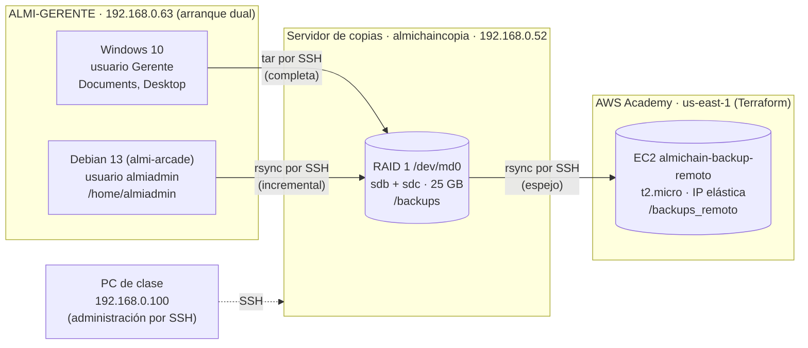

| Máquina | Sistema | IP | Papel |
|---|---|---|---|
| PC de clase | Zorin OS | 192.168.0.100 | Administración por SSH y Terraform |
| Servidor de copias (`almichaincopia`, VM `copia_seguridad_gerente`) | Ubuntu Server | 192.168.0.52 | Recoge las copias, las guarda en el RAID 1 y las replica |
| ALMI-GERENTE | Windows 10 + Debian 13 en arranque dual | 192.168.0.63 | Origen de los datos. Solo hay un sistema encendido a la vez |
| `almichain-backup-remoto` | Ubuntu Server 24.04 en EC2 | IP elástica | Copia fuera del local |

Las VM de este bloque van en **adaptador puente** (red del aula 192.168.0.0/24), no en la Red NAT ALMICHAIN del resto del reto: ver [Pendiente](#pendiente).

## Plan de copias

| | Windows 10 | Debian 13 |
|---|---|---|
| **Qué se copia** | `C:\Users\Gerente\Documents` y `Desktop` | `/home/almiadmin` |
| **Qué se excluye** | Los accesos de compatibilidad `Mi música`, `Mis imágenes` y `Mis vídeos` (no son carpetas reales) | — |
| **Tipo de copia** | Completa (`tar` por SSH; Windows no trae rsync) | Incremental con `rsync --link-dest`: cada carpeta parece completa, pero los archivos sin cambios son enlaces duros a la copia anterior y no ocupan espacio otra vez |
| **Frecuencia** | Semanal, viernes a las 12:00 | Semanal, viernes a las 12:00 |
| **Retención** | Últimas 4 copias (un mes) | Últimas 4 copias (un mes) |
| **Destino local** | `/backups/gerente/win10/AAAA-MM-DD_HHMM/` (RAID 1) | `/backups/gerente/debian13/AAAA-MM-DD_HHMM/` (RAID 1) |
| **Destino remoto** | `/backups_remoto/gerente/` en AWS (espejo de todo `/backups/gerente`) | Igual |

```
/backups/
├── backup.log
└── gerente/
    ├── win10/
    │   ├── 2026-11-04_1031/
    │   └── 2026-11-04_1138/
    └── debian13/
        ├── 2026-11-04_1205/
        └── 2026-11-04_1206/
```

**Regla 3-2-1:**
- **3 copias:** el original en ALMI-GERENTE, la del RAID 1 y la de AWS.
- **2 soportes distintos:** el disco del Gerente y el RAID 1 del servidor de copias (más el disco EBS de AWS).
- **1 copia fuera del local:** AWS.

**Arranque dual:** como solo hay un sistema encendido cada vez, el script prueba primero Windows y, si no responde, Debian. Cada ejecución copia el sistema que esté arrancado. Si el Gerente está apagado, lo anota en el log y aun así replica a AWS lo que ya hay.

**Hora:** las 12:00 del viernes es horario de clase, cuando las VM están encendidas. A las 3:00 de la madrugada estarían apagadas.

## Disco redundante (RAID 1)

En VirtualBox se añadieron al servidor de copias dos discos VDI de 25 GB (`sdb` y `sdc`) en el controlador SATA:

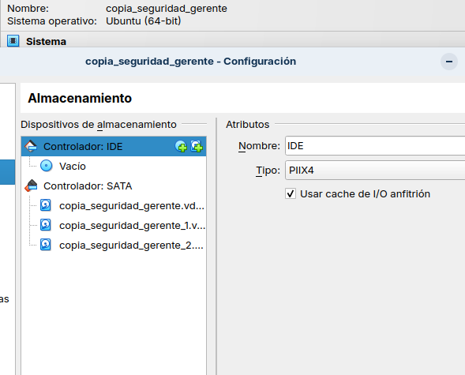

```bash
lsblk                                   # sdb y sdc de 25G, vacíos
sudo blkid /dev/sdb                     # sin salida = sin datos
sudo apt install mdadm
sudo mdadm --create /dev/md0 --level=1 --raid-devices=2 /dev/sdb /dev/sdc
cat /proc/mdstat                        # resync hasta [UU]
sudo mkfs.ext4 /dev/md0
sudo mkdir /backups && sudo mount /dev/md0 /backups
sudo chown -R copia:copia /backups
```

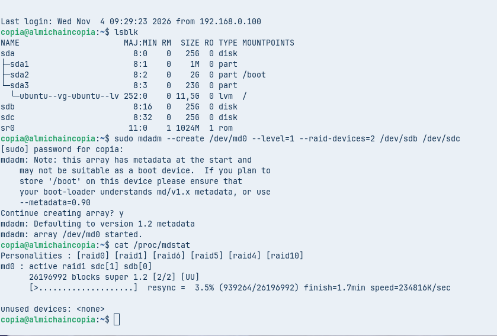

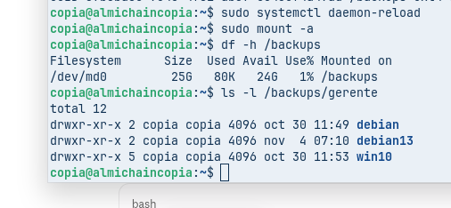

**Montaje permanente:** se guarda el array en `mdadm.conf`, se regenera el initramfs y se monta por UUID con `nofail`, para que el servidor arranque aunque falte el RAID.

```bash
sudo mdadm --detail --scan | sudo tee -a /etc/mdadm/mdadm.conf
sudo update-initramfs -u
echo "UUID=$(sudo blkid -s UUID -o value /dev/md0) /backups ext4 defaults,nofail 0 2" | sudo tee -a /etc/fstab
sudo systemctl daemon-reload && sudo mount -a
```

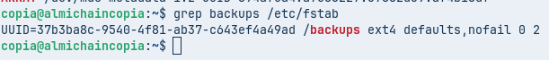

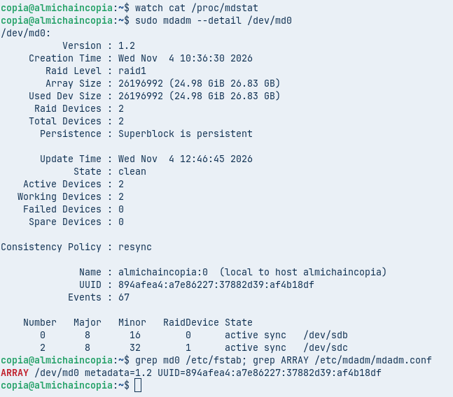

### Prueba de fallo de disco

Se marca `sdc` como fallido: el RAID sigue funcionando con un disco (`[U_]`) y los datos siguen accesibles. Después se quita, se vuelve a añadir como si fuera un disco nuevo y se reconstruye solo.

```bash
sudo mdadm /dev/md0 --fail /dev/sdc
cat /proc/mdstat                        # sdc[2](F) · [2/1] [U_]
ls /backups/gerente                     # los datos siguen ahí
sudo mdadm /dev/md0 --remove /dev/sdc
sudo mdadm /dev/md0 --add /dev/sdc      # reconstrucción (recovery)
```

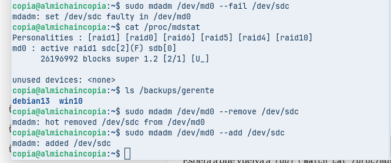

![RAID reconstruido, de nuevo [UU]](capturas/07-raid-reconstruido.png)

Tras reiniciar el servidor, el RAID arranca solo en `[UU]` y está montado en `/backups`:

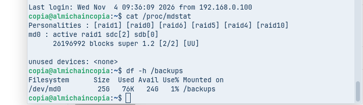

## Acceso SSH sin contraseña

Las copias se hacen con el usuario sin privilegios **`copia`** del servidor de copias y con una **clave ed25519 distinta para cada destino**. Ninguna contraseña aparece en el script.

```bash
ssh-keygen -t ed25519 -f ~/.ssh/id_ed25519_windows -N ""
ssh-keygen -t ed25519 -f ~/.ssh/id_ed25519_debian  -N ""
ssh-keygen -t ed25519 -f ~/.ssh/id_ed25519_remoto  -N ""
```

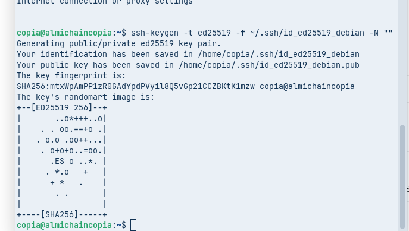

**Windows 10.** El servidor OpenSSH de Windows ya estaba activo en el puerto 22 (Windows bloquea el ping, por eso hace falta `nmap -Pn`):

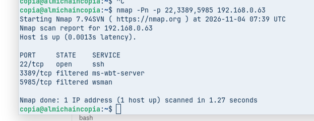

`ssh-copy-id` no funciona con Windows, así que la clave se instala a mano. El usuario `Gerente` **no es administrador** (`whoami /groups | findstr S-1-5-32-544` no devuelve nada), por lo que la clave va en su perfil y no en `C:\ProgramData\ssh\administrators_authorized_keys`:

```bash
scp ~/.ssh/id_ed25519_windows.pub win10:clave.pub     # pide la contraseña una vez
ssh win10
powershell
mkdir $HOME\.ssh -Force
Get-Content $HOME\clave.pub | Add-Content $HOME\.ssh\authorized_keys
Remove-Item $HOME\clave.pub
```

**Debian 13:**

```bash
ssh-copy-id -i ~/.ssh/id_ed25519_debian.pub debian13
```

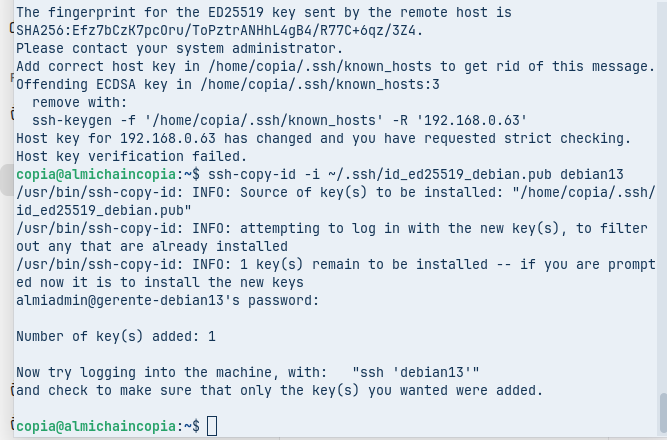

**Configuración de SSH** ([`config/ssh_config.example`](config/ssh_config.example)). Windows y Debian son la misma máquina con la misma IP, así que cada sistema presenta una huella de servidor distinta en la misma dirección. Con **`HostKeyAlias`** cada huella se guarda con su propio nombre (`gerente-win10` y `gerente-debian13`). Las claves privadas tienen permisos 600.

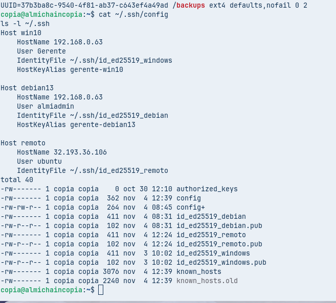

Esto además protege el script: si está arrancado Debian y se conecta a `win10`, SSH detecta que la huella no es la de Windows y **se niega a conectar**, en lugar de copiar el sistema equivocado.

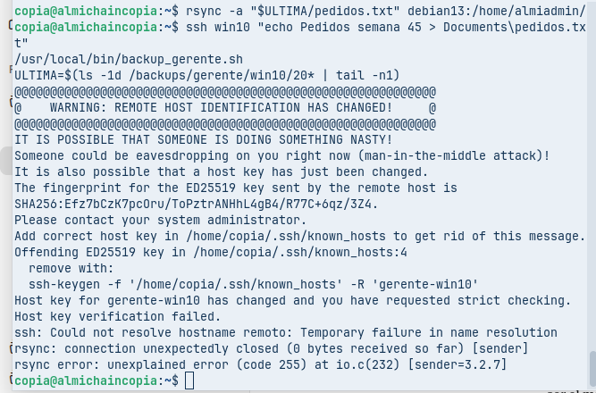

> No hay que borrar la huella con `ssh-keygen -R` cuando sale este aviso: si se hiciera, la siguiente conexión guardaría la huella de Debian como si fuera la de Windows.

## Copia local

El script [`scripts/backup_gerente.sh`](scripts/backup_gerente.sh) se instala en `/usr/local/bin/backup_gerente.sh` (con `chmod +x`). Hace tres cosas:

1. **Detecta qué sistema está encendido** y lo copia: Windows con `tar` por SSH (completa) o Debian con `rsync --link-dest` (incremental). `BatchMode=yes` hace que, si algo pidiera contraseña, falle en vez de quedarse esperando, y `ConnectTimeout=5` evita que se cuelgue con el sistema apagado.
2. **Retención:** borra las copias más antiguas y deja las 4 últimas de ese sistema.
3. **Réplica remota:** sincroniza todo `/backups/gerente` con AWS.

Cada paso deja una línea `OK`, `ERROR` o `AVISO` en `/backups/backup.log`.

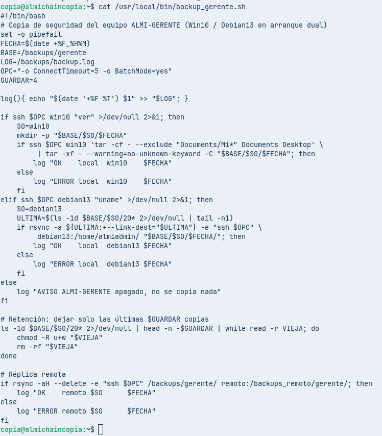

**Windows:** copia correcta, con `Desktop` y `Documents` y sin los accesos de compatibilidad.

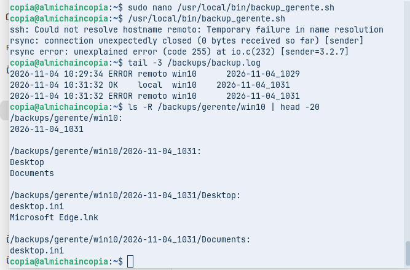

**Debian:**

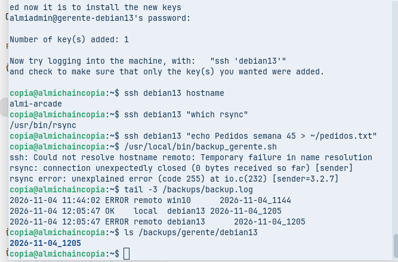

**Incremental:** la primera copia de Debian ocupa 32 KB y la segunda solo 8 KB (carpetas y metadatos), porque los archivos sin cambios son enlaces duros a la anterior.

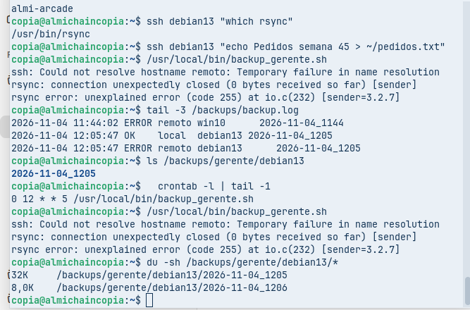

**Retención:** en `win10` solo quedan las 4 copias más recientes (11:38, 11:40, 11:42 y 11:44). La primera, la de las 10:31, la borró el script automáticamente al hacerse la quinta.

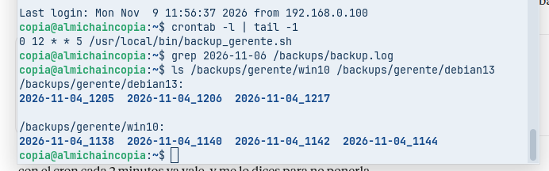

### Problemas encontrados y cómo se resolvieron

| Problema | Causa | Solución |
|---|---|---|
| `nmap` dice que ALMI-GERENTE está apagado | Windows bloquea el ping y nmap no escanea si no le contesta | `nmap -Pn` |
| La clave no llegaba a `C:\Users\Public` | La ruta con `C:/` en `scp` no se interpretaba bien | Enviarla a la carpeta del usuario: `scp ... win10:clave.pub` |
| `ssh-copy-id` a Debian pedía la contraseña de `Gerente` | El alias `debian13` tenía puesto el usuario de Windows | `User almiadmin` en el bloque de Debian |
| Aviso *REMOTE HOST IDENTIFICATION HAS CHANGED* | Misma IP, dos sistemas con huellas distintas | `HostKeyAlias` por sistema |
| `scp` falla con `Mi música`, `Mis imágenes` y `Mis vídeos` y la copia de Windows sale como `ERROR` | Son accesos de compatibilidad que deniegan la lectura, y `scp` no permite excluir rutas | Cambiar `scp` por `tar` por SSH con `--exclude "Documents/Mi*"` |
| Avisos `Ignoring unknown extended header keyword 'SCHILY.fflags'` | El `tar` de Windows añade metadatos que el de Linux no conoce | `--warning=no-unknown-keyword` |
| `integer expression expected` en el script | `PIPESTATUS` se sobrescribe con el primer `[ ]` | `set -o pipefail` y comprobar la tubería entera en el `if` |
| `rm: Permission denied` al borrar copias viejas | Las carpetas de Windows llegan de solo lectura | `chmod -R u+w` antes de borrar (también en la retención) |
| Cron una hora desfasado | El servidor estaba en UTC | `timedatectl set-timezone Europe/Madrid` y reiniciar cron |
| Con el Gerente apagado no se replicaba nada a AWS | El script salía con `exit 0` antes de la réplica | Quitar el `exit 0`: se anota `AVISO` y se sigue |

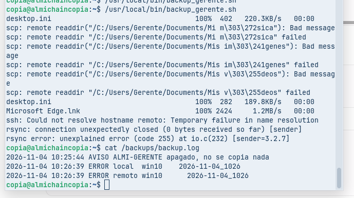

## Copia remota en AWS

El servidor remoto se crea con **Terraform** ([`terraform/`](terraform/)), en la misma cuenta de AWS Academy que la web. Crea 4 recursos:

| Recurso | Para qué |
|---|---|
| `aws_key_pair` | Importa la clave pública `id_ed25519_remoto.pub` del usuario `copia` (no hace falta ningún `.pem`) |
| `aws_security_group` | Solo SSH (22) y solo desde la IP pública del aula, que detecta sola con `checkip.amazonaws.com` |
| `aws_instance` | Ubuntu 24.04, `t2.micro`, disco de 10 GB. Al arrancar instala `rsync` y crea `/backups_remoto` |
| `aws_eip` | IP elástica: no cambia aunque el lab apague y encienda la instancia |

```bash
# En el PC de clase, con las credenciales del Learner Lab en ~/.aws/credentials
cd 08-copias-so/terraform
cp terraform.tfvars.example terraform.tfvars
# Clave pública traída directamente del servidor de copias:
sed -i "s|^clave_publica.*|clave_publica = \"$(ssh copia@192.168.0.52 cat .ssh/id_ed25519_remoto.pub)\"|" terraform.tfvars
terraform init
terraform plan      # Plan: 4 to add
terraform apply
# Añadir el alias "remoto" al ~/.ssh/config del servidor de copias:
terraform output -raw ssh_config | ssh copia@192.168.0.52 "cat >> ~/.ssh/config"
```

`terraform.tfvars` no se sube al repositorio (está en el `.gitignore`).

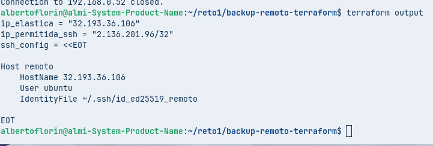

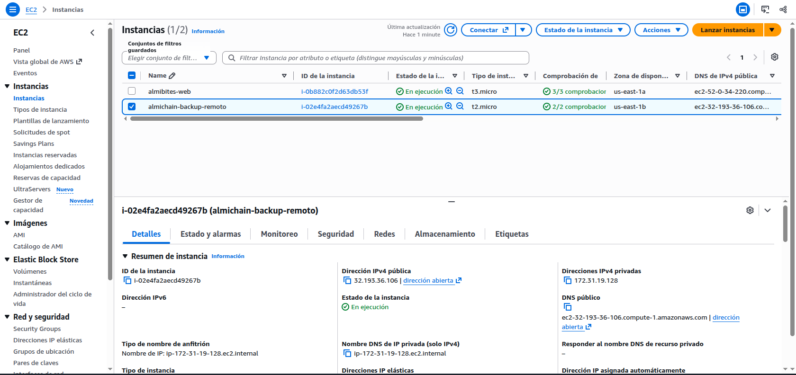

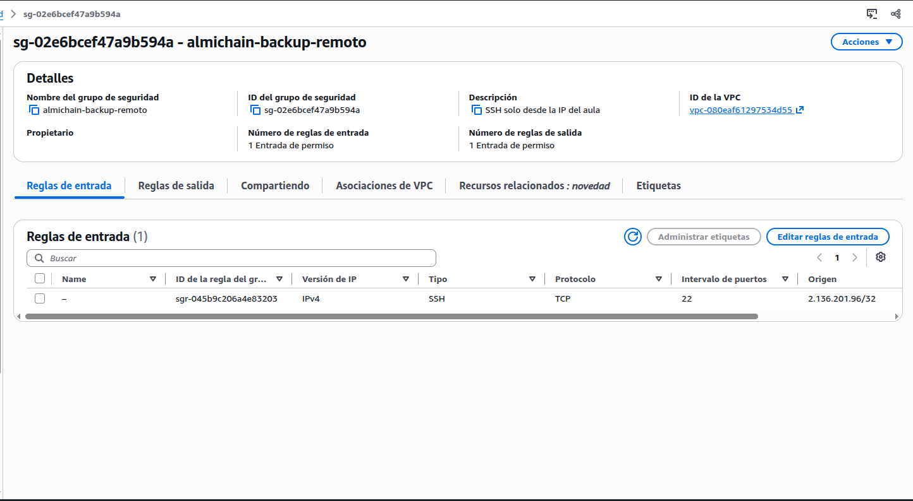

El script replica con `rsync -aH --delete`: `-H` conserva los enlaces duros de las copias incrementales (si no, en AWS ocuparían como copias completas) y `--delete` hace que el remoto sea un espejo, así que la retención también se aplica allí.

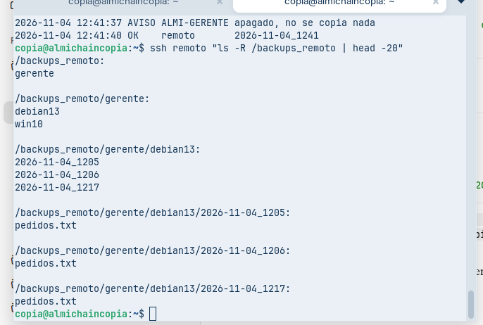

## Automatización

```bash
sudo timedatectl set-timezone Europe/Madrid
sudo systemctl restart cron
crontab -e        # como usuario copia, no root: las claves están en su home
```

```
0 12 * * 5 /usr/local/bin/backup_gerente.sh
```

([`config/crontab.txt`](config/crontab.txt)). Para comprobarlo sin esperar al viernes, se puso un rato `*/2 * * * *`: el log muestra ejecuciones a las 11:38, 11:40, 11:42 y 11:44 que **lanzó cron solo**. Después se volvió a dejar la línea semanal.

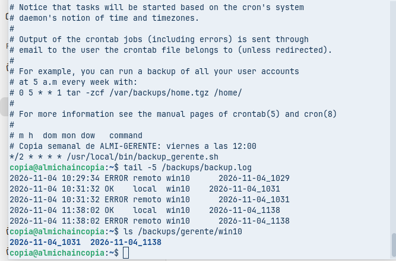

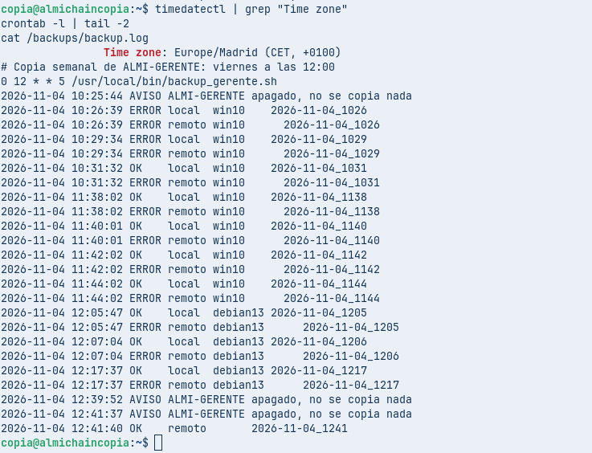

El log cuenta toda la historia: los `ERROR local win10` del primer script, la primera copia buena (10:31), las ejecuciones de cron, las copias de Debian y la primera réplica `OK remoto` (12:41).

## Pruebas de restauración

### Desde la copia remota (AWS)

Simula que se ha perdido el servidor de copias entero: el archivo se trae desde AWS y se compara su huella con la de la copia local.

```bash
scp remoto:/backups_remoto/gerente/debian13/2026-11-04_1217/pedidos.txt /tmp/
cat /tmp/pedidos.txt
sha256sum /tmp/pedidos.txt /backups/gerente/debian13/2026-11-04_1217/pedidos.txt
```

Las dos huellas SHA-256 son **idénticas** (`a8dbc8c1…a1ef8`):

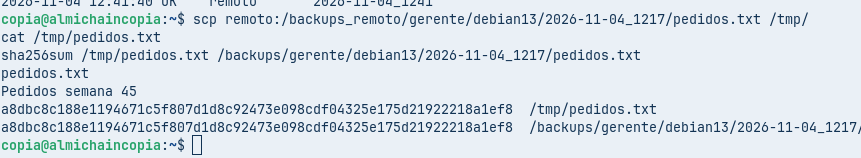

### En Debian (pendiente de captura)

Se hizo el 4 de noviembre, pero falta la captura. Se repite con el Gerente arrancado en Debian:

```bash
ssh debian13 "cat ~/pedidos.txt"
ssh debian13 "rm ~/pedidos.txt"; ssh debian13 "ls ~/pedidos.txt"   # No such file
ULTIMA=$(ls -1d /backups/gerente/debian13/20* | tail -n1)
rsync -a "$ULTIMA/pedidos.txt" debian13:/home/almiadmin/
ssh debian13 "sha256sum ~/pedidos.txt"; sha256sum "$ULTIMA/pedidos.txt"
```

<!-- 📸 capturas/26-restauracion-debian.png -->

### En Windows (pendiente)

```bash
ssh win10 "echo Pedidos semana 45 > Documents\pedidos.txt"
/usr/local/bin/backup_gerente.sh
ULTIMA=$(ls -1d /backups/gerente/win10/20* | tail -n1)
ssh win10 "del Documents\pedidos.txt"; ssh win10 "dir Documents"
scp "$ULTIMA/Documents/pedidos.txt" win10:Documents/pedidos.txt
sha256sum "$ULTIMA/Documents/pedidos.txt"
ssh win10 "certutil -hashfile Documents\pedidos.txt SHA256"   # mismo valor, en mayúsculas
```

<!-- 📸 capturas/27-restauracion-windows.png -->

## Seguridad aplicada

- **Mínimo privilegio:** las copias las hace el usuario `copia`, sin `sudo`. En Windows se entra con `Gerente`, que es usuario estándar.
- **Sin contraseñas:** autenticación por claves ed25519, una por destino, con la privada en 600. `BatchMode=yes` impide que el script se quede pidiendo contraseña.
- **Sin confusión de sistemas:** `HostKeyAlias` comprueba la huella de cada sistema.
- **AWS:** SSH solo desde la IP del aula (`/32`), sin contraseña, solo con la clave importada. Ningún secreto en el repositorio: las credenciales del lab están solo en `~/.aws/credentials` del PC y `terraform.tfvars` está en el `.gitignore`.
- **Disponibilidad:** RAID 1 (tolera la pérdida de un disco) y copia fuera del local (tolera la pérdida del servidor entero).

## Limitaciones y mejoras

| Limitación | Consecuencia | Mejora |
|---|---|---|
| Arranque dual | Cada ejecución solo copia el sistema encendido | Lanzar el cron a diario: el log dice qué se copió cada día |
| El Learner Lab apaga la EC2 al acabar la sesión (~4 h) | Si el viernes a las 12:00 el lab está apagado, el log anota `ERROR remoto` | La réplica es un espejo: la siguiente ejecución con el lab encendido se pone al día. En producción, una cuenta de AWS normal |
| Windows sin rsync | Copias completas, no incrementales | Instalar rsync (cwRsync o WSL) o usar Restic |
| Copias sin cifrar | En AWS los datos quedan en claro en el disco EBS | `encrypted = true` en el `root_block_device` de Terraform, o cifrar con Restic/GPG |
| Sin avisos | Un error solo se ve mirando el log | Correo o notificación cuando el log tenga `ERROR`, y `mdadm --monitor` para el RAID |
| El RAID 1 no es una copia | Un borrado se replica al instante en los dos discos | Por eso existen las copias con fecha y la de AWS |

## Pendiente

- [ ] Captura de la restauración en Debian (`capturas/26-restauracion-debian.png`).
- [ ] Restauración en Windows (`capturas/27-restauracion-windows.png`), opcional.
- [ ] Red: aquí ALMI-GERENTE y el servidor de copias van en **adaptador puente** (192.168.0.0/24). El paso del resto de VM del reto a adaptador puente está pendiente (ver [00-gestion](../00-gestion/README.md)).
