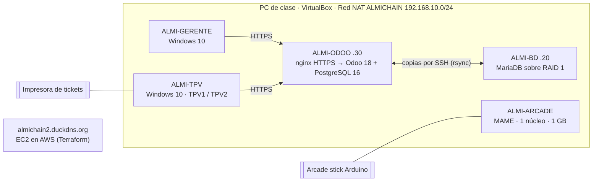

# Almi-Chain · Reto 1 · ASIR 1

Proyecto del **Reto 1 de 1.º de ASIR en Almi**: la infraestructura informática de **Almi Bites**, el restaurante de la cadena ficticia **Almi-Chain**. Equipo: **Alberto, Oier, Julen, Gontzal y Richar** · 16 de octubre – 13 de noviembre de 2026.

Todo se hace en máquinas virtuales de VirtualBox sobre los PC de clase (Zorin OS). Lo único físico son los 2 routers, la impresora de tickets y el arcade stick con Arduino. La web está en AWS Academy.

## Qué hay en cada carpeta

| Carpeta | Bloque | Qué contiene |
|---|---|---|
| [`00-gestion`](00-gestion/) | Gestión del proyecto | Tablero de tareas, guías paso a paso, anexos |
| [`01-windows-gerente-tpv`](01-windows-gerente-tpv/) | Equipo del gerente y TPV | Scripts de PowerShell: usuarios, seguridad, quiosco, certificado de Odoo |
| [`02-linux-recreativa`](02-linux-recreativa/) | Recreativa con MAME | Configuración de arranque directo a MAME, optimización a 1 núcleo y 1 GB sin swap, benchmark |
| [`03-arcade-stick`](03-arcade-stick/) | Arcade stick con Arduino | Cableado y programas del mando (mando USB o teclado USB) |
| [`04-red`](04-red/) | Red | Plan de direccionamiento, configuración de Packet Tracer y de los routers con WDS |
| [`05-erp-odoo`](05-erp-odoo/) | ERP Odoo + TPV | Docker, HTTPS, configuración de Odoo, los 2 TPV, factura automática, copias |
| [`06-web-aws`](06-web-aws/) | Web en AWS | La web y su despliegue con Terraform, DuckDNS y HTTPS |
| [`07-bd-raid-copias`](07-bd-raid-copias/) | Base de datos | Esquema MariaDB, usuarios, consultas, RAID 1, copias y restauración |
| [`diagramas`](diagramas/) | — | Modelo entidad/relación y diagramas de arquitectura |
| [`docs`](docs/) | — | Documentación final del reto (Word y PDF) |

## Máquinas del reto

| Máquina | Sistema | IP | Para qué |
|---|---|---|---|
| **ALMI-ODOO** | Ubuntu Server 24.04 + Docker | 192.168.10.30 | ERP Odoo 18 y los TPV, por HTTPS |
| **ALMI-BD** | Ubuntu Server 24.04 | 192.168.10.20 | MariaDB con RAID 1 y copias cruzadas con ALMI-ODOO |
| **ALMI-ARCADE** | Ubuntu 24.04 mínimo + MAME | DHCP | Recreativa: 1 núcleo, 1 GB, sin swap |
| **ALMI-GERENTE** | Windows 10 Pro | DHCP | Equipo del despacho (usuario Gerente) |
| **ALMI-TPV** | Windows 10 Pro | DHCP | Los dos TPV de barra (usuarios TPV1 y TPV2) en modo quiosco |
| **almichain-web** | Ubuntu 24.04 en AWS | IP elástica | Web https://almichain2.duckdns.org |

Todas las VM van en la **Red NAT `ALMICHAIN`** de VirtualBox (192.168.10.0/24, puerta de enlace 192.168.10.1). Cómo crearla: [00-gestion](00-gestion/README.md#red-nat-almichain).

## Máquinas virtuales exportadas

Las VM Linux están exportadas en formato **.ova** en la sección **Releases** de este repositorio. Para usarlas: VirtualBox → **Archivo → Importar servicio virtualizado** → elegir la .ova → **Importar**. Después, en **Configuración → Red**, poner el adaptador en **Red NAT → ALMICHAIN**. Las contraseñas no están en el repositorio: están en el gestor de contraseñas del equipo.

## Reglas del repositorio

- Ninguna contraseña, token ni clave privada se sube al repositorio (ver [`.gitignore`](.gitignore)). Todas están en KeePassXC.
- Cada uno trabaja en la carpeta de su bloque. Commits con el formato `Bloque: qué se ha hecho`.
- Las capturas de cada bloque van en su carpeta `capturas/` y se citan en su README.
