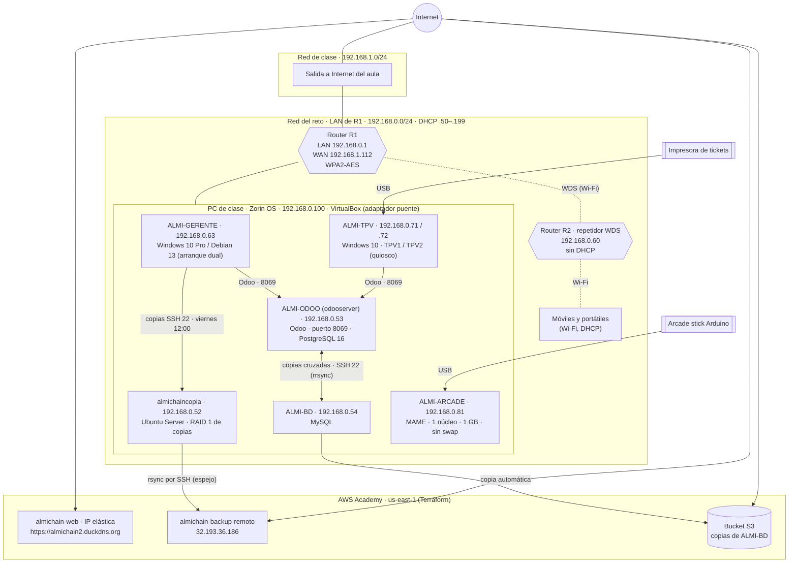

# Almi-Chain · Reto 1 · ASIR 1

Proyecto del **Reto 1 de 1.º de ASIR en Almi**: la infraestructura informática de **Almi Bites**, el restaurante de la cadena ficticia **Almi-Chain**. Equipo: **Alberto, Oier, Julen, Gontzal y Richar** · 16 de octubre – 13 de noviembre de 2026.

Todo se ha montado en máquinas virtuales de VirtualBox en los PC de clase (Zorin OS). Lo único físico son los 2 routers, la impresora de tickets y el arcade stick con Arduino. La web está en AWS Academy.

## Objetivo y alcance

Diseñar, montar, asegurar y probar la informática de un restaurante: puestos Windows para el gerente y los TPV, una recreativa Linux optimizada con un mando hecho con Arduino, la red del local (con Wi-Fi segura y un repetidor WDS), un ERP con TPV que factura solo, una web pública desplegada con Terraform y una base de datos propia con disco redundante y copias. Todo con **mínimo privilegio** y **seguridad por defecto**, documentado y con pruebas.

**Fuera del alcance**: comprar el material del presupuesto, la conexión real del local y los datos reales del restaurante (todos los datos son de ejemplo y ficticios).

## Rúbrica: dónde se cumple cada tarea

Tareas del **Anexo VI (rúbrica de competencias técnicas)**, en su orden, con la carpeta donde se cumplen y lo que falta para la nota máxima.

| # | Módulo | Tarea de la rúbrica | Dónde | Estado y qué falta |
|---|---|---|---|---|
| 1 | Implantación de SO | Instalación de S.O. arranque dual · Configurar una impresora | [01](01-windows-gerente-tpv/README.md) | **Arranque dual hecho en VirtualBox** con 77 capturas (VM, RAM, disco, Guest Additions, GRUB). **Falta la impresora de tickets** |
| 2 | Implantación de SO | Plan de copias de seguridad · Configurar disco redundante | [08](08-copias-so/README.md) | **Hecho, probado y validado por el profesor** (10 nov): RAID con fallo de disco, cron semanal ejecutado solo, réplica en AWS y restauración |
| 3 | Implantación de SO | Optimizar y monitorizar máquina recreativa · Restricción de cuentas de usuarios y equipos | [02](02-linux-recreativa/README.md) y [01](01-windows-gerente-tpv/README.md) | Recreativa hecha y probada; falta el benchmark en VirtualBox. Restricción de cuentas de Windows sin probar |
| 4 | Redes | Elección de conectividad WAN · Diseño y esquema de conectividad · Ampliación de cobertura Wi-Fi | [04](04-red/README.md) | Preparado. Falta el `.pkt`, el plano y las pruebas con los routers (WDS) |
| 5 | Lenguajes de marcas | Diseño de la página web | [06](06-web-aws/docs/00-diseno-web.md) | Justificación del diseño hecha (secciones, colores, responsive, accesibilidad). **Falta** el boceto o maqueta con una herramienta (móvil, tablet y escritorio) |
| 6 | Lenguajes de marcas | Implementación de la página web | [06](06-web-aws/README.md) | Desplegada con Terraform, HTTPS y DuckDNS, con [evidencias del despliegue](06-web-aws/docs/06-evidencias-despliegue.md). Falta medir el rendimiento en la web publicada |
| 7 | Lenguajes de marcas | Implementación de un ERP | [05](05-erp-odoo/README.md) | **Hecho y probado**: caso real automatizado (factura al cobrar en el TPV) |
| 8 | Bases de datos | Diseña el modelo lógico | [diagramas](diagramas/) y [07](07-bd-raid-copias/README.md) | Hecho |
| 9 | Bases de datos | Paso a tablas e implementación | [07](07-bd-raid-copias/README.md) | Hecho con scripts DDL y datos de prueba. Para el 5: falta una solución para integrar la base propia con la de Odoo |
| 10 | Bases de datos | Plan de copias de seguridad | [07](07-bd-raid-copias/README.md) | **Hecho y probado** (RAID 1, copia automática y restauración). Repetir el RAID en VirtualBox |
| 11 | Digitalización | Análisis y justificación de las THD empleadas (cloud/AWS, ERP-TPV) | — | **Falta**: no hay ningún apartado en el repositorio |
| 12 | Digitalización | Montaje y programación del arcade stick con Arduino | [03](03-arcade-stick/README.md) | Programas hechos (compilan), incluido uno con antirrebote y remapeo sin reprogramar. Falta el montaje y las pruebas con la placa |

## Estado del proyecto (10 de noviembre de 2026)

Lo que está hecho, lo que está preparado pero sin probar y lo que falta. "Probado" quiere decir que hay pruebas ejecutadas con su captura o transcripción; cada bloque tiene su tabla de pruebas.

| Bloque | Estado | Pruebas | Qué falta |
|---|---|---|---|
| 00 Gestión | En marcha | — | Reparto de tareas entre los 5, Anexo I firmado y Anexo II |
| 01 Windows gerente y TPV | **Instalado en VirtualBox** (arranque dual Windows 10 + Debian 13 y ALMI-TPV) | 4 de 14 | Usuario Gerente y su carpeta, quiosco de TPV1/TPV2, impresora de tickets y certificado de Odoo |
| 02 Recreativa | **Hecho y probado** | 7 de 9 | Benchmark dentro de la VM en VirtualBox y prueba con el stick |
| 03 Arcade stick | **Preparado, sin probar** (los cuatro programas compilan) | 0 de 8 | Montaje físico, cableado y pruebas con la placa real |
| 04 Red | **Preparado, sin probar** | 0 de 14 | Archivo `.pkt`, plano del local y configuración de los routers físicos |
| 05 ERP Odoo | **Hecho y probado** (con RAID 1 en VirtualBox) | 9 de 12 completas, 3 a medias | Envío real del correo (contraseña de aplicación de Gmail), impresión en la impresora física y prueba de fallo del RAID |
| 06 Web en AWS | **Desplegada** en AWS Academy (instancia `almibites-web` en ejecución) | 2 de 10 documentadas, con [capturas del despliegue](06-web-aws/docs/06-evidencias-despliegue.md) (Lighthouse solo en local) | Pruebas 3 a 10: HTTPS, redirección, DNS, SSL Labs, geolocalización, móvil, Lighthouse y destroy/apply |
| 07 Base de datos | **Hecho y probado** | 15 de 15 | — |
| 08 Copias de los SO | **Hecho, probado y validado por el profesor** (10 nov) | RAID con fallo de disco, copia Win10 y Debian, incremental, retención, cron semanal real, réplica en AWS y restauración desde AWS | — |
| Presupuesto | **Incompleto** | — | Filas *por completar* |

## Uso de inteligencia artificial

Parte del contenido de este repositorio (scripts, configuraciones, documentación, capturas y la auditoría) se ha preparado con la ayuda de un asistente de IA (Claude, de Anthropic), a partir del enunciado, de la guía paso a paso del equipo y de las decisiones del equipo. Todo lo que se presenta como probado se ejecutó de verdad en los entornos que indica el apartado anterior; lo que no se ha podido ejecutar se marca como pendiente.

## Qué hay en cada carpeta

| Carpeta | Bloque | Qué contiene |
|---|---|---|
| [`00-gestion`](00-gestion/) | Gestión del proyecto | Tablero de tareas, guías paso a paso, anexos |
| [`01-windows-gerente-tpv`](01-windows-gerente-tpv/) | Equipo del gerente y TPV | Scripts de PowerShell: usuarios, seguridad, quiosco, certificado de Odoo |
| [`02-linux-recreativa`](02-linux-recreativa/) | Recreativa con MAME | Configuración de arranque directo a MAME, optimización a 1 núcleo y 1 GB sin swap, benchmark |
| [`03-arcade-stick`](03-arcade-stick/) | Arcade stick con Arduino | Cableado y programas del mando (mando USB o teclado USB) |
| [`04-red`](04-red/) | Red | Plan de direccionamiento, configuración de Packet Tracer y de los routers con WDS |
| [`05-erp-odoo`](05-erp-odoo/) | ERP Odoo + TPV | Docker, HTTPS, configuración de Odoo, los 2 TPV, factura automática, copias |
| [`06-web-aws`](06-web-aws/) | Web en AWS | La web y su despliegue con Terraform, DuckDNS y HTTPS |
| [`07-bd-raid-copias`](07-bd-raid-copias/) | Base de datos | Esquema MariaDB, usuarios, consultas, RAID 1, copias y restauración |
| [`08-copias-so`](08-copias-so/) | Copias de los sistemas operativos | Servidor de copias con RAID 1 que copia por SSH Windows 10 y Debian 13 de ALMI-GERENTE, réplica en AWS con Terraform, cron y restauración |
| [`diagramas`](diagramas/) | — | Modelo entidad/relación del equipo (los diagramas de arquitectura están en cada README) |
| [`docs`](docs/) | — | Memoria del reto (Word y PDF), anexo de las máquinas virtuales y conclusiones |
| [`herramientas`](herramientas/) | — | Generador de la documentación (Word y PDF) a partir de los README |
| [`presupuesto`](presupuesto/) | — | Presupuesto global |

Las decisiones técnicas del reto y su porqué (por ejemplo, por qué Odoo va en VirtualBox y la web en AWS) están en [docs/decisiones.md](docs/decisiones.md).

## Red del laboratorio y máquinas del reto

En clase hay **dos redes**:

| Red | Rango | Qué hay |
|---|---|---|
| **Red de clase** | 192.168.1.0/24 | La red del aula. Aquí se conecta la **WAN del router R1** (192.168.1.112) |
| **Red del reto** (LAN del router R1) | 192.168.0.0/24 | Todo lo del reto: el PC de clase, las VM en **adaptador puente** y el repetidor WDS. Puerta de enlace y DNS: **192.168.0.1** (R1). El DHCP de R1 reparte de la .50 a la .199 |

| Máquina | Sistema | IP | Dónde está | Para qué |
|---|---|---|---|---|
| **Router R1** | Router Wi-Fi | LAN **192.168.0.1** · WAN **192.168.1.112** | Físico | Puerta de enlace de la red del reto, DHCP .50–.199, Wi-Fi WPA2 ([bloque 04](04-red/README.md)) |
| **Router R2** | Router Wi-Fi | **192.168.0.60** | Físico | Repetidor WDS de R1, sin DHCP |
| **PC de clase** | Zorin OS | 192.168.0.100 | Físico | Anfitrión de VirtualBox; administración por SSH y Terraform |
| **ALMI-GERENTE** | Windows 10 Pro + Debian 13 | **192.168.0.63** (la misma en los dos sistemas) | VirtualBox | Equipo del gerente con arranque dual ([01](01-windows-gerente-tpv/README.md), [08](08-copias-so/README.md)) |
| **Servidor de copias** (`almichaincopia`) | Ubuntu Server | **192.168.0.52** | VirtualBox | Copias de los SO de ALMI-GERENTE en RAID 1 ([08](08-copias-so/README.md)) |
| **ALMI-TPV** | Windows 10 Pro | **192.168.0.71** (TPV-1) y **.72** (TPV-2) | VirtualBox | Los dos TPV de barra (TPV1 y TPV2) en quiosco ([01](01-windows-gerente-tpv/README.md)) |
| **ALMI-ODOO** (`odooserver`) | Ubuntu Server | **192.168.0.53** | VirtualBox | Odoo con PostgreSQL 16; se entra por `http://192.168.0.53:8069` ([05](05-erp-odoo/README.md)) |
| **ALMI-BD** | Ubuntu Server | **192.168.0.54** | VirtualBox | Base de datos **MySQL** del restaurante, copias cruzadas con ALMI-ODOO y **copia automática a un bucket S3** de AWS ([07](07-bd-raid-copias/README.md)) |
| **ALMI-ARCADE** | Ubuntu 24.04 mínimo + MAME | **192.168.0.81** | VirtualBox | Recreativa: 1 núcleo, 1 GB, sin swap ([02](02-linux-recreativa/README.md)) |
| **almichain-web** | Ubuntu 24.04 en EC2 | IP elástica | AWS | Web https://almichain2.duckdns.org ([06](06-web-aws/README.md)) |
| **almichain-backup-remoto** | Ubuntu 24.04 en EC2 | 32.193.36.186 | AWS | Copia remota de las copias de los SO ([08](08-copias-so/README.md)) |
| **Bucket S3** | Amazon S3 | — | AWS | Copia automática de ALMI-BD |

Todas las IP del reto son fijas y están configuradas en cada equipo. En el diseño del **restaurante real** cada grupo de equipos iría en su VLAN (gestión, TPV, clientes y administración) con las reglas del [bloque de red](04-red/README.md); en el laboratorio todo comparte la red 192.168.0.0/24.

## Reglas del repositorio

- Ninguna contraseña, token ni clave privada se sube al repositorio (ver [`.gitignore`](.gitignore)). Todas están en KeePassXC.
- Cada uno trabaja en la carpeta de su bloque. Commits con el formato `Bloque: qué se ha hecho`.
- Las capturas de cada bloque van en su carpeta `capturas/` y se citan en su README.
