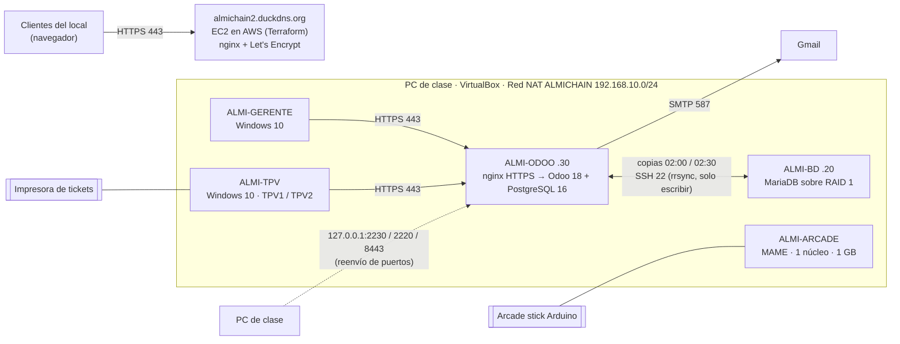

# Almi-Chain · Reto 1 · ASIR 1

Proyecto del **Reto 1 de 1.º de ASIR en Almi**: la infraestructura informática de **Almi Bites**, el restaurante de la cadena ficticia **Almi-Chain**. Equipo: **Alberto, Oier, Julen, Gontzal y Richar** · 16 de octubre – 13 de noviembre de 2026.

Todo se hace en máquinas virtuales de VirtualBox sobre los PC de clase (Zorin OS). Lo único físico son los 2 routers, la impresora de tickets y el arcade stick con Arduino. La web está en AWS Academy.

## Objetivo y alcance

Diseñar, montar, asegurar y probar la informática de un restaurante: puestos Windows para el gerente y los TPV, una recreativa Linux optimizada con un mando hecho con Arduino, la red del local (con Wi-Fi segura y un repetidor WDS), un ERP con TPV que factura solo, una web pública desplegada con Terraform y una base de datos propia con disco redundante y copias. Todo con **mínimo privilegio** y **seguridad por defecto**, documentado y con pruebas.

**Fuera del alcance**: comprar el material del presupuesto, la conexión real del local y los datos reales del restaurante (todos los datos son de ejemplo y ficticios).

## Estado del proyecto (27 de octubre de 2026)

Lo que está hecho, lo que está preparado pero sin probar y lo que falta. "Probado" quiere decir que hay pruebas ejecutadas con su captura o transcripción; el origen de cada prueba está en el apartado siguiente.

| Bloque | Estado | Pruebas | Qué falta |
|---|---|---|---|
| 00 Gestión | En marcha | — | Reparto de tareas entre los 5, Anexo I firmado y Anexo II |
| 01 Windows gerente y TPV | **Preparado, sin probar** | 0 de 11 | Montar las dos VM en clase, ejecutar los scripts y hacer las pruebas y capturas |
| 02 Recreativa | **Hecho y probado** (en QEMU) | 7 de 9 | Benchmark dentro de la VM en VirtualBox y prueba con el stick |
| 03 Arcade stick | **Preparado, sin probar** (los programas compilan) | 0 de 6 | Montaje físico, cableado y pruebas con la placa real |
| 04 Red | **Preparado, sin probar** | 0 de 14 | Archivo `.pkt`, plano del local y configuración de los routers físicos |
| 05 ERP Odoo | **Hecho y probado** (servidor de pruebas y VM en QEMU) | 9 de 11 completas, 2 a medias | Envío real del correo (contraseña de aplicación de Gmail) e impresión en la impresora física |
| 06 Web en AWS | **Preparado, sin desplegar** | 0 de 10 | Despliegue en AWS Academy, capturas, SSL Labs y Lighthouse |
| 07 Base de datos | **Hecho y probado** (servidor de pruebas y VM en QEMU) | 15 de 15 | Repetir en VirtualBox las pruebas del RAID (hechas en QEMU) |
| Presupuesto | **Incompleto** | — | Filas *por completar* |

## Origen de las evidencias

Para que se pueda valorar cada captura sabiendo de dónde sale:

| Capturas | Dónde se hicieron |
|---|---|
| `05-erp-odoo/capturas/01`–`35` y `07-bd-raid-copias/capturas/01`–`12` | En un **servidor de pruebas Linux en la nube** (Ubuntu 24.04, sin VirtualBox) al que se le puso el nombre `almi-odoo`/`almi-bd` y las IP 192.168.10.30 y .20 en la interfaz local. Los comandos y las salidas son reales, pero **no son las VM de VirtualBox del aula**, y las "copias a la otra máquina" de esas capturas iban al mismo servidor. Las de terminal están dibujadas a partir de la salida real; las del navegador son de Chromium sin interfaz, con la barra de dirección dibujada |
| `07-bd-raid-copias/capturas/18` en adelante, `05-erp-odoo/capturas/36` en adelante y `02-linux-recreativa/capturas/*` | Arrancando los discos de las **VM exportadas (.ova) en QEMU** sin aceleración, por consola serie (la de MAME, por la pantalla de la VM arrancando con GRUB). No es VirtualBox. Las capturas de terminal hechas así llevan al lado su transcripción `.txt` con la salida real |
| Benchmark de MAME (bloque 02) | En el ordenador anfitrión limitado a 1 núcleo, **no dentro de la VM** |
| Bloques 01, 03, 04 y 06 | **Sin capturas todavía** |

Cómo se construyeron y probaron las VM, y con qué herramientas se hicieron las capturas: [`herramientas/`](herramientas/README.md).

## Uso de inteligencia artificial

Parte del contenido de este repositorio (scripts, configuraciones, documentación, capturas y la auditoría) se ha preparado con la ayuda de un asistente de IA (Claude, de Anthropic), a partir del enunciado, de la guía paso a paso del equipo y de las decisiones del equipo. Todo lo que se presenta como probado se ejecutó de verdad en los entornos que indica el apartado anterior; lo que no se ha podido ejecutar se marca como pendiente.

## Qué hay en cada carpeta

| Carpeta | Bloque | Qué contiene |
|---|---|---|
| [`00-gestion`](00-gestion/) | Gestión del proyecto | Tablero de tareas, guías paso a paso, anexos |
| [`01-windows-gerente-tpv`](01-windows-gerente-tpv/) | Equipo del gerente y TPV | Scripts de PowerShell: usuarios, seguridad, quiosco, certificado de Odoo |
| [`02-linux-recreativa`](02-linux-recreativa/) | Recreativa con MAME | Configuración de arranque directo a MAME, optimización a 1 núcleo y 1 GB sin swap, benchmark |
| [`03-arcade-stick`](03-arcade-stick/) | Arcade stick con Arduino | Cableado y programas del mando (mando USB o teclado USB) |
| [`04-red`](04-red/) | Red | Plan de direccionamiento, configuración de Packet Tracer y de los routers con WDS |
| [`05-erp-odoo`](05-erp-odoo/) | ERP Odoo + TPV | Docker, HTTPS, configuración de Odoo, los 2 TPV, factura automática, copias |
| [`06-web-aws`](06-web-aws/) | Web en AWS | La web y su despliegue con Terraform, DuckDNS y HTTPS |
| [`07-bd-raid-copias`](07-bd-raid-copias/) | Base de datos | Esquema MariaDB, usuarios, consultas, RAID 1, copias y restauración |
| [`diagramas`](diagramas/) | — | Modelo entidad/relación del equipo (los diagramas de arquitectura están en cada README) |
| [`docs`](docs/) | — | Memoria del reto (Word y PDF), anexo de las máquinas virtuales y conclusiones |
| [`herramientas`](herramientas/) | — | Cómo se construyeron y probaron las VM exportadas y cómo se genera la memoria |
| [`presupuesto`](presupuesto/) | — | Presupuesto global |

## Máquinas del reto

| Máquina | Sistema | IP | Para qué |
|---|---|---|---|
| **ALMI-ODOO** | Ubuntu Server 24.04 + Docker | 192.168.10.30 | ERP Odoo 18 y los TPV, por HTTPS |
| **ALMI-BD** | Ubuntu Server 24.04 | 192.168.10.20 | MariaDB con RAID 1 y copias cruzadas con ALMI-ODOO |
| **ALMI-ARCADE** | Ubuntu 24.04 mínimo + MAME | DHCP | Recreativa: 1 núcleo, 1 GB, sin swap |
| **ALMI-GERENTE** | Windows 10 Pro | DHCP | Equipo del despacho (usuario Gerente) |
| **ALMI-TPV** | Windows 10 Pro | DHCP | Los dos TPV de barra (usuarios TPV1 y TPV2) en modo quiosco |
| **almichain-web** | Ubuntu 24.04 en AWS | IP elástica | Web https://almichain2.duckdns.org |

Todas las VM van en la **Red NAT `ALMICHAIN`** de VirtualBox (192.168.10.0/24, puerta de enlace 192.168.10.1). Cómo crearla: [00-gestion](00-gestion/README.md#red-nat-almichain).

En el restaurante real cada grupo de equipos va en su VLAN (gestión, TPV, clientes y administración) con las reglas del [bloque de red](04-red/README.md); en el laboratorio todas las VM comparten la Red NAT.

## Máquinas virtuales exportadas

Las VM Linux (ALMI-ODOO, ALMI-BD y ALMI-ARCADE) están exportadas en formato **.ova**. No caben en el repositorio, así que se entregan aparte en trozos con un script para unirlos: ver [docs/maquinas-virtuales.md](docs/maquinas-virtuales.md). Para usarlas: VirtualBox → **Archivo → Importar servicio virtualizado** → elegir la .ova → **Importar**. Después, en **Configuración → Red**, poner el adaptador en **Red NAT → ALMICHAIN**. Las contraseñas no están en el repositorio. Cada VM genera sus propios secretos la primera vez que arranca y `almiadmin` tiene que cambiar su contraseña inicial al entrar (ver [docs/maquinas-virtuales.md](docs/maquinas-virtuales.md)).

## Reglas del repositorio

- Ninguna contraseña, token ni clave privada se sube al repositorio (ver [`.gitignore`](.gitignore)). Todas están en KeePassXC.
- Cada uno trabaja en la carpeta de su bloque. Commits con el formato `Bloque: qué se ha hecho`.
- Las capturas de cada bloque van en su carpeta `capturas/` y se citan en su README.
