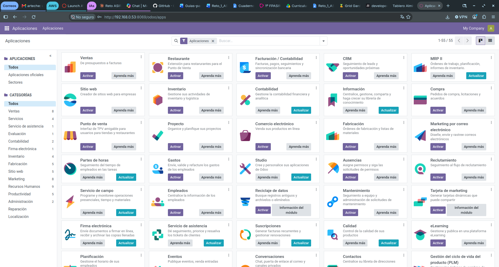
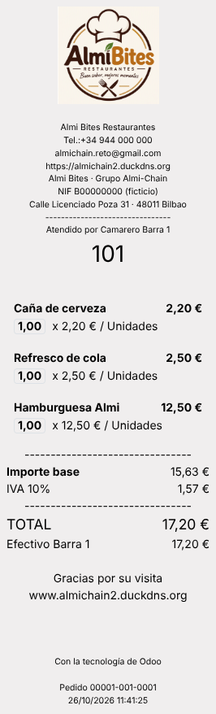
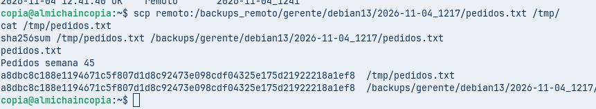
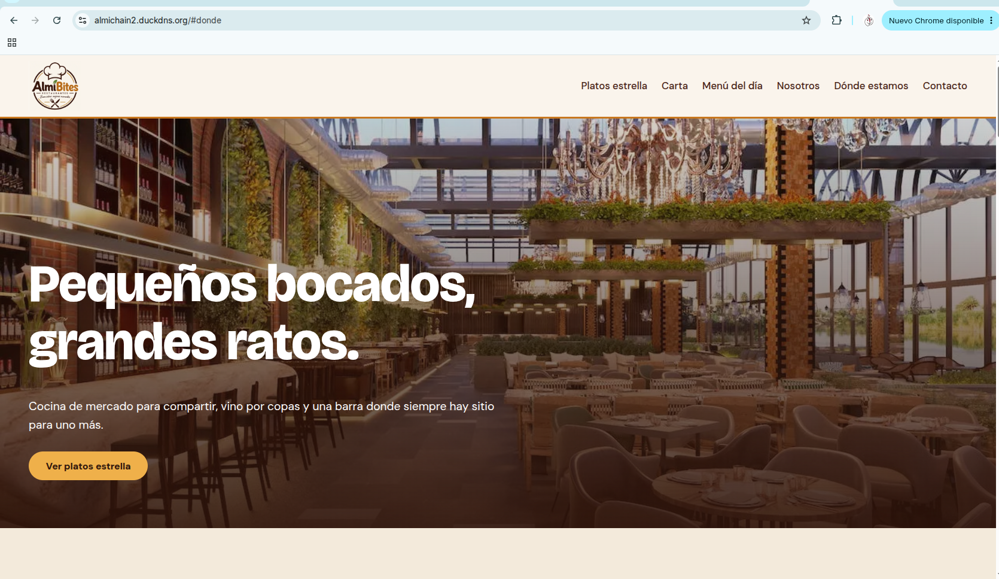

# Introducción

**Equipo:** Alberto, Oier, Julen, Gontzal y Richar · 1.º ASIR · Almi · Octubre y noviembre de 2026

Hemos montado la informática de **Almi Bites**, un restaurante de la cadena Almi-Chain: los puestos Windows, una máquina recreativa con su mando, la red del local, un ERP con TPV, la base de datos con disco redundante y copias de seguridad, y la web del restaurante en AWS. Todo se ha hecho en máquinas virtuales de VirtualBox en los PC de clase, salvo los routers, la impresora y el arcade stick, que son físicos.

El detalle de cada parte (todas las órdenes, scripts y capturas) está en el repositorio de GitHub, en la carpeta de cada bloque.

# 1. Organización del equipo

- **Tablero Kanban** con las tareas del reto y quién se encarga de cada una (`00-gestion/tablero`).
- **GitHub** para guardar el trabajo: una carpeta por bloque, con sus pasos, scripts y capturas.
- **KeePassXC** para las contraseñas (archivo `almichain.kdbx`). En el repositorio no hay ninguna contraseña.

# 2. Red del laboratorio

El router R1 se conecta a la red de clase (192.168.1.0/24) y crea la red del reto, **192.168.0.0/24**. Todas las máquinas virtuales están en **adaptador puente** dentro de esa red, con IP fija.

| Equipo | IP |
|---|---|
| Router R1 | 192.168.0.1 (WAN 192.168.1.112) |
| Router R2 (repetidor WDS) | 192.168.0.60 |
| Servidor de copias | 192.168.0.52 |
| ALMI-GERENTE (Windows 10 + Debian 13) | 192.168.0.63 |
| ALMI-ODOO (`odooserver`) | 192.168.0.53 |
| ALMI-BD (MySQL) | 192.168.0.54 |
| TPV-1 y TPV-2 | 192.168.0.71 y .72 |
| ALMI-ARCADE (recreativa) | 192.168.0.81 |
| PC de clase | 192.168.0.100 |

# 3. Puestos Windows: gerente con arranque dual y TPV

**Equipo del gerente (ALMI-DUAL):**

1. Crear la VM en VirtualBox: 3 GB de RAM, 2 CPU y disco de 60 GB.
2. Instalar Windows 10 en una partición de 40 GB y dejar 20 GB sin asignar.
3. Crear el usuario administrador `almiadmin`, la cuenta del gerente e instalar las Guest Additions.
4. Instalar Debian 13 en el espacio libre (particionado manual) y GRUB en el disco.
5. Comprobar que GRUB deja elegir entre Debian y Windows.

**TPV de las barras (ALMI-TPV):**

1. Instalar Windows 10 y crear `almiadmin` como administrador.
2. Crear los usuarios TPV1 y TPV2 como **usuarios estándar** (sin permisos de administrador).
3. Política de contraseñas con `net accounts`: 12 caracteres, caducan a los 90 días y bloqueo tras 5 fallos.
4. UAC al máximo, antivirus y cortafuegos activos.

# 4. Máquina recreativa

1. VM con **1 núcleo, 1 GB de RAM y sin swap**.
2. Instalar Ubuntu Server en modo mínimo.
3. Crear el usuario `arcade` sin permisos de administrador, que inicia sesión solo.
4. Instalar un entorno gráfico mínimo y **MAME**, y hacer que al arrancar se abra MAME directamente.
5. Desactivar los servicios que no hacen falta y ajustar MAME para que vaya fluido.
6. Comprobar con `vmstat` que no se usa swap mientras se juega.

# 5. Arcade stick con Arduino

1. Cablear el joystick (4 direcciones) y los botones a los pines del Arduino; cada botón va entre su pin y GND.
2. Cargar el programa (`03-arcade-stick/sketches`), que hace que el Arduino funcione como **mando USB**: el ordenador lo reconoce sin instalar drivers.
3. El programa incluye antirrebote y permite cambiar qué hace cada botón desde el monitor serie, sin volver a programarlo.
4. Probar el mando en la recreativa jugando en MAME.

# 6. Red del restaurante

1. **Packet Tracer**: red completa del restaurante con un router 2911 (R-Principal), un switch para el local y otro para la parte de Internet.
2. **Red del local** 192.168.0.0/24: Odoo con la impresora, la base de datos, el equipo del gerente, los dos TPV y la recreativa, cada uno con IP fija.
3. **Wi-Fi de clientes** en una red separada (192.168.50.0/24) con su propio router, WPA2 y DHCP, para que los clientes no lleguen a los equipos del local.
4. **Internet simulado** (192.168.1.0/24) con los servicios que usa el reto: la web en AWS, DuckDNS, GitHub y Trello.
5. Pruebas de conectividad con `ping` e `ipconfig` entre los equipos.
6. **Routers físicos**: R1 con la contraseña de administración cambiada, Wi-Fi WPA2 y la red 192.168.0.0/24; R2 como **repetidor WDS** para ampliar la cobertura.

# 7. ERP Odoo con TPV

1. VM con Ubuntu Server (`odooserver`, 192.168.0.53) y **PostgreSQL 16**.
2. Instalar Odoo en un entorno virtual de Python, con su configuración en `/etc/odoo.conf`.
3. Crear el servicio `odoo.service` de systemd para que Odoo arranque solo. Al principio fallaba por una ruta mal escrita en el servicio; se corrigió y quedó en marcha.
4. Abrir el puerto 8069 en el cortafuegos (`ufw`) y comprobar que escucha.
5. Crear la base de datos `almi-chain` desde el navegador (`http://192.168.0.53:8069`).
6. Activar las aplicaciones (Punto de venta, Facturación, Inventario…). Para el Punto de venta hubo que instalar la librería `phonenumbers` con `pip`.
7. Dar de alta empleados, productos con stock y clientes, y configurar los TPV de las dos barras.
8. Activar SSH para administrar el servidor desde el PC de clase.

**Disco redundante del servidor de Odoo:** se añadieron dos discos de 25 GB y se creó un **RAID 1** con `mdadm`, montado en `/srv/raid1`.

# 8. Base de datos

1. **Modelo entidad-relación** del restaurante y paso a tablas (13 tablas: clientes, mesas, reservas, empleados, comandas, platos, ingredientes, proveedores, facturas…).
2. Crear las tablas en **MySQL** con su script SQL, con claves primarias y ajenas, y cargar datos de prueba.
3. Importar también la base del restaurante en el **PostgreSQL** del servidor de Odoo y conectarse a ella con DBeaver.
4. Tres usuarios con **mínimo privilegio**: la aplicación (lee y escribe), consulta (solo lectura) y copias.
5. **RAID 1** con dos discos para los datos.
6. **Copia automática** con `cron`, enviada también al servidor de Odoo y a un bucket S3 de AWS, y prueba de restauración.

# 9. Copias de seguridad de los sistemas operativos

1. Servidor de copias (Ubuntu Server) con **RAID 1** de dos discos, probado quitando un disco y reconstruyéndolo.
2. Acceso por **SSH con clave**, sin contraseña, entre el servidor de copias y el equipo del gerente.
3. Copia completa de Windows y copia **incremental** de Debian con `rsync`.
4. Réplica de las copias en una **EC2 de AWS**, creada con Terraform.
5. Script automático con `cron` todas las semanas y borrado de las copias antiguas.
6. Prueba de restauración desde la copia de AWS.

# 10. Web del restaurante en AWS

1. Web hecha con **HTML y CSS**, adaptada a móvil, con carta, menú del día, opiniones, contacto y geolocalización.
2. Infraestructura en **AWS Academy** creada con **Terraform**: instancia EC2, grupo de seguridad e IP elástica.
3. Al crearse, la instancia instala nginx, publica la web y pide el certificado **HTTPS** de Let's Encrypt para el dominio de DuckDNS.

# 11. Presupuesto

Presupuesto con IVA incluido: hardware 2.075 € y software 138 €, en total **2.213 €**, más la fibra de Movistar a 24,90 €/mes el primer año. El detalle, con enlaces, está en `presupuesto/README.md`.
