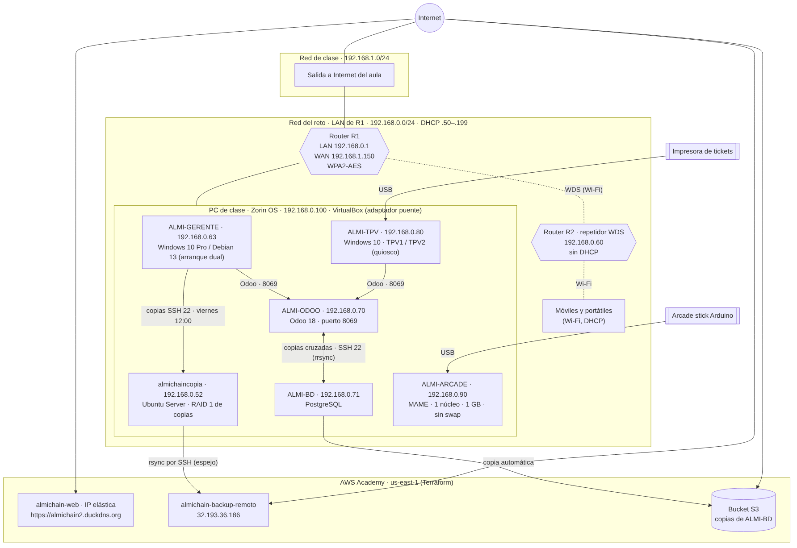

# 1. Introducción

**Equipo:** Alberto, Oier, Julen, Gontzal y Richar · 1.º ASIR · Almi · Octubre y noviembre de 2026

Este manual explica, paso a paso, cómo montar la informática de **Almi Bites**, un restaurante de la cadena Almi-Chain:

| Capítulo | Qué se monta |
|---|---|
| 3 | Equipo del gerente con arranque dual (Windows 10 y Debian 13) y los TPV de las dos barras |
| 4 | Máquina recreativa con MAME (1 núcleo, 1 GB de RAM y sin swap) |
| 5 | Arcade stick con Arduino |
| 6 | Red del restaurante: Packet Tracer, routers y repetidor WDS |
| 7 | ERP Odoo con TPV y disco redundante |
| 8 | Web del restaurante en AWS con Terraform |
| 9 | Base de datos con RAID 1 y copias de seguridad |
| 10 | Copias de seguridad de los sistemas operativos |

Todo se monta en máquinas virtuales de **VirtualBox** en los PC de clase, salvo los routers, la impresora de tickets y el arcade stick, que son físicos. Los archivos que se usan (scripts, configuraciones y SQL) están en el repositorio de GitHub, en la carpeta de cada capítulo.

**Antes de empezar:**

- Las contraseñas no se escriben en ningún documento: se guardan en **KeePassXC** (archivo `almichain.kdbx`).
- El usuario administrador de todas las máquinas es `almiadmin`.
- Las tareas y quién se encarga de cada una están en el tablero Kanban (`00-gestion/tablero`).

# 2. Red del laboratorio

El router R1 se conecta a la red de clase (192.168.1.0/24) y crea la red del reto, **192.168.0.0/24**. Todas las máquinas virtuales se conectan en **adaptador puente** a esa red, con IP fija.

Al principio del reto las máquinas se conectaron a una Red NAT de VirtualBox llamada ALMICHAIN (192.168.10.0/24), y así aparece en las primeras capturas de los puestos Windows. Cuando se configuraron los routers, todas pasaron a la red del reto.

**Configurar la red de una VM en VirtualBox:** Configuración → Red → Adaptador 1 → Conectado a: **Adaptador puente** → la tarjeta de red del PC de clase.

| Equipo | IP |
|---|---|
| Router R1 | 192.168.0.1 (WAN 192.168.1.112) |
| Router R2 (repetidor WDS) | 192.168.0.60 |
| Servidor de copias | 192.168.0.52 |
| ALMI-ODOO (`odooserver`) | 192.168.0.53 |
| ALMI-BD | 192.168.0.54 |
| ALMI-GERENTE (Windows 10 y Debian 13) | 192.168.0.63 |
| TPV-1 y TPV-2 | 192.168.0.71 y .72 |
| ALMI-ARCADE (recreativa) | 192.168.0.81 |
| PC de clase | 192.168.0.100 |
