# 1. Introducción

**Equipo:** Alberto, Oier, Julen, Gontzal y Richar · 1.º ASIR · Almi · Octubre y noviembre de 2026

Este manual explica, paso a paso, cómo montar la informática de **Almi Bites**, un restaurante de la cadena Almi-Chain:

| Capítulo | Qué se monta |
|---|---|
| 3 | Equipo del gerente con arranque dual (Windows 10 y Debian 13) y los TPV de las dos barras |
| 4 | Máquina recreativa con MAME (1 núcleo, 1 GB de RAM y sin swap) |
| 5 | Arcade stick con Arduino |
| 6 | Red del restaurante: Packet Tracer, routers y repetidor WDS |
| 7 | ERP Odoo con TPV y disco redundante |
| 8 | Web del restaurante en AWS con Terraform |
| 9 | Base de datos con RAID 1 y copias de seguridad |
| 10 | Copias de seguridad de los sistemas operativos |

Todo se monta en máquinas virtuales de **VirtualBox** en los PC de clase, salvo los routers, la impresora de tickets y el arcade stick, que son físicos. Los archivos que se usan (scripts, configuraciones y SQL) están en el repositorio de GitHub, en la carpeta de cada capítulo.

**Antes de empezar:**

- Las contraseñas no se escriben en ningún documento: se guardan en **KeePassXC** (archivo `almichain.kdbx`).
- El usuario administrador de todas las máquinas es `almiadmin`.
- Las tareas y quién se encarga de cada una están en el tablero Kanban (`00-gestion/tablero`).

# 2. Red del laboratorio

El router R1 se conecta a la red de clase (192.168.1.0/24) y crea la red del reto, **192.168.0.0/24**. Todas las máquinas virtuales se conectan en **adaptador puente** a esa red, con IP fija.

Al principio del reto las máquinas se conectaron a una Red NAT de VirtualBox llamada ALMICHAIN (192.168.10.0/24), y así aparece en las primeras capturas de los puestos Windows. Cuando se configuraron los routers, todas pasaron a la red del reto.

**Configurar la red de una VM en VirtualBox:** Configuración → Red → Adaptador 1 → Conectado a: **Adaptador puente** → la tarjeta de red del PC de clase.

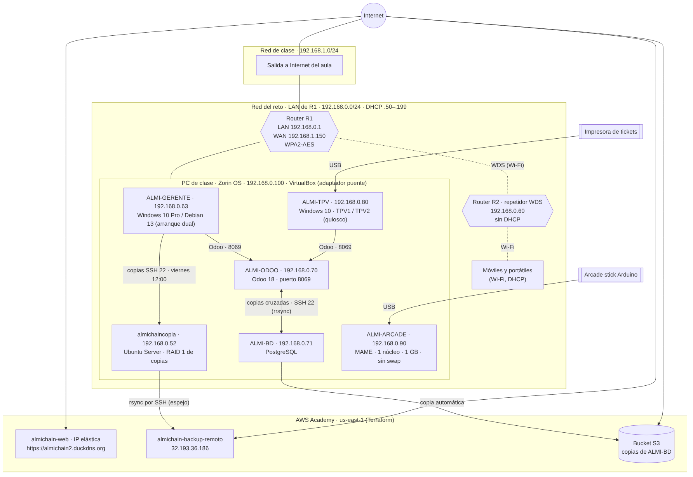

| Equipo | IP |
|---|---|
| Router R1 | 192.168.0.1 (WAN 192.168.1.112) |
| Router R2 (repetidor WDS) | 192.168.0.60 |
| Servidor de copias | 192.168.0.52 |
| ALMI-ODOO (`odooserver`) | 192.168.0.53 |
| ALMI-BD | 192.168.0.54 |
| ALMI-GERENTE (Windows 10 y Debian 13) | 192.168.0.63 |
| TPV-1 y TPV-2 | 192.168.0.71 y .72 |
| ALMI-ARCADE (recreativa) | 192.168.0.81 |
| PC de clase | 192.168.0.100 |

# 3. Puestos Windows: gerente con arranque dual y TPV

## Objetivo
Preparar los puestos de Windows del restaurante con **mínimo privilegio**: el equipo del despacho para el **Gerente** (ALMI-GERENTE) y una VM con los dos **TPV de barra** (ALMI-TPV, usuarios TPV1 y TPV2) que solo abren su TPV de Odoo en **modo quiosco** e imprimen el ticket en la **impresora de tickets física**. Incluye las necesidades, el hardware y el presupuesto de los equipos reales.

Tareas del tablero: P01 a P12.

## Requisitos
| Dato | ALMI-GERENTE | ALMI-TPV |
|---|---|---|
| Sistema | **Arranque dual**: Windows 10 Pro (o Education) con licencia + Debian 13 | Windows 10 Pro (o Education) con licencia |
| Memoria / CPU | 3072 MB / 2 | 3072 MB / 2 |
| Disco | 60 GB VDI dinámico: 40 GB Windows + 20 GB Debian | 40 GB VDI dinámico |
| Pantalla | 128 MB, VBoxSVGA | 128 MB, VBoxSVGA |
| Red | Adaptador puente (192.168.0.0/24) | Adaptador puente (192.168.0.0/24) |
| USB | Habilitado | Habilitado (impresora) |
| Usuarios | almiadmin (administrador), Gerente | almiadmin (administrador), TPV1, TPV2 |

> Decisión del equipo: ALMI-GERENTE lleva **arranque dual**, Windows 10 Pro y Debian 13 (usuario `almiadmin`), como pide la rúbrica. La recreativa es una VM aparte, ALMI-ARCADE (bloque 02). Las copias de seguridad de los dos sistemas del gerente están en el [bloque 08](../08-copias-so/README.md).
>
> El arranque dual y la VM de los TPV **ya están instalados en VirtualBox** (en clase; documento de Oier en el Drive del equipo): ver [Instalación hecha en clase](#instalación-hecha-en-clase-almi-dual-y-almi-tpv) con sus 77 capturas. En VirtualBox la VM del gerente se llama **ALMI-DUAL**; dentro, Windows se llama **ALMI-GERENTE** y Debian **almi-arcade**.

#### Necesidades y equipos reales

| Puesto | Quién | Para qué | Restricciones | En el laboratorio |
|---|---|---|---|---|
| Equipo del despacho | Gerente | Ofimática, Odoo (facturas, personal, inventario), correo | Usuario estándar, sin instalar programas | ALMI-GERENTE, usuario Gerente |
| TPV de barra 1 | Camareros | Solo cobrar en el TPV de Odoo e imprimir tickets | Quiosco: solo el TPV, sin escritorio ni USB | ALMI-TPV, usuario TPV1 |
| TPV de barra 2 | Camareros | Igual que el 1 | Igual que el 1 | ALMI-TPV, usuario TPV2 |
| Impresora de tickets (×2 en el real) | TPV | Imprimir el ticket de cada venta | Solo la usa el TPV | 1 impresora física compartida |

Requisitos mínimos para la compra: equipo del gerente con 4 núcleos, 16 GB de RAM y SSD NVMe de 500 GB; TPV táctil todo en uno de 15" con 8 GB de RAM y SSD de 128 GB; impresora térmica de 80 mm ESC/POS con corte automático, USB + Ethernet y salida para cajón. El presupuesto con modelo, precio, enlace y fecha está en [`../presupuesto/`](../presupuesto).

| Software | Dónde | Licencia y coste |
|---|---|---|
| Windows 10 Pro | Gerente y TPV | De pago, por equipo |
| Microsoft Edge | Gerente y TPV | Incluido en Windows |
| Odoo Community (TPV y ERP) | Servidor ALMI-ODOO, por navegador | LGPL, gratis |
| Controlador de la impresora | TPV | Gratis, del fabricante |
| Microsoft Defender | Todos | Incluido en Windows |
| KeePassXC | Equipo del gerente | Libre, gratis |

## Instalación paso a paso
Hecho en **VirtualBox**, en la red NAT ALMICHAIN (192.168.10.0/24), a partir del documento del equipo *Documentación Reto 1 - ALMI-DUAL y ALMI-TPV* (Drive del equipo, 4 de noviembre). Las contraseñas no aparecen en ninguna captura: se escriben ocultas y se guardan en KeePassXC (`almichain.kdbx`).

| | ALMI-DUAL (equipo del gerente) | ALMI-TPV (barras) |
|---|---|---|
| Sistemas | Windows 10 + Debian 13, arranque con GRUB | Windows 10 |
| Hardware | 3072 MB, 2 CPU, 128 MB de vídeo, USB 1.1, red NAT ALMICHAIN | Igual |
| Disco | 60 GB: Windows (C:) 40 GB y Debian 21,5 GB (ext4, sin swap) | 40 GB, todo Windows |
| Nombre | ALMI-GERENTE (Windows) y almi-arcade (Debian) | ALMI-TPV |
| Usuarios | almiadmin (administrador) y la cuenta local *Gerente Almi-Chain* en Windows; almiadmin en Debian (root bloqueado, usa sudo) | almiadmin (administrador), TPV1 y TPV2 (usuarios estándar) |

**El orden importa**: primero Windows (dejando 20 GB sin asignar) y después Debian. Si se instala al revés, Windows sobrescribe el gestor de arranque y Debian desaparece del menú.

#### Lo esencial, en capturas

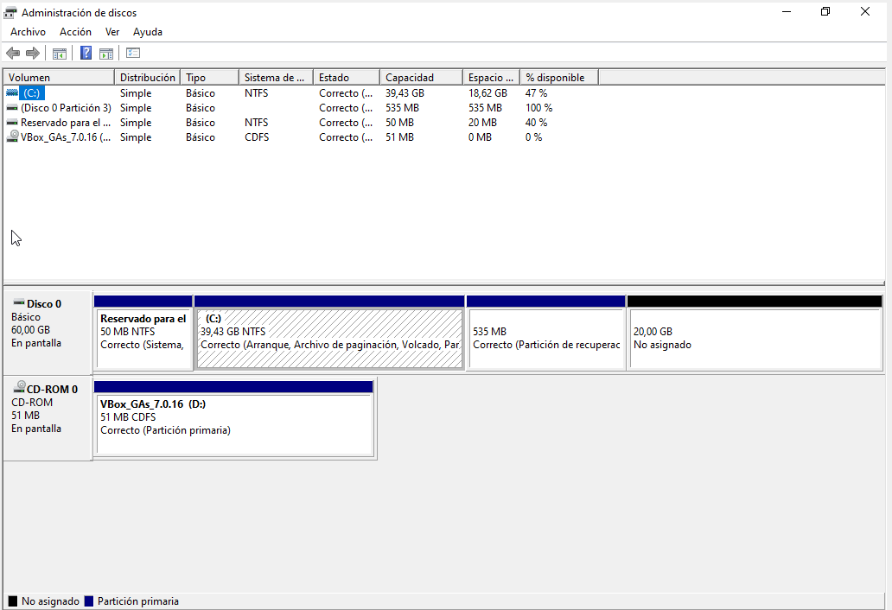


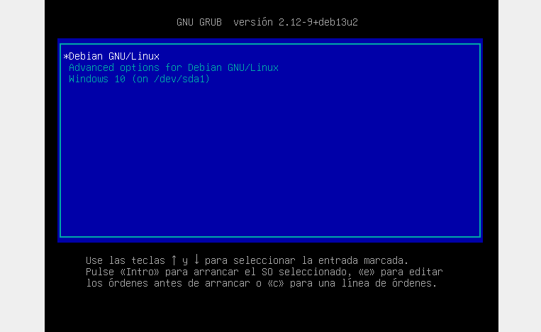


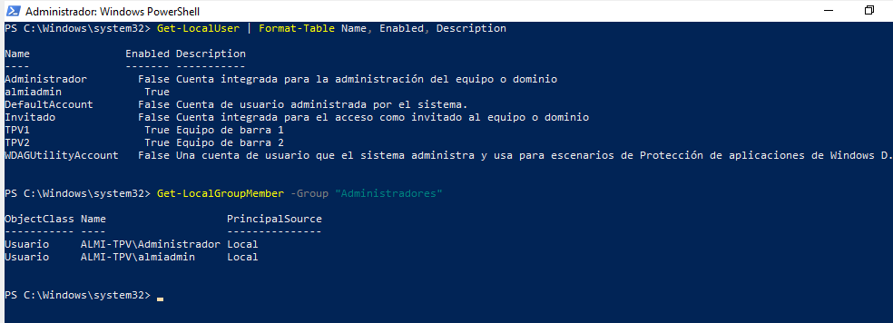

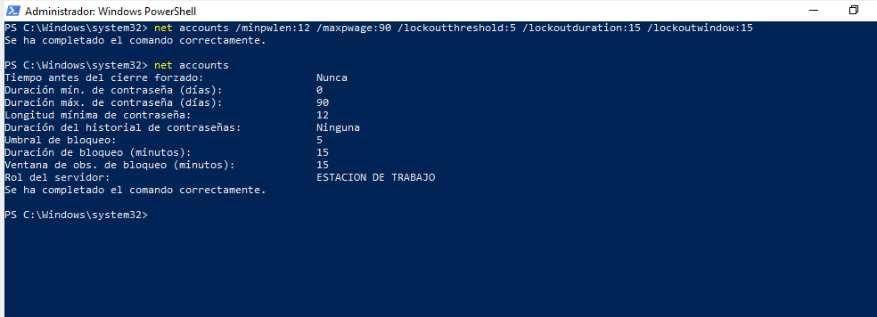

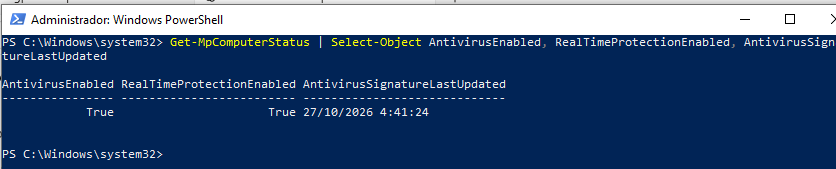

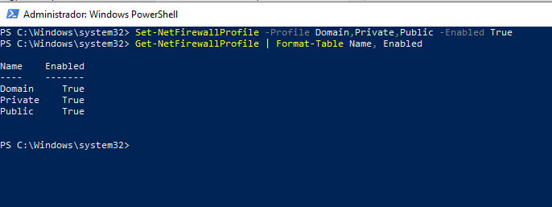

#### Todos los pasos

<details><summary><b>Pasos 1–6: Preparación: red NAT y KeePassXC (en el PC anfitrión, Ubuntu)</b></summary>

| Paso | Qué se hace | Captura |
|---|---|---|
| 1 | Creamos la red NAT de VirtualBox llamada ALMICHAIN con el rango 192.168.10.0/24 y el DHCP activado. Todas las máquinas del reto se conectarán a esta red. | [ver](../01-windows-gerente-tpv/capturas/paso-01-prep.png) |
| 2 | En Ubuntu instalamos KeePassXC, un gestor de contraseñas, con sudo apt install keepassxc. Así guardamos las claves del reto en un solo sitio seguro. | [ver](../01-windows-gerente-tpv/capturas/paso-02-prep.png) |
| 3 | Abrimos KeePassXC y creamos una base de datos nueva llamada almichain. | [ver](../01-windows-gerente-tpv/capturas/paso-03-prep.png) |
| 4 | En la configuración de cifrado dejamos los valores por defecto (formato KDBX 4, el recomendado) y pulsamos Continuar. | [ver](../01-windows-gerente-tpv/capturas/paso-04-prep.png) |
| 5 | Ponemos una contraseña maestra para la base de datos, la repetimos y pulsamos Hecho. | [ver](../01-windows-gerente-tpv/capturas/paso-05-prep.png) |
| 6 | Comprobamos que el archivo almichain.kdbx se ha guardado en la carpeta Documentos. | [ver](../01-windows-gerente-tpv/capturas/paso-06-prep.png) |

</details>

<details><summary><b>Pasos 7–29: ALMI-DUAL: Windows 10</b></summary>

| Paso | Qué se hace | Captura |
|---|---|---|
| 7 | En VirtualBox creamos la máquina virtual Windows10 ALMI-DUAL con la ISO de Windows 10 (Win10_22H2 en español). Marcamos Omitir instalación desatendida porque la instalaremos a mano. | [ver](../01-windows-gerente-tpv/capturas/paso-07-dual-win.png) |
| 8 | Hardware: 3072 MB de RAM y 2 procesadores. | [ver](../01-windows-gerente-tpv/capturas/paso-08-dual-win.png) |
| 9 | Disco duro virtual: creamos uno nuevo de 60 GB. Una parte será para Windows y otra para Debian. | [ver](../01-windows-gerente-tpv/capturas/paso-09-dual-win.png) |
| 10 | Ya creada la VM, en Configuración > Sistema revisamos la RAM (3072 MB) y el orden de arranque (óptica y disco duro). | [ver](../01-windows-gerente-tpv/capturas/paso-10-dual-win.png) |
| 11 | En Pantalla subimos la memoria de vídeo al máximo, 128 MB, para que la VM vaya más fluida. | [ver](../01-windows-gerente-tpv/capturas/paso-11-dual-win.png) |
| 12 | En Red conectamos el adaptador 1 a Red NAT y elegimos la red ALMICHAIN. | [ver](../01-windows-gerente-tpv/capturas/paso-12-dual-win.png) |
| 13 | En USB dejamos habilitado el controlador USB 1.1 (OHCI). | [ver](../01-windows-gerente-tpv/capturas/paso-13-dual-win.png) |
| 14 | Arrancamos la VM y empieza el instalador de Windows. Aparecen los 60 GB sin asignar. | [ver](../01-windows-gerente-tpv/capturas/paso-14-dual-win.png) |
| 15 | Creamos una partición principal de 40 GB para Windows y dejamos 20 GB sin asignar para instalar Debian después. | [ver](../01-windows-gerente-tpv/capturas/paso-15-dual-win.png) |
| 16 | Windows pregunta cómo configurar el equipo y elegimos Configurar para uso personal. | [ver](../01-windows-gerente-tpv/capturas/paso-16-dual-win.png) |
| 17 | Creamos el usuario administrador local: almiadmin. | [ver](../01-windows-gerente-tpv/capturas/paso-17-dual-win.png) |
| 18 | Abrimos PowerShell como administrador y ejecutamos net user almiadmin * para poner la contraseña del usuario. La primera vez no coincidieron las dos y la segunda salió bien (Se ha completado el comando correctamente). | [ver](../01-windows-gerente-tpv/capturas/paso-18-dual-win.png) |
| 19 | En las Directivas de seguridad local, apartado Opciones de seguridad, configuramos el límite de inactividad del equipo en 300 segundos: si nadie lo toca, se bloquea. | [ver](../01-windows-gerente-tpv/capturas/paso-19-dual-win.png) |
| 20 | Abrimos Este equipo. Aparece la unidad D: con los VirtualBox Guest Additions (se insertan desde el menú Dispositivos de VirtualBox). | [ver](../01-windows-gerente-tpv/capturas/paso-20-dual-win.png) |
| 21 | Dentro de la unidad D: ejecutamos VBoxWindowsAdditions. | [ver](../01-windows-gerente-tpv/capturas/paso-21-dual-win.png) |
| 22 | Se abre el instalador de Guest Additions 7.0.16. Pulsamos Next. | [ver](../01-windows-gerente-tpv/capturas/paso-22-dual-win.png) |
| 23 | Dejamos la carpeta de destino por defecto y pulsamos Next. | [ver](../01-windows-gerente-tpv/capturas/paso-23-dual-win.png) |
| 24 | Dejamos los componentes marcados por defecto y pulsamos Install. | [ver](../01-windows-gerente-tpv/capturas/paso-24-dual-win.png) |
| 25 | Al terminar pide reiniciar. Dejamos Reboot now y pulsamos Finish. | [ver](../01-windows-gerente-tpv/capturas/paso-25-dual-win.png) |
| 26 | En Configuración > Cuentas vemos la cuenta local GERENTE ALMI-CHAIN. | [ver](../01-windows-gerente-tpv/capturas/paso-26-dual-win.png) |
| 27 | Desde aquí podemos cambiar la contraseña de esa cuenta. En la captura, la clave actual escrita no era correcta y pide intentarlo de nuevo. | [ver](../01-windows-gerente-tpv/capturas/paso-27-dual-win.png) |
| 28 | En Configuración > Sistema > Acerca de comprobamos que el equipo se llama ALMI-GERENTE, tiene 3 GB de RAM, Windows de 64 bits y aparece como supervisado y protegido. | [ver](../01-windows-gerente-tpv/capturas/paso-28-dual-win.png) |
| 29 | En el Administrador de discos comprobamos que el disco de 60 GB tiene Windows (C:) de 39,43 GB y 20 GB sin asignar, listos para Debian. | [ver](../01-windows-gerente-tpv/capturas/paso-29-dual-win.png) |

</details>

<details><summary><b>Pasos 30–62: ALMI-DUAL: Debian 13 en el espacio libre</b></summary>

| Paso | Qué se hace | Captura |
|---|---|---|
| 30 | Apagamos la VM y, en Configuración > Almacenamiento, añadimos la ISO debian-13.0.0-amd64-netinst a la unidad óptica (puerto SATA 1). | [ver](../01-windows-gerente-tpv/capturas/paso-30-dual-debian.png) |
| 31 | Arrancamos con esa ISO y en el menú de Debian 13 elegimos Install. | [ver](../01-windows-gerente-tpv/capturas/paso-31-dual-debian.png) |
| 32 | Idioma de la instalación: Spanish - Español. | [ver](../01-windows-gerente-tpv/capturas/paso-32-dual-debian.png) |
| 33 | Ubicación: España. | [ver](../01-windows-gerente-tpv/capturas/paso-33-dual-debian.png) |
| 34 | Mapa de teclado: Español. | [ver](../01-windows-gerente-tpv/capturas/paso-34-dual-debian.png) |
| 35 | El instalador carga componentes adicionales. Solo hay que esperar. | [ver](../01-windows-gerente-tpv/capturas/paso-35-dual-debian.png) |
| 36 | Nombre de la máquina: almi-arcade. | [ver](../01-windows-gerente-tpv/capturas/paso-36-dual-debian.png) |
| 37 | Nombre de dominio: lo dejamos vacío y seguimos. | [ver](../01-windows-gerente-tpv/capturas/paso-37-dual-debian.png) |
| 38 | Nos pide la clave del superusuario (root). Se puede dejar vacía para bloquear root y usar el usuario normal con sudo. | [ver](../01-windows-gerente-tpv/capturas/paso-38-dual-debian.png) |
| 39 | Nos pide repetir la misma clave para verificarla. | [ver](../01-windows-gerente-tpv/capturas/paso-39-dual-debian.png) |
| 40 | Nombre completo del usuario: Administrador Almi. | [ver](../01-windows-gerente-tpv/capturas/paso-40-dual-debian.png) |
| 41 | Nombre de usuario de la cuenta: almiadmin. | [ver](../01-windows-gerente-tpv/capturas/paso-41-dual-debian.png) |
| 42 | Elegimos la contraseña del usuario (se muestra oculta con asteriscos). | [ver](../01-windows-gerente-tpv/capturas/paso-42-dual-debian.png) |
| 43 | La repetimos para verificarla. | [ver](../01-windows-gerente-tpv/capturas/paso-43-dual-debian.png) |
| 44 | Zona horaria: Península. | [ver](../01-windows-gerente-tpv/capturas/paso-44-dual-debian.png) |
| 45 | Método de particionado: Manual, porque el disco ya tiene Windows y no queremos borrarlo. | [ver](../01-windows-gerente-tpv/capturas/paso-45-dual-debian.png) |
| 46 | Vemos las 3 particiones de Windows (NTFS) y el espacio libre de 21,5 GB que dejamos antes. Lo seleccionamos. | [ver](../01-windows-gerente-tpv/capturas/paso-46-dual-debian.png) |
| 47 | Elegimos Crear una partición nueva. | [ver](../01-windows-gerente-tpv/capturas/paso-47-dual-debian.png) |
| 48 | Tamaño de la partición: los 21,5 GB completos. | [ver](../01-windows-gerente-tpv/capturas/paso-48-dual-debian.png) |
| 49 | Tipo de partición: Primaria. | [ver](../01-windows-gerente-tpv/capturas/paso-49-dual-debian.png) |
| 50 | Queda una partición #4 de 21,5 GB en ext4, montada en /. Elegimos Finalizar el particionado y escribir los cambios en el disco. | [ver](../01-windows-gerente-tpv/capturas/paso-50-dual-debian.png) |
| 51 | Avisa de que no hay espacio de intercambio (swap). Respondemos No y seguimos sin swap: es lo que pide el reto, porque la recreativa tiene que funcionar sin usar el disco como memoria. | [ver](../01-windows-gerente-tpv/capturas/paso-51-dual-debian.png) |
| 52 | Resume los cambios: se formateará solo la partición #4 como ext4. Confirmamos con Sí. | [ver](../01-windows-gerente-tpv/capturas/paso-52-dual-debian.png) |
| 53 | Se instala el sistema base. Esperamos a que termine. | [ver](../01-windows-gerente-tpv/capturas/paso-53-dual-debian.png) |
| 54 | Pregunta si queremos analizar otros medios de instalación: No. | [ver](../01-windows-gerente-tpv/capturas/paso-54-dual-debian.png) |
| 55 | País de la réplica (servidor) de Debian: España. | [ver](../01-windows-gerente-tpv/capturas/paso-55-dual-debian.png) |
| 56 | Réplica de Debian: deb.debian.org. | [ver](../01-windows-gerente-tpv/capturas/paso-56-dual-debian.png) |
| 57 | Selección de programas: solo marcamos Utilidades estándar del sistema. Sin entorno de escritorio, es una instalación en modo texto. | [ver](../01-windows-gerente-tpv/capturas/paso-57-dual-debian.png) |
| 58 | El instalador detecta Windows en el disco y pregunta si instalar el cargador GRUB: Sí. | [ver](../01-windows-gerente-tpv/capturas/paso-58-dual-debian.png) |
| 59 | Elegimos el disco /dev/sda para instalar GRUB. | [ver](../01-windows-gerente-tpv/capturas/paso-59-dual-debian.png) |
| 60 | Instalación completada. Pulsamos Continuar para reiniciar (con la ISO ya retirada). | [ver](../01-windows-gerente-tpv/capturas/paso-60-dual-debian.png) |
| 61 | Aparece el menú de arranque GRUB con dos opciones: Debian GNU/Linux y Windows 10. Esto es lo que hace la máquina dual. | [ver](../01-windows-gerente-tpv/capturas/paso-61-dual-debian.png) |
| 62 | Entramos en Debian con el usuario almiadmin en la máquina almi-arcade. Debian 13 funciona. | [ver](../01-windows-gerente-tpv/capturas/paso-62-dual-debian.png) |

</details>

<details><summary><b>Pasos 63–77: ALMI-TPV: usuarios y seguridad</b></summary>

| Paso | Qué se hace | Captura |
|---|---|---|
| 63 | Creamos la VM ALMI-TPV con la misma ISO de Windows 10 y Omitir instalación desatendida marcado. | [ver](../01-windows-gerente-tpv/capturas/paso-63-tpv.png) |
| 64 | En el instalador de Windows creamos la partición sobre los 40 GB del disco. | [ver](../01-windows-gerente-tpv/capturas/paso-64-tpv.png) |
| 65 | Creamos el usuario administrador local almiadmin. | [ver](../01-windows-gerente-tpv/capturas/paso-65-tpv.png) |
| 66 | En PowerShell (como administrador) guardamos la contraseña de TPV1 con Read-Host -AsSecureString, que la pide sin mostrarla en pantalla. | [ver](../01-windows-gerente-tpv/capturas/paso-66-tpv.png) |
| 67 | Creamos el usuario TPV1 (nombre completo TPV Barra 1, descripción Equipo de barra 1) con New-LocalUser, y lo añadimos al grupo Usuarios (usuario normal, sin permisos de administrador). | [ver](../01-windows-gerente-tpv/capturas/paso-67-tpv.png) |
| 68 | Hacemos lo mismo para pedir la contraseña de TPV2. | [ver](../01-windows-gerente-tpv/capturas/paso-68-tpv.png) |
| 69 | Creamos el usuario TPV2 (TPV Barra 2, Equipo de barra 2) y lo añadimos también al grupo Usuarios. | [ver](../01-windows-gerente-tpv/capturas/paso-69-tpv.png) |
| 70 | Comprobación de usuarios y administradores: con Get-LocalUser vemos TPV1 y TPV2 activos, y con Get-LocalGroupMember vemos que en el grupo Administradores solo están Administrador y almiadmin. Todo correcto. | [ver](../01-windows-gerente-tpv/capturas/paso-70-tpv.png) |
| 71 | Aplicamos la política de contraseñas con net accounts: mínimo 12 caracteres, caducan a los 90 días y la cuenta se bloquea 15 minutos tras 5 intentos fallidos. Sirve para proteger el TPV del restaurante y evitar que los empleados accedan al equipo sin control. | [ver](../01-windows-gerente-tpv/capturas/paso-71-tpv.png) |
| 72 | En la directiva de seguridad local activamos que la contraseña cumpla los requisitos de complejidad. | [ver](../01-windows-gerente-tpv/capturas/paso-72-tpv.png) |
| 73 | En el Control de cuentas de usuario (UAC) subimos el nivel a Notificarme siempre, para que cualquier cambio en el equipo pida confirmación. | [ver](../01-windows-gerente-tpv/capturas/paso-73-tpv.png) |
| 74 | Segunda comprobación de usuarios y administradores: sigue todo bien. | [ver](../01-windows-gerente-tpv/capturas/paso-74-tpv.png) |
| 75 | Comprobación del antivirus: con Get-MpComputerStatus vemos que el antivirus y la protección en tiempo real están activos (True) y con las firmas actualizadas. | [ver](../01-windows-gerente-tpv/capturas/paso-75-tpv.png) |
| 76 | Activación y comprobación del cortafuegos: con Set-NetFirewallProfile activamos los tres perfiles (Domain, Private y Public) y comprobamos que están en True. | [ver](../01-windows-gerente-tpv/capturas/paso-76-tpv.png) |
| 77 | En el menú Inicio ya aparecen los dos usuarios del TPV: TPV Barra 1 y TPV Barra 2. | [ver](../01-windows-gerente-tpv/capturas/paso-77-tpv.png) |

</details>

#### Diferencias con los scripts de este bloque

La instalación de clase se hizo **a mano** (PowerShell, `net accounts` y directivas locales), no con los scripts de [`scripts/`](../01-windows-gerente-tpv/scripts). El resultado de lo que se hizo coincide con ellos (mínimo privilegio, contraseñas, UAC, Defender y cortafuegos), pero **faltan**: la carpeta privada `C:\Gerencia`, SMBv1 y Escritorio remoto desactivados, el quiosco de TPV1 y TPV2, la impresora de tickets y el certificado de Odoo. Ejecutando [`1-seguridad.ps1`](../01-windows-gerente-tpv/scripts/1-seguridad.ps1) y los siguientes en estas VM se completa lo que falta.

Detalles de las capturas que conviene saber:

- **Paso 18**: la primera vez las dos contraseñas no coincidieron y la segunda sí (*Se ha completado el comando correctamente*).
- **Paso 27**: el intento de cambiar la contraseña del gerente falló porque la actual se escribió mal. No es una prueba de nada; queda pendiente la prueba 3.
- **Paso 51**: Debian se instaló sin swap a propósito.

## Configuración completa con los scripts
#### 1. Crear las VM e instalar Windows

1. VirtualBox → **Nueva** → nombre ALMI-GERENTE (y luego ALMI-TPV), ISO de Windows 10, **Omitir instalación desatendida**, datos de la tabla de requisitos, sin EFI.
2. Instalación personalizada en todo el disco, **cuenta sin conexión** `almiadmin` con contraseña de 12 caracteres o más (KeePassXC), privacidad en "No", diagnóstico "Requerido".
3. **Guest Additions** (Dispositivos → Insertar imagen de CD de las Guest Additions), activar Windows y **Windows Update** hasta que no haya más.
4. Nombre del equipo en PowerShell como administrador: `Rename-Computer -NewName "ALMI-GERENTE" -Restart` (o `ALMI-TPV`).
5. **Copiar los scripts** de la carpeta [`scripts/`](../01-windows-gerente-tpv/scripts) a la VM, por ejemplo a `C:\Almi\scripts`: con una carpeta compartida de VirtualBox (Dispositivos → Carpetas compartidas, de solo lectura) o descargando el repositorio en ZIP desde GitHub con `almiadmin`.

> **Riesgo: Windows 10 ya no tiene soporte** (fin de soporte el 14 de octubre de 2025): no recibe parches de seguridad salvo con el programa de pago ESU. Se usa porque es el Windows de clase con licencia. En el restaurante real, los equipos nuevos irían con **Windows 11 Pro** (ver el presupuesto).

#### 2. Seguridad general

[`scripts/1-seguridad.ps1`](../01-windows-gerente-tpv/scripts/1-seguridad.ps1) en las dos VM, en PowerShell como administrador (`Set-ExecutionPolicy -Scope Process Bypass` antes). Va **antes que los usuarios**, porque Windows comprueba la directiva de contraseñas cuando se crea o se cambia una contraseña, no después:

- Invitado desactivado.
- Contraseñas de 12 caracteres con complejidad, caducidad de 90 días y **bloqueo de 15 minutos tras 5 fallos**.
- UAC en "Notificarme siempre": un usuario estándar no puede instalar nada sin la contraseña de `almiadmin`.
- Defender y cortafuegos activos en los tres perfiles.
- **Sin SMBv1** y **sin Escritorio remoto**.
- Sin reproducción automática.
- En ALMI-GERENTE, bloqueo de pantalla a los 5 minutos.

Los scripts buscan los grupos por su SID (`S-1-5-32-544` Administradores, `S-1-5-32-545` Usuarios), así que funcionan igual con Windows en español o en inglés, y se paran si algo falla (`$ErrorActionPreference = "Stop"` y comprobación de `secedit`, `net accounts` e `icacls`).

#### 3. Usuarios con mínimo privilegio

| Script | Dónde | Qué hace |
|---|---|---|
| [`scripts/2-usuarios-gerente.ps1`](../01-windows-gerente-tpv/scripts/2-usuarios-gerente.ps1) | ALMI-GERENTE | Usuario estándar **Gerente** y carpeta **`C:\Gerencia`** solo para Administradores, SYSTEM y Gerente |
| [`scripts/2-usuarios-tpv.ps1`](../01-windows-gerente-tpv/scripts/2-usuarios-tpv.ps1) | ALMI-TPV | Usuarios estándar **TPV1** y **TPV2** |

Las contraseñas se piden al ejecutar el script (no están escritas en él), tienen que tener 12 caracteres o más y cumplir la complejidad (si no, el script se para), y se guardan en KeePassXC.

TPV1 y TPV2 son cuentas de quiosco: **no pueden cambiar su contraseña y no les caduca**, a diferencia del resto (90 días). Si caducara, la barra se quedaría bloqueada en mitad del servicio; la cambia `almiadmin` cuando toca.

Prueba de que la directiva funciona: `New-LocalUser -Name prueba -Password (ConvertTo-SecureString "1234" -AsPlainText -Force)` tiene que dar error (*InvalidPasswordException*).

#### 4. Impresora de tickets física

Se instala **antes** del quiosco, porque después TPV1 y TPV2 ya no pueden tocar nada.

1. Apuntar marca, modelo y si tiene red (RJ45).
2. **Por USB**: VM apagada → Configuración → USB → filtro con la impresora → arrancar → instalar el controlador del fabricante.
   **Por red**: impresora en la misma red que el PC → *Agregar impresora por dirección TCP/IP* con su IP (en el restaurante real, 192.168.20.50 en la VLAN de TPV).
3. Nombre de la impresora: **Ticket-Barra**. Papel de 80 mm, corte al final y apertura de cajón.
4. Página de prueba (foto del ticket).
5. Desmarcar *Permitir que Windows administre mi impresora predeterminada* y poner **Ticket-Barra como predeterminada en TPV1 y en TPV2** (es por usuario).

#### 5. Quiosco de TPV1 y TPV2

En ALMI-TPV con `almiadmin`: `mmc` → Editor de objetos de directiva de grupo para **TPV1** y para **TPV2** → guardar como `Directivas-TPV.msc`. En **Configuración de usuario → Plantillas administrativas** de cada uno, en **Habilitada**:

| Ruta | Directiva |
|---|---|
| Panel de control | Prohibir el acceso a Configuración de PC y a Panel de control |
| Sistema | Impedir el acceso al símbolo del sistema (también scripts) |
| Sistema | Impedir el acceso a herramientas de edición del Registro |
| Sistema → Opciones de Ctrl+Alt+Supr | Quitar Administrador de tareas |
| Sistema → Acceso de almacenamiento extraíble | Todas las clases de almacenamiento extraíble: denegar acceso a todo |
| Menú Inicio y barra de tareas | Quitar el menú Ejecutar del menú Inicio |
| Componentes de Windows → Explorador de archivos | Ocultar estas unidades especificadas en Mi PC (todas) |
| Componentes de Windows → Explorador de archivos | Impedir el acceso a las unidades desde Mi PC (todas) |
| Sistema | **Interfaz de usuario personalizada**: Edge en quiosco con su TPV |

Línea de la interfaz personalizada ([`scripts/quiosco-TPV1.txt`](../01-windows-gerente-tpv/scripts/quiosco-TPV1.txt)); en TPV2 cambia `config_id=2`:

```
"C:\Program Files (x86)\Microsoft\Edge\Application\msedge.exe" --kiosk http://192.168.0.53:8069/pos/ui?config_id=1 --edge-kiosk-type=fullscreen --kiosk-printing --no-first-run
```

`--kiosk-printing` imprime el ticket directamente en la impresora predeterminada del usuario, sin cuadro de diálogo. Los `config_id` se han comprobado en Odoo: **Barra 1 = 1** y **Barra 2 = 2**.

`gpupdate /force`, cerrar sesión y entrar como TPV1: se abre Edge a pantalla completa con Barra 1. Antes hay que haber instalado el certificado de Odoo (apartado 6); si no, Edge enseña un aviso de seguridad que en modo quiosco no se puede saltar.

**Primer inicio en cada TPV**: la primera vez Odoo pide usuario y contraseña. Se entra con `barra1@almichain.local` en TPV1 y `barra2@almichain.local` en TPV2 (contraseñas en KeePassXC) y Edge guarda la sesión en el perfil del usuario de Windows. Si un día la sesión de Odoo caduca, vuelve a salir esa pantalla y el encargado la repite.

#### 6. Certificado de Odoo

[`scripts/3-certificado-odoo.ps1`](../01-windows-gerente-tpv/scripts/3-certificado-odoo.ps1) en las dos VM, como `almiadmin`:

1. En ALMI-ODOO se apunta la huella: `sudo openssl x509 -in /etc/ssl/almichain/odoo.crt -noout -fingerprint -sha256`.
2. El script descarga la parte pública del certificado de `http://192.168.0.53/almichain-odoo.crt` (no usa SSH ni la contraseña del servidor), enseña su huella y **pide escribir la del servidor**. Si no coinciden, o si el certificado fuera de autoridad (`CA:TRUE`), no instala nada.
3. Si coinciden, lo instala en *Entidades de certificación raíz de confianza* del equipo. Edge muestra el candado sin avisos.

Comprobar la huella es lo que evita que alguien en la red sirva un certificado falso en ese momento. El certificado es de servidor (`CA:FALSE`), así que aunque esté en el almacén de raíces solo vale para Odoo.

## Solución de problemas
Los dos primeros problemas son **previstos** (de la guía y de la experiencia de otros montajes), no encontrados. Cuando se monte en clase se apuntan aquí los que aparezcan de verdad.

| Problema | Solución |
|---|---|
| Windows 10 obliga a usar cuenta Microsoft en la instalación | Desconectar el cable de red de la VM (Configuración → Red → desmarcar *Cable conectado*) para que deje crear cuenta local |
| La impresora predeterminada es por usuario | Ponerla a mano en TPV1 y TPV2 antes de aplicar el quiosco |
| Los scripts de PowerShell con tildes se veían mal | Guardados en UTF-8 con BOM |
| Al instalar Debian después de Windows hay que no tocar las particiones de Windows | Particionado **manual**: crear la partición solo en el espacio libre (pasos 45-50) |
| Si se instala Debian primero, Windows borra GRUB | Instalar siempre Windows primero |

# 4. Máquina recreativa con MAME

## Objetivo
Una máquina recreativa con **MAME** para la sala del restaurante, en un equipo muy limitado: **1 núcleo y 1 GB de RAM, sin usar el disco como memoria (swap)**. Al encenderla entra sola en MAME, sin pedir contraseña, con un usuario sin privilegios. Se mide el rendimiento antes y después de optimizar y se monitoriza mientras se juega.

Tareas del tablero: A01 a A10.

## Requisitos
| Elemento | Valor |
|---|---|
| VM | **ALMI-ARCADE** · 1 CPU · 1024 MB · disco de 8 GB · **sin swap** · gráficos VMSVGA · Adaptador puente (192.168.0.0/24) · USB activado (arcade stick) |
| Sistema | Ubuntu 24.04 LTS mínimo (sin escritorio) |
| Software | Servidor X mínimo (`xserver-xorg-core`, `xinit`), MAME 0.264, `alsa-utils` |
| Usuarios | `almiadmin` (administrador) y `arcade` (sin sudo, entra solo y abre MAME) |

> **Decisiones del equipo.** La recreativa no comparte máquina con el equipo del gerente (que tiene su propio arranque dual Windows 10 + Debian 13, ver bloque 01): es una VM aparte con exactamente 1 núcleo y 1 GB. Se usa **Ubuntu 24.04 mínimo** en lugar de Debian: el resultado es el mismo (sistema sin escritorio, solo X y MAME) y comparte paquetes y comandos con los servidores del reto. Como la VM tiene ya 1 núcleo y 1 GB, en GRUB se deja además `mem=1024M nr_cpus=1` para que el límite no dependa de la configuración de VirtualBox.

## Cómo funciona
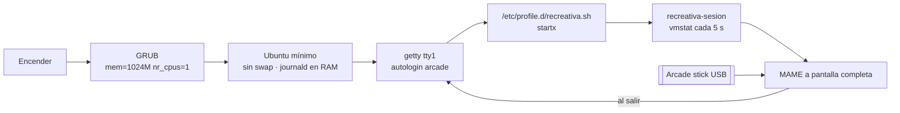

## Instalación paso a paso
Los archivos están en [`config/`](../02-linux-recreativa/config) y [`scripts/`](../02-linux-recreativa/scripts).

#### 1. VM e instalación

1. VirtualBox → **Nueva** → ALMI-ARCADE, Ubuntu (64-bit), **1024 MB y 1 CPU**, disco de 8 GB. Pantalla: VMSVGA. Adaptador puente. USB activado.
2. Instalar **Ubuntu Server 24.04** en modo **minimized** (**Omitir instalación desatendida** en VirtualBox), disco entero, nombre `almi-arcade`, usuario `almiadmin`, **sin** OpenSSH. (En la VM el paquete `openssh-server` está instalado pero **desactivado**: `systemctl is-enabled ssh` → `disabled`.)
3. **Quitar el swap**. Ubuntu 24.04 no crea una partición de intercambio sino un **archivo** `/swap.img`, y el instalador no deja quitarlo. Después de instalar:

   ```bash
   sudo swapoff -a
   sudo sed -i '/swap.img/d' /etc/fstab
   sudo rm -f /swap.img
   swapon --show        # sin salida
   free -m              # Swap: 0
   ```

#### 2. 1 núcleo y 1 GB

`/etc/default/grub`:

```
GRUB_TIMEOUT=3
GRUB_CMDLINE_LINUX_DEFAULT="quiet mem=1024M nr_cpus=1"
```

`sudo update-grub` y reiniciar.

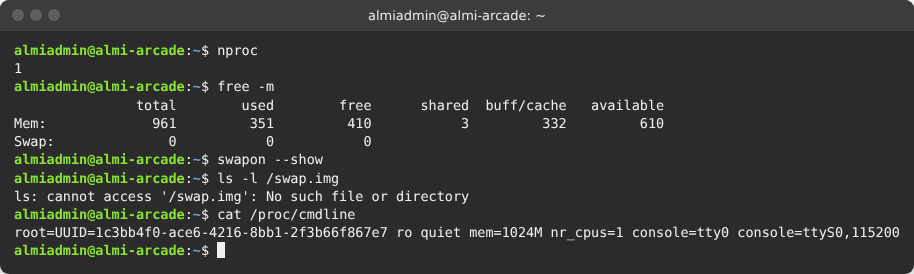

#### 3. Usuarios y seguridad

```bash
sudo useradd -m -s /bin/bash -c "Recreativa" -G audio,video,input arcade
sudo passwd arcade
sudo chmod 700 /home/arcade /home/almiadmin
sudo apt install -y libpam-pwquality cracklib-runtime   # cracklib-runtime: el diccionario de contraseñas débiles
sudo sed -i 's/^# *minlen.*/minlen = 12/' /etc/security/pwquality.conf
sudo ufw default deny incoming && sudo ufw default allow outgoing && sudo ufw enable
```

`arcade` no está en el grupo `sudo`: no puede administrar nada.

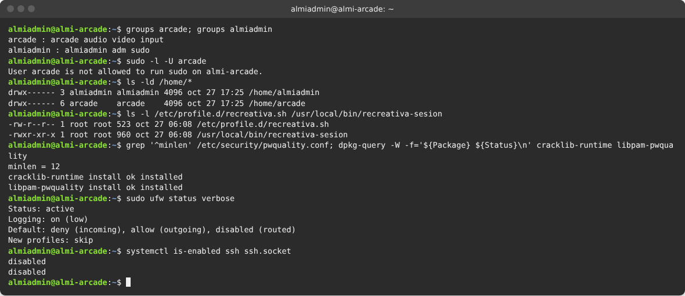

#### 4. Servidor gráfico mínimo y MAME

```bash
sudo apt install -y --no-install-recommends xserver-xorg-core xserver-xorg-input-libinput \
  xserver-xorg-video-fbdev xserver-xorg-video-vesa xinit x11-xserver-utils alsa-utils mame
mame -version
sudo mkdir -p /usr/local/share/games/mame/roms
```

**Juegos**: *Pong* y *Breakout* funcionan **sin ROMs** (MAME los emula a partir del esquema del circuito original). Para más juegos se descargan ROMs legales de mamedev.org (robby, gridlee, supertnk) a `/usr/local/share/games/mame/roms/` y se comprueban con `mame -verifyroms` (instrucciones en [`config/LEEME-roms.txt`](../02-linux-recreativa/config/LEEME-roms.txt), que también se deja en esa carpeta de la VM). Las ROMs no se suben al repositorio.

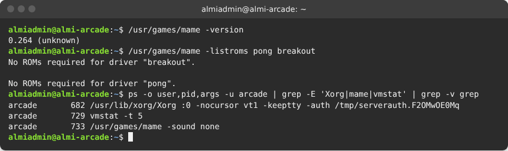

#### 5. Arranque directo a MAME

| Archivo | Dónde | Qué hace |
|---|---|---|
| [`config/autologin.conf`](../02-linux-recreativa/config/autologin.conf) | `/etc/systemd/system/getty@tty1.service.d/override.conf` | `arcade` entra solo en la consola 1 |
| [`config/recreativa-profile.sh`](../02-linux-recreativa/config/recreativa-profile.sh) | `/etc/profile.d/recreativa.sh` (de root, 644) | Cuando `arcade` entra en tty1, arranca X sin cursor con la sesión de la recreativa |
| [`config/recreativa-sesion`](../02-linux-recreativa/config/recreativa-sesion) | `/usr/local/bin/recreativa-sesion` (de root, 755) | Desactiva el salvapantallas, guarda `vmstat` cada 5 s y abre MAME (sin sonido si la máquina no tiene tarjeta de sonido) |
| [`config/ui.ini`](../02-linux-recreativa/config/ui.ini) | `/home/arcade/.mame/ui.ini` | El menú de MAME se abre con Pong seleccionado |
| [`config/mame.ini`](../02-linux-recreativa/config/mame.ini) | `/home/arcade/.mame/mame.ini` | Configuración optimizada (apartado 6). Tiene que estar en ASCII y sin BOM |

Desde la carpeta del repositorio:

```bash
sudo mkdir -p /etc/systemd/system/getty@tty1.service.d
sudo install -m 644 config/autologin.conf /etc/systemd/system/getty@tty1.service.d/override.conf
sudo install -o root -g root -m 644 config/recreativa-profile.sh /etc/profile.d/recreativa.sh
sudo install -o root -g root -m 755 config/recreativa-sesion /usr/local/bin/recreativa-sesion
sudo install -d -o arcade -g arcade /home/arcade/.mame /home/arcade/rendimiento
sudo install -o arcade -g arcade -m 644 config/mame.ini config/ui.ini /home/arcade/.mame/
sudo systemctl daemon-reload && sudo reboot
```

Para administrar con MAME abierto: **Ctrl + Alt + F2** y entrar como `almiadmin`.

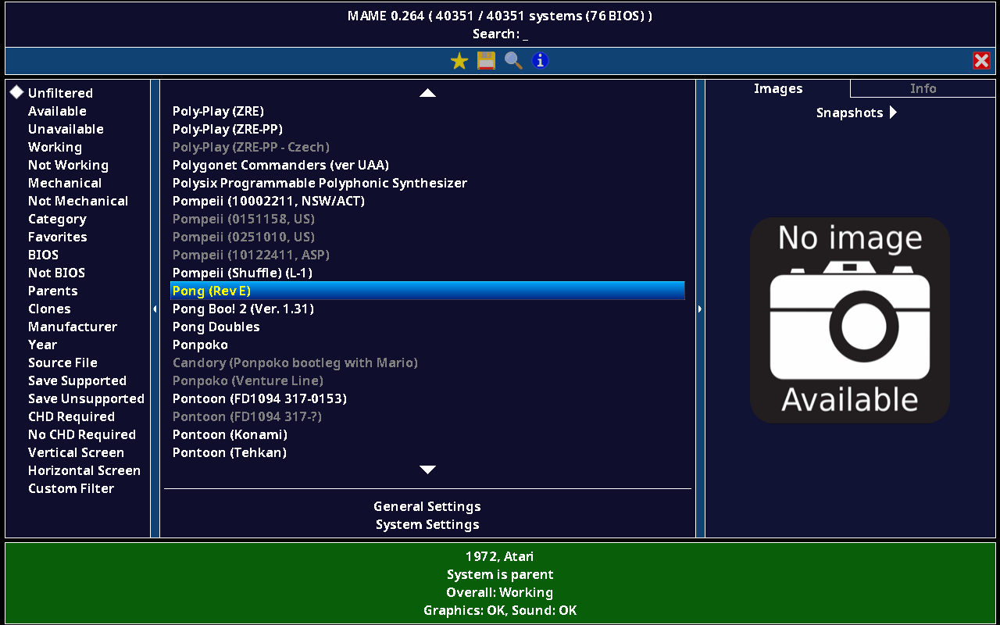

#### 6. Optimización

| Cambio | Para qué |
|---|---|
| Sin swap y `mem=1024M nr_cpus=1` | Lo pide el reto: no usar el disco como memoria |
| `journald` en memoria, máximo 20 MB | No escribir en disco mientras se juega |
| Solo 2 consolas de texto (`NAutoVTs=2`) | Menos procesos |
| Desactivados `apt-daily`, `unattended-upgrades`, `man-db`, `e2scrub`, `fstrim`, `motd-news` y SSH | Nada trabajando en segundo plano durante la partida. Las actualizaciones las hace `almiadmin` a mano una vez por semana |
| Sin `systemd-networkd-wait-online` | Arranque más rápido |
| [`config/mame.ini`](../02-linux-recreativa/config/mame.ini) del usuario arcade | `video soft`, `waitvsync 0`, `autoframeskip 1`, `samplerate 22050`, `skip_gameinfo 1`, `joystick 1` |

Comandos:

```bash
sudo mkdir -p /etc/systemd/journald.conf.d
printf '[Journal]\nStorage=volatile\nRuntimeMaxUse=20M\n' | sudo tee /etc/systemd/journald.conf.d/arcade.conf
sudo sed -i 's/^#NAutoVTs=.*/NAutoVTs=2/' /etc/systemd/logind.conf
for u in apt-daily.timer apt-daily-upgrade.timer man-db.timer e2scrub_all.timer fstrim.timer motd-news.timer unattended-upgrades.service; do
  sudo systemctl disable --now "$u"
done
sudo systemctl disable --now ssh 2>/dev/null   # si se instaló
sudo systemctl mask systemd-networkd-wait-online.service
```

Resultado en la VM: 11 servicios en marcha en la captura, de los que 3 no estarían en uso normal: `serial-getty@ttyS0` (la consola serie que se usó para la prueba) y `user@1000`/`user@1001` (las sesiones abiertas para la captura). 2 temporizadores, el registro en memoria y SSH y las actualizaciones automáticas desactivados.

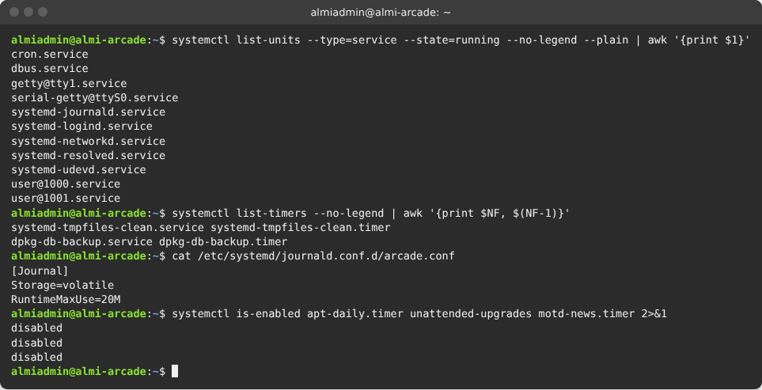

#### 7. Benchmark y monitorización

[`scripts/benchmark.sh`](../02-linux-recreativa/scripts/benchmark.sh) (instalado como `benchmark-recreativa`; se lanza con `sudo benchmark-recreativa`) ejecuta `mame -bench 60` tres veces por juego como el usuario `arcade` y da la media. 100 % es la velocidad real de la máquina original; más de 100 % es que sobra potencia.

> **Dónde se midió.** Las cifras de esta tabla se midieron con MAME 0.264 **en el ordenador donde se preparó el proyecto, no dentro de la VM**, limitando MAME a 1 núcleo con `taskset -c 0`. Sirven para comparar antes y después del `mame.ini`, pero no son la velocidad de la recreativa en VirtualBox. La medida dentro de ALMI-ARCADE en el PC de clase está **pendiente** (prueba 8).

Resultados con MAME 0.264 limitado a **1 núcleo** (en el anfitrión), con la configuración por defecto (antes) y con el `mame.ini` optimizado (después):

| Medida | Antes de optimizar | Después de optimizar |
|---|---|---|
| Pong (`-bench 60`, media de 3) | 297,3 % (307,95 · 298,59 · 285,23) | 315,0 % (311,16 · 317,15 · 316,58) |
| Breakout (`-bench 60`, media de 3) | 97,6 % (93,54 · 88,63 · 110,77) | 114,3 % (114,05 · 114,59 · 109,14) |
| Memoria total visible | 961 MB | 961 MB |
| Swap | 0 | 0 |

*Breakout* es el juego más exigente (simula el circuito discreto componente a componente) y es el que más nota la optimización: pasa de ir justo (por debajo de 100 % en alguna pasada) a ir sobrado en todas.

El script se probó también **dentro de la VM**, para comprobar que funciona donde se instala (antes fallaba: `sudo` no encontraba `mame`, y con el sistema en español la media salía mal). Las cifras de esa prueba (en torno al 20 %) **no miden la recreativa**: la VM se probó sin aceleración por hardware (VT-x).

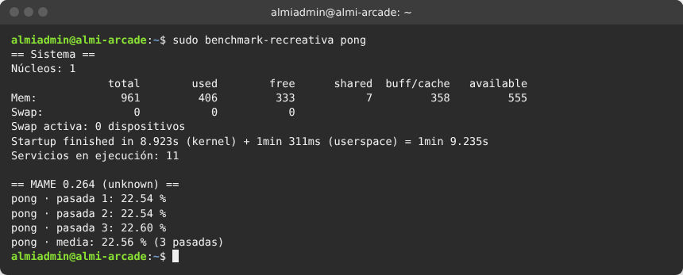

La sesión (`recreativa-sesion`) guarda un registro de `vmstat` en `/home/arcade/rendimiento/` mientras se juega. Las columnas `si` y `so` (memoria que entra y sale del swap) tienen que estar siempre a 0.

En la prueba, con MAME abierto unos 5 minutos (62 muestras): **`swpd`, `si` y `so` siempre a 0**. La CPU sale al 100 % porque esta prueba se hizo **sin aceleración por hardware**; en VirtualBox con VT-x el uso es mucho menor. Las cifras de velocidad buenas son las del benchmark de arriba.

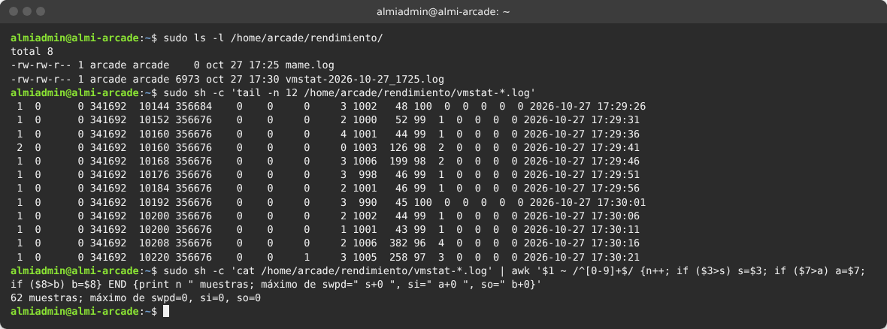

## Solución de problemas
| Problema | Causa | Solución |
|---|---|---|
| MAME se quedaba colgado al arrancar, con la CPU al 100 % y sin abrir ventana | El `mame.ini` tenía comentarios con tildes delante de la marca BOM que pone `mame -createconfig`, y el lector de MAME entra en un bucle | Comentarios del `mame.ini` solo en ASCII y sin BOM |
| MAME se cerraba al momento con *Segmentation fault* y la sesión se reiniciaba en bucle | MAME 0.264 falla al abrir el sonido si la VM no tiene tarjeta de sonido | La sesión comprueba `/proc/asound/cards` y, si no hay tarjeta, arranca MAME con `-sound none`. En VirtualBox conviene activar el audio (Intel HD Audio) |
| X arrancaba solo la primera vez ("drmSetMaster failed: Permission denied") | Faltaba `libpam-systemd`: la sesión de arcade no se registraba en logind y X sin root no podía usar la pantalla | Instalar `libpam-systemd` (viene en una instalación normal de Ubuntu) |
| X no arranca con "Failed to load module fbdev/vesa" | Sin aceleración gráfica disponible, X no tenía controlador de respaldo | Instalar `xserver-xorg-video-fbdev` y `xserver-xorg-video-vesa`; en VirtualBox usar VMSVGA |
| No había ROMs legales descargables desde clase en el primer momento | | Pong y Breakout no necesitan ROMs; el resto se añade desde mamedev.org |

# 5. Arcade stick con Arduino

## Objetivo
Construir el mando de la recreativa: un **joystick de 8 direcciones y 9 botones** (6 de juego, Moneda, Start y Menú) conectados a una placa **Arduino** que el ordenador reconoce como **mando USB** o como **teclado USB**, y configurarlo en MAME dentro de la VM ALMI-ARCADE.

Tareas del tablero: S01 a S09.

## Requisitos
| Elemento | Detalle |
|---|---|
| Placa | La que da el profesor (no es un Uno). Ver la tabla de caminos |
| Joystick | Arcade de 8 direcciones con 4 microinterruptores |
| Botones | 6 de 30 mm (juego) + 3 de 24 mm (Moneda, Start, Menú), con microinterruptor |
| Cables | Faston de 2,8 mm y cable USB de la placa |
| Software | Arduino IDE 2 (AppImage) en Zorin; librería ArduinoJoystickLibrary (camino A) o Keyboard (camino B) |

#### Qué camino seguir según la placa

| Placa | Chip | ¿Mando o teclado USB? | Camino |
|---|---|---|---|
| Arduino Leonardo, Micro, Pro Micro y clones | ATmega32U4 | Sí, de serie | **A** (mando) o **B** (teclado) |
| Arduino Uno R4 Minima / WiFi | Renesas RA4M1 | Sí, como teclado | **B** (teclado) |
| Uno R3, Mega, Nano | ATmega328P / 2560 | No de serie | **C** (plan B) |

Para saber cuál es: nombre impreso en la placa y `lsusb` al conectarla.

## Cableado
Cada microinterruptor tiene **COM** (común), **NO** (normalmente abierto) y **NC** (no se usa). Todos los COM en cadena a **GND**; cada NO a su pin. No hacen falta resistencias: se usan las internas de la placa (`INPUT_PULLUP`, pulsado = LOW).

| Función | Pin | Camino A (mando) | Camino B (tecla) | En MAME |
|---|---|---|---|---|
| Arriba | 2 | Eje Y = -1 | Flecha arriba | Mover arriba |
| Abajo | 3 | Eje Y = +1 | Flecha abajo | Mover abajo |
| Izquierda | 4 | Eje X = -1 | Flecha izquierda | Mover izquierda |
| Derecha | 5 | Eje X = +1 | Flecha derecha | Mover derecha |
| Botón 1 | 6 | Botón 1 | Ctrl izquierdo | Botón 1 |
| Botón 2 | 7 | Botón 2 | Alt izquierdo | Botón 2 |
| Botón 3 | 8 | Botón 3 | Espacio | Botón 3 |
| Botón 4 | 9 | Botón 4 | Shift izquierdo | Botón 4 |
| Botón 5 | 10 | Botón 5 | Z | Botón 5 |
| Botón 6 | A0 | Botón 6 | X | Botón 6 |
| Moneda | A1 | Botón 7 | 5 | Meter moneda |
| Start | A2 | Botón 8 | 1 | Empezar (jugador 1) |
| Menú | A3 | Botón 9 | Tab | Menú de MAME |

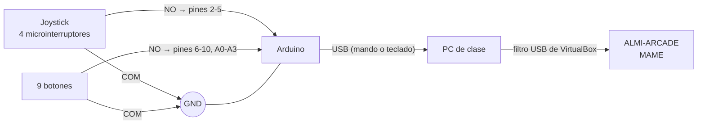

El joystick empuja el microinterruptor del lado contrario: si al mover arriba sale "Abajo", se intercambian esos dos cables.

## Programas
| Programa | Para qué |
|---|---|
| [`sketches/prueba_cableado/prueba_cableado.ino`](../03-arcade-stick/sketches/prueba_cableado/prueba_cableado.ino) | Escribe en el Monitor Serie (9600) qué se pulsa. Sirve para comprobar los 13 cables antes de nada |
| [`sketches/arcade_stick_mando/arcade_stick_mando.ino`](../03-arcade-stick/sketches/arcade_stick_mando/arcade_stick_mando.ino) | **Camino A**: mando USB con ejes X/Y y 9 botones. Solo envía cuando algo cambia |
| [`sketches/arcade_stick_teclado/arcade_stick_teclado.ino`](../03-arcade-stick/sketches/arcade_stick_teclado/arcade_stick_teclado.ino) | **Camino B**: teclado USB con las teclas por defecto de MAME. **Modo seguro**: si se conecta con Menú pulsado no envía teclas, para poder reprogramar la placa |

| [`sketches/arcade_stick_configurable/arcade_stick_configurable.ino`](../03-arcade-stick/sketches/arcade_stick_configurable/arcade_stick_configurable.ino) | **Camino A configurable** (programa de Julen, Drive del equipo, 10 de noviembre): mando USB con **antirrebote** (5 ms), direcciones opuestas que se anulan, palanca como ejes o como cruceta (`DIRECTIONS_AS_HAT`) y **remapeo de botones sin reprogramar** por el puerto serie, guardado en la EEPROM |

Los cuatro programas compilan sin errores para Arduino Leonardo (ATmega32U4) con la librería ArduinoJoystickLibrary (camino A) y la librería Keyboard (camino B). Comprobado con `arduino-builder` el 10 de noviembre: el configurable ocupa 11 338 bytes (39 % de la memoria de programa).

#### Remapeo sin reprogramar (programa configurable)

Es lo que pide el nivel 4 de la rúbrica del stick (*input personalizable y antirrebote*). Con la placa conectada, en el Monitor Serie a **115200** baudios:

| Orden | Qué hace |
|---|---|
| `SHOW` | Muestra qué botón del sistema genera cada botón físico |
| `MAP 1 3` | El botón físico 1 pasa a ser el botón 3 |
| `SAVE` | Lo guarda en la EEPROM: se mantiene al desconectar |
| `RESET` | Vuelve al mapeo de fábrica (después `SAVE` para fijarlo) |

**Diferencia con el cableado de la tabla**: este programa lee **4 botones** (pines 6-9), no 9. Para los 9 del diseño (con Moneda, Start y Menú) hay que subir `NUM_BTN` a 9 y añadir `10, A0, A1, A2, A3` al final de `IN_PINS`, como dice su comentario. Si la EEPROM tiene un mapeo de 4 botones guardado, al cambiar `NUM_BTN` conviene hacer `RESET` y `SAVE`.

## Instalación paso a paso
1. **Arduino IDE 2** en Zorin: AppImage de arduino.cc, `sudo apt install -y libfuse2`, `chmod +x`, `sudo usermod -aG dialout $USER` y volver a iniciar sesión.
2. **Tools → Board**: Leonardo, Micro (o Leonardo para un Pro Micro de 5 V) o Uno R4. **Tools → Port**: `/dev/ttyACM0`. Probar con *Blink*.
3. Cablear según la tabla con la placa desconectada.
4. Subir `prueba_cableado` y comprobar las 13 entradas en el Monitor Serie.
5. Camino A: **Sketch → Include Library → Add .ZIP Library** con ArduinoJoystickLibrary (github.com/MHeironimus/ArduinoJoystickLibrary) y subir `arcade_stick_mando`. Camino B: subir `arcade_stick_teclado`.
6. Probar en Zorin: `sudo apt install -y joystick evtest`; camino A con `jstest /dev/input/js0`, camino B con `sudo evtest`. En Windows, `joy.cpl`.
7. **Pasar el stick a la recreativa**: VM ALMI-ARCADE apagada → **Configuración → USB → +** → elegir el Arduino. Al arrancar, la placa pasa a la VM.
8. **Controles en MAME**: con el juego abierto, **Tab** → *Input (this Machine)* o *Input (general)* → elegir cada acción y pulsar el botón del stick. MAME lo guarda en `~/.mame/cfg/`. En el camino B no hace falta: ya usa las teclas de MAME.

#### Camino C (plan B) si la placa es un Uno R3, Mega o Nano

Esas placas no pueden ser mando USB de serie. Opciones: (1) pedir un Pro Micro (unos 6-8 €) o (2) mantener el programa de prueba que escribe por el puerto serie y un pequeño script en la VM que convierta lo que llega en pulsaciones de teclado (`python3-evdev` con `uinput`). Se documenta cuál se usa.

## El arcade stick funcionando

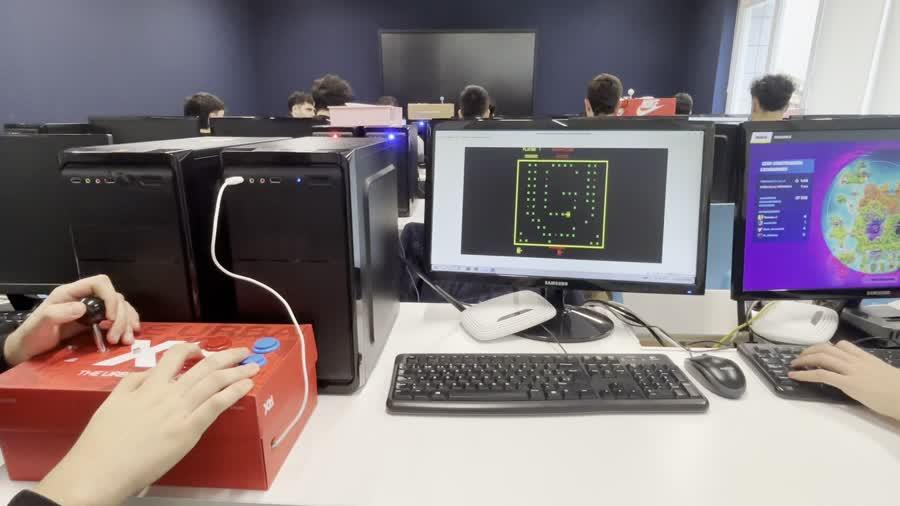

Vídeo de la prueba del arcade stick conectado a la recreativa y jugando en MAME: [abrir el vídeo en Google Drive](https://drive.google.com/file/d/1sB5696oLMcich_KJwhIkgUCDqDXQG4Dg/view). Para verlo desde el papel, escanear el código QR.


## Solución de problemas
Problemas que pueden aparecer al montarlo y cómo resolverlos:

| Problema | Solución |
|---|---|
| Al mover arriba sale "Abajo" (o izquierda/derecha cambiadas) | El joystick empuja el microinterruptor del lado contrario: se intercambian esos dos cables |
| La placa es un Uno R3, Mega o Nano | No puede ser mando USB de serie: camino C |
| Un botón pegado o un programa que no deja de enviar teclas impide reprogramar la placa | Conectarla con *Menú* pulsado (modo seguro) o pulsar *reset* justo cuando el IDE empieza a subir el programa (en un Pro Micro, dos veces seguidas) |

# 6. Red del restaurante

## Objetivo
Diseñar la red del restaurante: elegir la línea **WAN**, hacer el **plan de direccionamiento**, el **plano del local**, la red completa en **Packet Tracer** (switch, router, operador, servidores, TPV, Wi-Fi) con seguridad, y configurar los **dos routers físicos**: el principal seguro y el secundario como **repetidor WDS**.

Tareas del tablero: R01 a R10.

## Línea WAN
Lo que necesita el restaurante: fibra **simétrica** (las copias suben a la nube), suficiente para los TPV, Odoo, la Wi-Fi de clientes y las copias, **línea fija** para las reservas, router con buena Wi-Fi y sin permanencia larga. Se han comparado las ofertas de fibra para negocios de dos operadores, a la misma velocidad (600 Mb), consultadas el 16 de noviembre de 2026 en sus páginas oficiales:

| | **Movistar** · Fibra 600 Mb Autónomos | **Vodafone Business** · Fibra óptica 600 Mbps |
|---|---|---|
| Velocidad | 600 Mb simétricos | 600 Mb simétricos (según cobertura) |
| Precio con IVA | **24,90 €/mes** los 12 primeros meses, después 35,00 €/mes | **37,05 €/mes** (30,62 € sin IVA) |
| Precio sin IVA | 20,57 €/mes, después 28,93 €/mes | 30,62 €/mes |
| Coste el primer año (con IVA) | **298,80 €** | **444,60 €** |
| Línea fija | Incluida: llamadas ilimitadas a fijos y 50 min/mes a móviles | Incluida: 6.000 min/mes a fijos y móviles nacionales |
| Router | Smart WiFi 7 | WiFi 6, hasta 120 dispositivos |
| Alta e instalación | Gratis | Gratis (oferta web) |
| Permanencia | Sin permanencia | No se indica |
| Soporte | Llamadas de clientes prioritarias | Soporte preferente para empresas |
| IP fija | No se indica: hay que pedirla aparte | No se indica: hay que pedirla aparte |
| Fuente | [movistar.es · Internet autónomos](https://www.movistar.es/autonomos/fibra-optica/internet-autonomos) (promoción hasta el 30/11/2026) | [vodafone.es · Fibra pymes](https://www.vodafone.es/c/empresas/pymes/es/conectividad/internet-fijo-y-television/fibra/) |

**Elección: Movistar Fibra 600 Mb.** A la misma velocidad cuesta unos 146 € menos el primer año y, después de la promoción, sigue siendo más barata (35,00 € frente a 37,05 € al mes). Además no tiene permanencia, las llamadas a fijos son ilimitadas y el router es Wi-Fi 7. Ninguna de las dos incluye IP fija en la oferta: hay que pedirla al contratar, porque el local no la necesita para navegar pero sí si un día se quiere acceder a Odoo desde fuera.

## Red en Packet Tracer
Archivo: [`packet-tracer/RETO1-FINAL.pkz`](../04-red/packet-tracer/RETO1-FINAL.pkz).

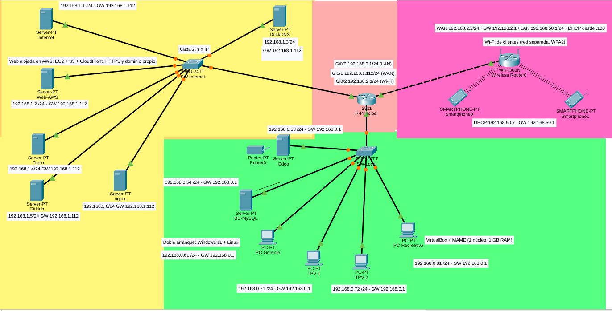

| Zona | Red | Equipos |
|---|---|---|
| Local (switch SW-Local) | 192.168.0.0/24, puerta de enlace 192.168.0.1 | Odoo .53 (con la impresora), BD-MySQL .54, PC-Gerente .61 (doble arranque), TPV-1 .71, TPV-2 .72, PC-Recreativa .81 |
| Router R-Principal (2911) | Gi0/0 192.168.0.1 (LAN), Gi0/1 192.168.1.112 (WAN), Gi0/2 192.168.2.1 (Wi-Fi) | — |
| Wi-Fi de clientes (WRT300N) | WAN 192.168.2.2, LAN 192.168.50.0/24 con DHCP desde .100, WPA2 | Móviles de los clientes, separados del local |
| Internet (switch SW-Internet) | 192.168.1.0/24, puerta de enlace 192.168.1.112 | Internet, Web-AWS, DuckDNS, Trello, GitHub y nginx (simulados) |

Los clientes de la Wi-Fi están en una red aparte (192.168.50.0/24), detrás de su propio router, así que no llegan a los equipos del local.

## Routers reales y repetidor WDS
**R1, principal**: reset de fábrica, contraseña de administración nueva, firmware actualizado, SSID `AlmiChain-Clientes`, **canal fijo** (1, 6 u 11, el menos usado: `nmcli -f SSID,CHAN,SIGNAL dev wifi list`), ancho de 20 MHz, **WPA2-PSK AES**, **WPS desactivado**, **administración remota y UPnP desactivados**, aislamiento de clientes si lo tiene.

**R2, repetidor WDS**: reset, contraseña nueva, **IP de LAN en la red de R1 fuera de su rango DHCP** (p. ej. 192.168.0.2), **DHCP desactivado**, **mismo canal** que R1, **Habilitar puente WDS** → buscar `AlmiChain-Clientes` → WPA2-PSK con la clave de R1. En Estado tiene que poner WDS **Run/Conectado**. Si el modelo no tiene WDS, se usa el modo repetidor/extensor y se documenta.

Guía detallada: [`routers/configuracion-routers.md`](../04-red/routers/configuracion-routers.md).

# 7. ERP Odoo con TPV

## Objetivo
El restaurante necesita un ERP con facturación, clientes (CRM), personal, marketing, inventario y TPV. Se ha elegido **Odoo Community**, instalado en la VM **ALMI-ODOO** (`odooserver`, 192.168.0.53) con PostgreSQL 16 y accesible en el puerto **8069**. Los dos TPV de la barra son los puntos de venta **Barra 1** y **Barra 2** de Odoo. Cuando se cobra una venta a un cliente, Odoo **crea y publica la factura**, la **deja preparada para enviarla por correo** con el PDF y **descuenta el stock**, sin que nadie toque nada.

Tareas del tablero: E01 a E13.

## Instalación paso a paso
Así se montó Odoo en la VM de clase, según los **apuntes de Oier** ([`Apuntes_Odoo.pdf`](../05-erp-odoo/Apuntes_Odoo.pdf)) y las 31 capturas de **Richar** (23, 26 y 27 de octubre), que están en [`capturas/`](../05-erp-odoo/capturas) con el prefijo `clase-`.

| Elemento | Valor |
|---|---|
| Servidor | Ubuntu Server en VirtualBox (`odooserver`, usuario `odoo`) |
| Acceso | `http://192.168.0.53:8069` |
| Base de datos | PostgreSQL 16, puerto 5432: base de Odoo `almi-chain` y base del reto `restaurante` |
| Configuración | `/etc/odoo.conf` |
| Servicio | `odoo.service` (systemd), con un entorno virtual de Python |

1. **Configurar Odoo y su servicio.** `/etc/odoo.conf` con la contraseña maestra, el usuario de base de datos `odoo` y la carpeta de módulos. El servicio `odoo.service` arranca Odoo después de la red y de PostgreSQL, con el usuario `odoo`, y lo reinicia si se cae.
2. **Arreglar el arranque.** El servicio fallaba (`status=203/EXEC`) porque la ruta de `ExecStart` no era la real. Con las rutas correctas (`/home/odoo/odoo/venv/bin/python3` y `odoo-bin`), `daemon-reload` y `restart`, queda `active (running)` y `enabled`.
3. **Red.** `ufw allow 8069/tcp`, comprobar con `ss -tulpn` que escucha en el 8069 y con `ip a` la IP del servidor (192.168.0.53).
4. **Crear la base de datos** desde el navegador: contraseña maestra, nombre `almi-chain`, idioma español, país España y sin datos de demostración. El error *Access Denied* se debía a la contraseña maestra.
5. **Aplicaciones.** Al activar Punto de venta faltaba la librería `phonenumbers`: se instaló con `pip` dentro del entorno virtual y se reinició Odoo.
6. **SSH** para administrar el servidor desde el PC de clase (`ssh odoo@192.168.0.53`).
7. **PostgreSQL.** Comprobar el clúster 16 (`pg_lsclusters`), ver las bases y los roles con `psql`, crear el usuario `almi_chain` e importar la base del restaurante con `psql restaurante < restaurante_postgres.sql`.
8. **DBeaver.** Para conectarse desde otro equipo hace falta que PostgreSQL escuche en la red (`listen_addresses`, `pg_hba.conf` y `ufw allow 5432/tcp`).

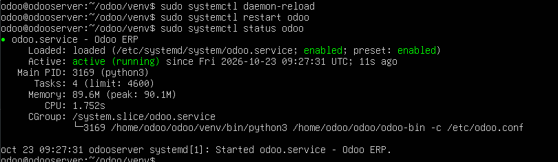

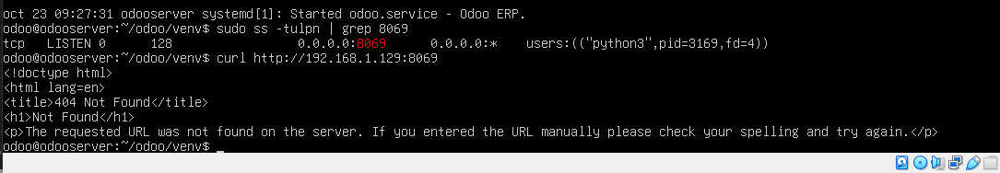

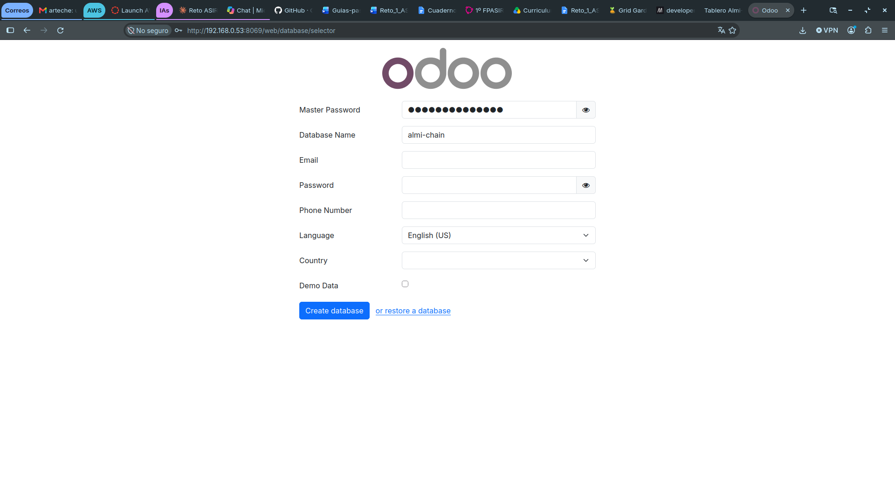

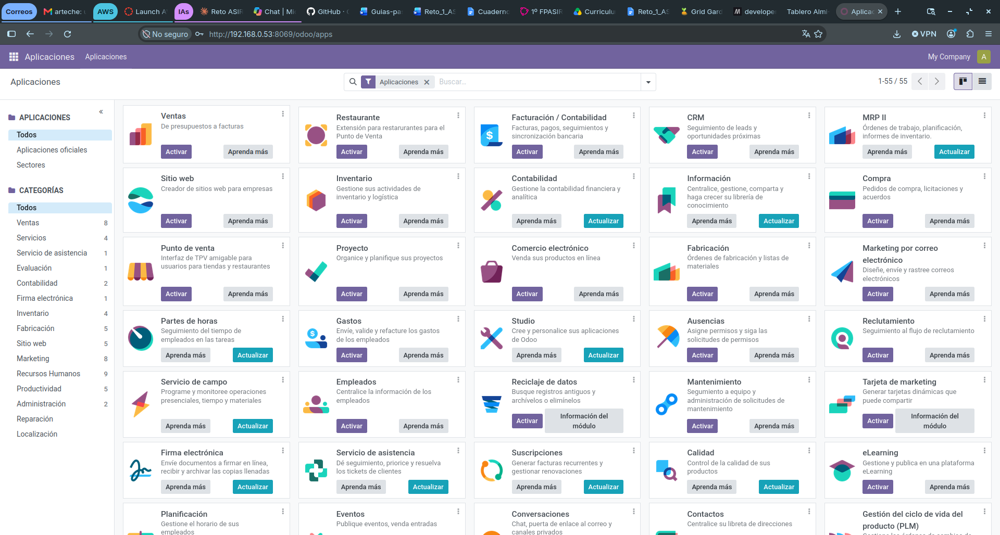

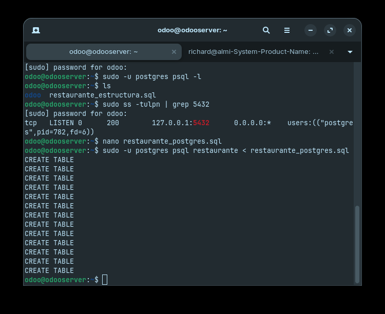

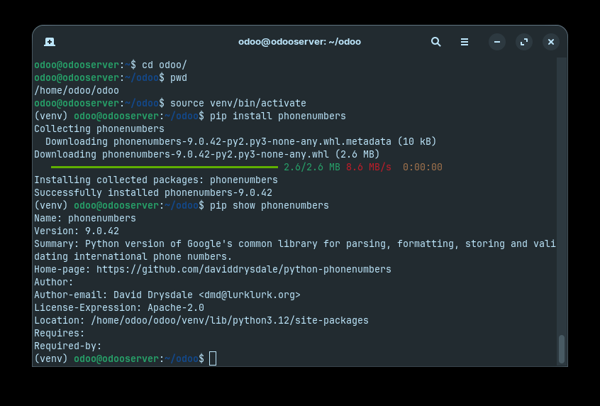

## Configuración de Odoo: aplicaciones, usuarios, productos y TPV
Todo esto se configuró con el script [`scripts/configurar_odoo.py`](../05-erp-odoo/scripts/configurar_odoo.py), que hace por XML-RPC lo mismo que los pasos a mano de la guía (en la interfaz de Odoo) y sirve para rehacerlo en unos minutos si hay que reinstalar (las contraseñas se pasan como variables de entorno, no están en el script):

```bash
export ODOO_URL=http://192.168.0.53:8069
export ODOO_ADMIN_LOGIN=... ODOO_ADMIN_PASS=... ODOO_GERENTE_PASS=... ODOO_BARRA1_PASS=... ODOO_BARRA2_PASS=...
python3 scripts/configurar_odoo.py
```

**Aplicaciones**: Facturación, Punto de venta, CRM, Empleados, Marketing por correo electrónico, Inventario y Reglas de automatización.

**Empresa**: Almi Bites Restaurantes, Bilbao, EUR, con el logotipo de la web.

**Usuarios con mínimo privilegio** (E06):

| Usuario | Inicio de sesión | Permisos |
|---|---|---|
| Gerente | gerente@almichain.local | Facturación: Facturación · TPV: Administrador · CRM: Administrador · Empleados: Administrador · Inventario: Administrador · Marketing: Usuario · **sin Ajustes** |
| Camarero Barra 1 | barra1@almichain.local | Solo Punto de venta: Usuario |
| Camarero Barra 2 | barra2@almichain.local | Solo Punto de venta: Usuario |

**Empleados**: Gorka Larrea (Gerente, Dirección, usuario Gerente), Nerea Olabarria (Camarera, Sala, usuario Camarero Barra 1), Asier Landa (Camarero, Sala, usuario Camarero Barra 2) y Miren Agirre (Cocinera, Cocina).

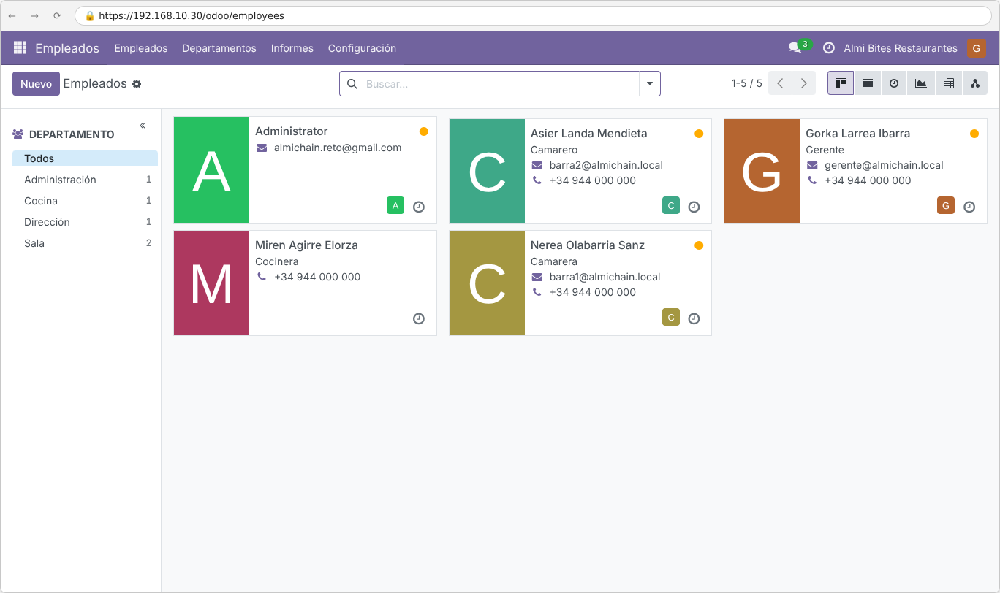

**Productos** (E07): 4 bebidas y 4 platos, tipo Bienes con **Rastrear inventario**, **IVA 10 % (hostelería) con el precio con IVA incluido**, disponibles en el TPV en las categorías Bebidas y Platos, 50 unidades de stock inicial. **Clientes**: Ane Etxeberria, Jon Arrieta y Lucía Martín.

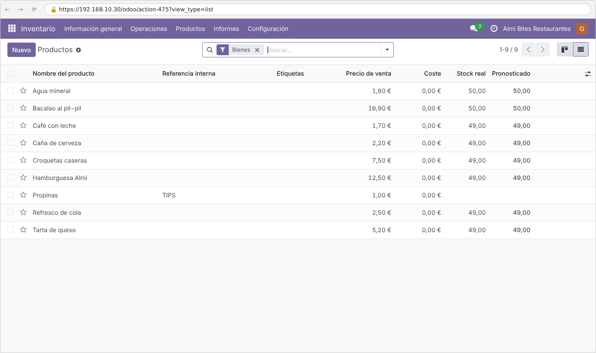

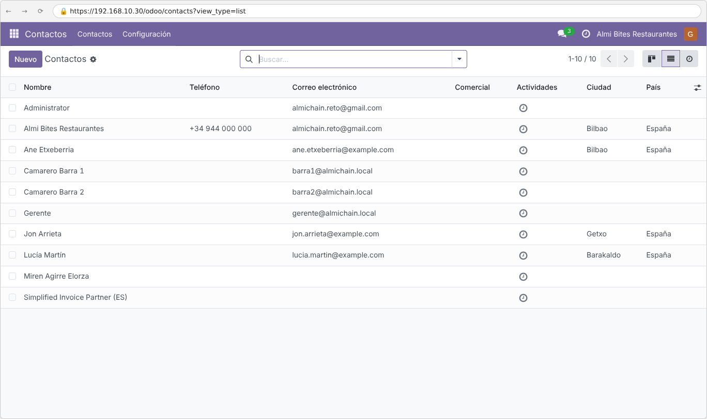

**TPV** (E08): **Barra 1** (`config_id=1`) y **Barra 2** (`config_id=2`), cada uno con **Tarjeta** y su propia caja de **Efectivo** (Odoo no deja compartir un método de efectivo entre dos TPV), cabecera y pie del recibo e **impresión automática** sin vista previa.

**Correo saliente** (E09): servidor `smtp.gmail.com`, puerto 587, STARTTLS, usuario `almichain.reto@gmail.com`. La **contraseña de aplicación** de Gmail se escribe a mano en Odoo y se guarda en KeePassXC.

**Factura automática** (E10): regla **TPV - Facturar pedidos con cliente** sobre *Pedidos de TPV*, que se dispara cuando el estado pasa a **Pagado**, con el filtro `[('partner_id', '!=', False), ('to_invoice', '=', False), ('account_move', '=', False)]`: el pedido tiene cliente, el camarero **no** ha marcado ya *Factura* en el TPV (si lo marca, Odoo la hace él) y todavía no tiene factura. Así nunca sale una factura doble:

```python
for order in records:
    if order.partner_id and not order.account_move:
        order.action_pos_order_invoice()
```

## Prueba: venta en el TPV y factura automática
Con el usuario **Camarero Barra 1** se abre la caja de **Barra 1**, se marcan una caña, un refresco y una hamburguesa, se elige la clienta **Ane Etxeberria** y se cobra en efectivo. Después, con **Camarero Barra 2**, una venta en **Barra 2** a **Jon Arrieta**.

**Barra 1** (Camarero Barra 1, clienta Ane Etxeberria):


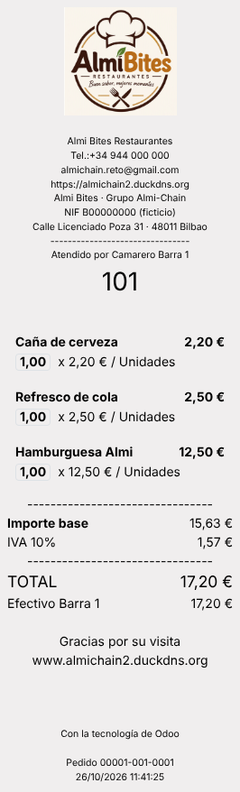

**Barra 2** (Camarero Barra 2, cliente Jon Arrieta):

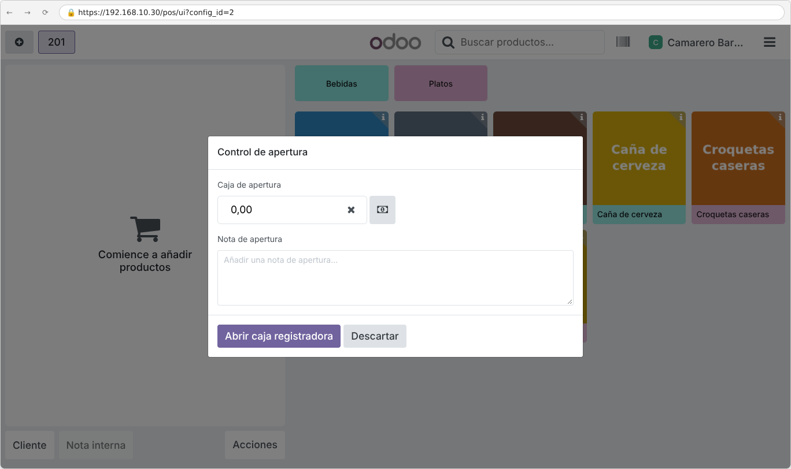

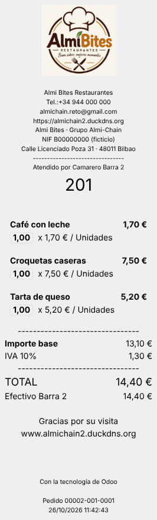

Resultado visto por el **Gerente**:


## Copia de seguridad de Odoo
Script [`scripts/copia-odoo.sh`](../05-erp-odoo/scripts/copia-odoo.sh) en `/usr/local/bin/`, todos los días a las **02:30** con cron de root. Guarda la base de datos (`pg_dump` en formato propio), los adjuntos (`filestore`), las huellas SHA-256, borra las copias de más de 7 días y lo manda todo a **ALMI-BD** por SSH con una clave que solo sirve para eso.

Prueba de restauración en una base nueva `almichain_restaurada`: tiene el mismo número de pedidos que la original.

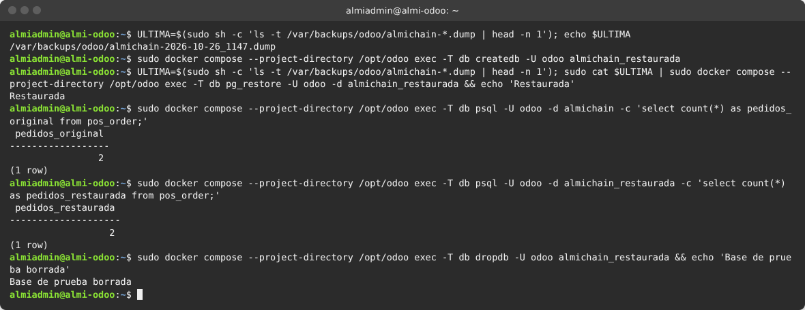

## Disco redundante del servidor (RAID 1)
Hecho por Richar el 30 de octubre en la VM de Odoo de clase (`odooserver`, **VirtualBox**), a partir de su documento *Configurar disco redundante* (Drive del equipo). Con la VM apagada se añaden **dos discos de 25 GB** al controlador SATA y se monta con ellos un **RAID 1** con `mdadm` en `/srv/raid1`.

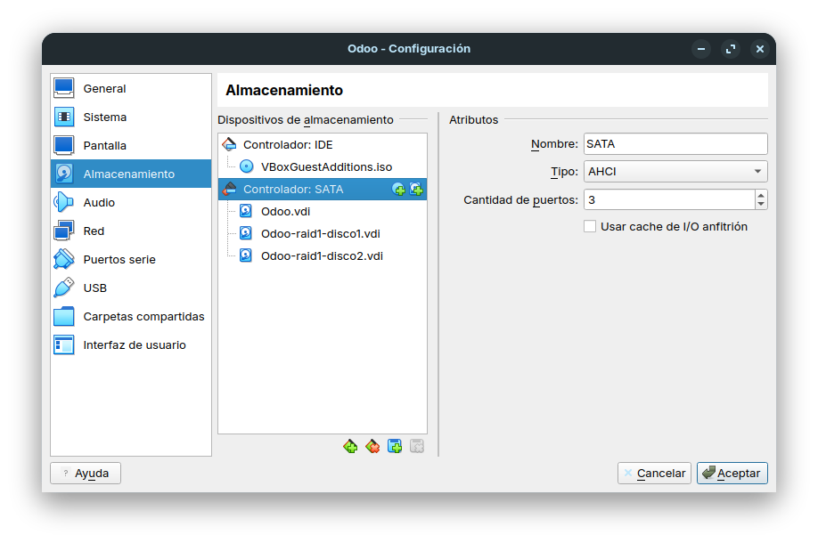

**Fase 1. Identificar los discos.** `sda` es el disco del sistema (donde está Odoo); `sdb` y `sdc` son los dos nuevos.

```bash
lsblk -e 7 -o NAME,PATH,SIZE,MODEL,SERIAL,TYPE,FSTYPE,MOUNTPOINTS
```

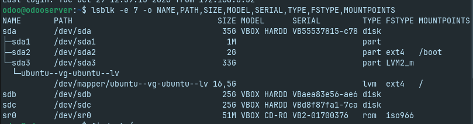

**Fase 2. Instalar mdadm** (crea, administra y vigila el RAID): `sudo apt install mdadm -y`.

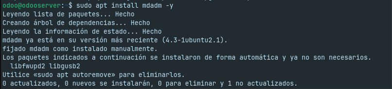

**Fase 3. Particionar** los dos discos igual: tabla GPT, una partición de todo el disco marcada como RAID, y que el sistema vuelva a leer las particiones.

```bash
sudo parted /dev/sdb --script mklabel gpt
sudo parted /dev/sdb --script mkpart primary 1MiB 100%
sudo parted /dev/sdb --script set 1 raid on
# lo mismo con /dev/sdc
sudo partprobe /dev/sdb; sudo partprobe /dev/sdc
```

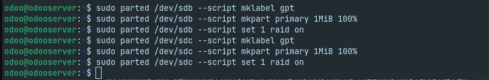

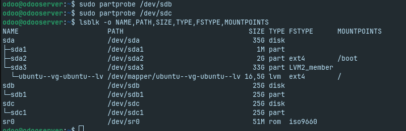

**Fase 4. Crear el RAID 1** con las dos particiones:

```bash
sudo mdadm --create /dev/md0 --verbose --level=1 --raid-devices=2 \
  --metadata=1.2 --name=odoo_raid --bitmap=internal /dev/sdb1 /dev/sdc1
```

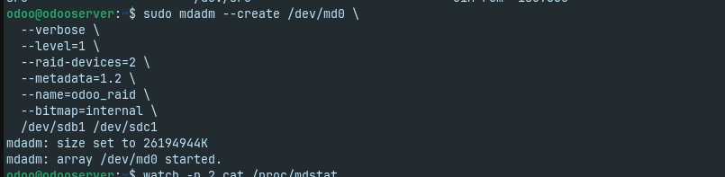

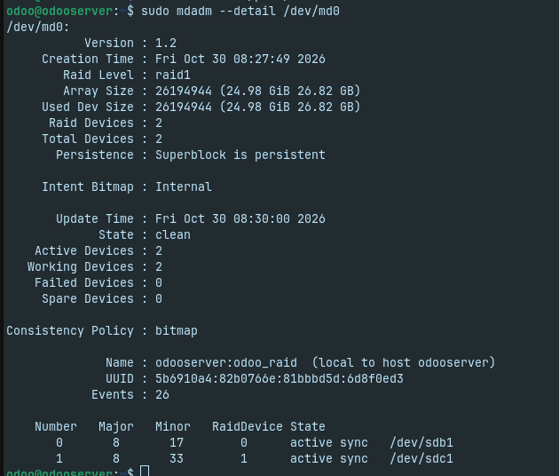

**Fase 5. Formatear y montar**: ext4 con etiqueta `ODOO_RAID`, montado en `/srv/raid1`.

```bash
sudo mkfs.ext4 -L ODOO_RAID /dev/md0
sudo mkdir -p /srv/raid1
sudo mount /dev/md0 /srv/raid1
df -hT /srv/raid1
```

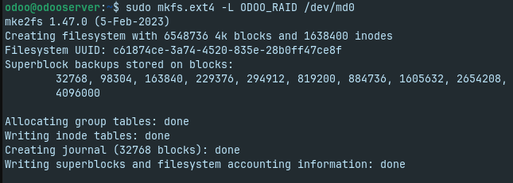

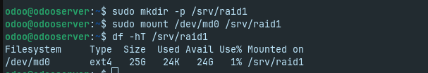

**Fase 6. Montaje automático**: línea en `/etc/fstab` por **UUID** del sistema de archivos y con `nofail`, para que el servidor arranque aunque el RAID falle.

```
UUID=<uuid de /dev/md0> /srv/raid1 ext4 defaults,nofail 0 2
```

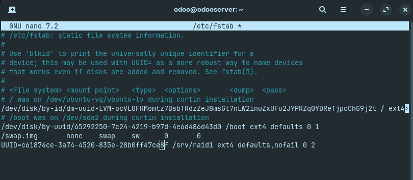

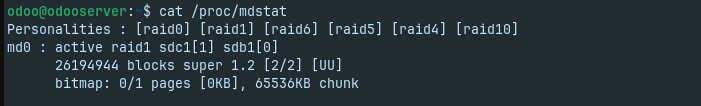

**Fase 7. Guardar la configuración de mdadm**, para que el array se llame siempre `md0` al arrancar:

```bash
sudo mdadm --detail --scan | sudo tee -a /etc/mdadm/mdadm.conf
```

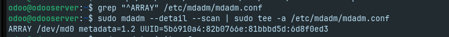

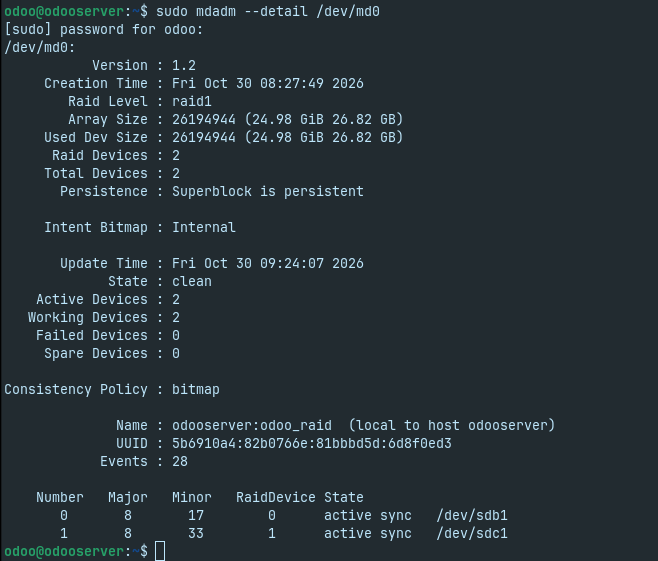

**Qué queda por hacer para que sirva de verdad** (revisión del procedimiento):

- `sudo update-initramfs -u` después de la fase 7: sin él, en algunos arranques el array aparece como `md127` y el `fstab` no lo encuentra (por eso conviene montarlo por UUID, como se hizo).
- **Usarlo**: ahora es un disco vacío. Lo útil es que las copias de Odoo ([`copia-odoo.sh`](../05-erp-odoo/scripts/copia-odoo.sh), apartado 7) se guarden en `/srv/raid1` o mover ahí los datos de PostgreSQL, con Odoo parado.
- **Probar un fallo**: `sudo mdadm /dev/md0 --fail /dev/sdc1`, comprobar que los datos siguen, y `--remove` / `--add` para reconstruirlo, con su captura (como en las pruebas del RAID de [ALMI-BD](../07-bd-raid-copias/README.md)).

# 8. Web del restaurante en AWS

## Objetivo
La web informativa del restaurante **Almi Bites** (carta, galería, mapa con **geolocalización** y formulario de contacto), preparada para publicarse en **AWS Academy** con **Terraform**, dominio gratuito de **DuckDNS** y **HTTPS** de Let's Encrypt en **https://almichain2.duckdns.org**. Con `terraform destroy` y `terraform apply` se rehace todo igual (despliegue reproducible).

> **Estado**: **desplegada** en AWS Academy (región `us-east-1`) el 10 de noviembre de 2026 y publicada en **https://almichain2.duckdns.org**. El despliegue paso a paso, con capturas, está en [`docs/06-evidencias-despliegue.md`](../06-web-aws/docs/06-evidencias-despliegue.md). Quedan por documentar las pruebas 3 a 10 de la tabla de pruebas.

Tareas del tablero: W01 a W09. Esta carpeta es el proyecto de Terraform completo: se despliega desde aquí (ver la [guía de despliegue](../06-web-aws/docs/02-guia-despliegue.md)).

## Requisitos
| Elemento | Valor |
|---|---|
| Nube | AWS Academy Learner Lab (región `us-east-1`), coste 0 € |
| Herramientas en el PC | Terraform 1.x, credenciales del lab en `~/.aws/credentials` |
| Dominio | `almichain2.duckdns.org` (token de DuckDNS en KeePassXC) |
| Servidor | EC2 Ubuntu 24.04 con nginx y Certbot, IP elástica |

## Cómo funciona
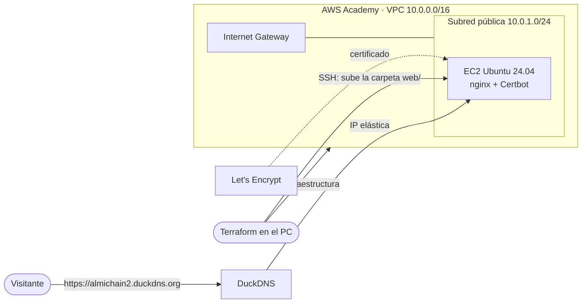

Terraform crea **13 recursos**: VPC, Internet Gateway, subred, tabla de rutas y su asociación, grupo de seguridad (22, 80, 443), clave privada, par de claves, fichero `.pem`, IP elástica, EC2, asociación de la IP y la subida de la web. Al arrancar, la EC2 instala nginx, actualiza la IP en DuckDNS, pide el certificado y fuerza HTTPS.

## Archivos
| Archivo | Qué es |
|---|---|
| [`versions.tf`](../06-web-aws/versions.tf) | Versión de Terraform y proveedores (aws, tls, local) |
| [`variables.tf`](../06-web-aws/variables.tf) | Variables (subdominio, token, correo, región, tipo de instancia) |
| [`main.tf`](../06-web-aws/main.tf) | Toda la infraestructura |
| [`outputs.tf`](../06-web-aws/outputs.tf) | IP, URL y comando SSH al terminar |
| [`user_data.sh.tftpl`](../06-web-aws/user_data.sh.tftpl) | Script de arranque del servidor (nginx, DuckDNS, HTTPS) |
| [`terraform.tfvars.example`](../06-web-aws/terraform.tfvars.example) | Plantilla de datos personales (el `terraform.tfvars` real no se sube) |
| [`web/`](../06-web-aws/web) | La web: `index.html`, `estilos.css`, `geo.js` (geolocalización) e imágenes |
| [`docs/00-diseno-web.md`](../06-web-aws/docs/00-diseno-web.md) | Diseño de la web: secciones, colores, responsive y accesibilidad (documento de Julen) |
| [`docs/01-arquitectura.md`](../06-web-aws/docs/01-arquitectura.md) | Arquitectura en AWS |
| [`docs/02-guia-despliegue.md`](../06-web-aws/docs/02-guia-despliegue.md) | Guía de despliegue paso a paso |
| [`docs/03-explicacion-codigo.md`](../06-web-aws/docs/03-explicacion-codigo.md) | Explicación del código de Terraform y del script de arranque |
| [`docs/04-pruebas.md`](../06-web-aws/docs/04-pruebas.md) | Pruebas detalladas |
| [`docs/05-mantenimiento.md`](../06-web-aws/docs/05-mantenimiento.md) | Mantenimiento: límites de Let's Encrypt, recrear el servidor, quién despliega |
| [`docs/06-evidencias-despliegue.md`](../06-web-aws/docs/06-evidencias-despliegue.md) | Evidencias: el despliegue real paso a paso, con capturas |
| [`capturas/`](../06-web-aws/capturas) | Capturas del despliegue (claves de AWS ocultas) |
| [`descargas/almibites-terraform.zip`](../06-web-aws/descargas/almibites-terraform.zip) | El proyecto de Terraform en un `.zip`, tal cual se usó en el despliegue del 10-nov-2026 (sin `terraform.tfvars` ni claves) |

## Despliegue paso a paso
Guía completa: [`docs/02-guia-despliegue.md`](../06-web-aws/docs/02-guia-despliegue.md). Resumen:

```bash
# Cada sesión del lab: credenciales nuevas (AWS Details → AWS CLI → Show)
nano ~/.aws/credentials

# Primera vez
cp terraform.tfvars.example terraform.tfvars && nano terraform.tfvars
terraform init

# Desplegar (tarda unos 5 minutos)
terraform plan       # Plan: 13 to add
terraform apply      # yes

# Prueba de despliegue reproducible
terraform destroy
terraform apply
```

## Solución de problemas
La web todavía no se ha desplegado desde este repositorio, así que estos problemas son **previstos** (documentación de AWS Academy, Let's Encrypt y Terraform):

| Problema | Solución |
|---|---|
| Las credenciales de AWS Academy caducan a las ~4 horas | Copiar las nuevas en `~/.aws/credentials` en cada sesión del lab ([guía, paso 3](../06-web-aws/docs/02-guia-despliegue.md)) |
| Let's Encrypt solo da 5 certificados por semana para el mismo dominio | Probar con `certbot_staging = true` y pasar a `false` solo para la versión final ([mantenimiento](../06-web-aws/docs/05-mantenimiento.md)) |
| Al cambiar el script de arranque, la EC2 se paraba y arrancaba sin volver a ejecutarlo | `user_data_replace_on_change = true`: Terraform recrea la máquina |
| Abrir SSH a todo Internet | `ssh_cidr` obligatoria y sin `0.0.0.0/0`: solo la IP pública de quien despliega |

# 9. Base de datos con RAID 1 y copias

## Objetivo
Diseñar e implantar la base de datos de un local de Almi-Chain (clientes, reservas, mesas, comandas, carta, ingredientes, proveedores, personal y facturas) en un servidor **MariaDB** cuyos datos están en un **RAID 1**, con usuarios de mínimo privilegio, **copias automáticas** a otro servidor y **pruebas de restauración** y de **fallo de disco**.

Tareas del tablero: B01 a B12.

## Requisitos
| Elemento | Valor |
|---|---|
| VM | ALMI-BD · 2 GB de RAM · 2 núcleos · disco de sistema de 15 GB + **dos discos de 10 GB** para el RAID · Adaptador puente |
| Sistema | Ubuntu Server 24.04 LTS · IP 192.168.0.54/24 |
| Software | MariaDB 10.11, mdadm, rsync, cron |
| Usuario de administración | `almiadmin` (contraseña en KeePassXC) |

## Cómo funciona
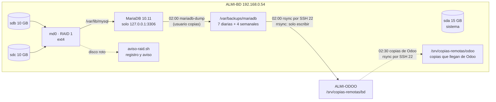

## Modelo de datos
Modelo del equipo hecho en dbdiagram.io: [`../diagramas/modelo-er-equipo.pdf`](../diagramas/modelo-er-equipo.pdf). Es un **modelo relacional** (tablas, columnas y claves). El **modelo entidad/relación conceptual** está en [`../diagramas/modelo-er-conceptual.mmd`](../diagramas/modelo-er-conceptual.mmd) (fuente, se edita como texto) y su imagen: las tres tablas intermedias (`detalle_comanda`, `plato_ingrediente` y `suministro`) aparecen como relaciones N:M con sus atributos. Está hecho a partir del esquema; el equipo lo revisa y, si el profesor lo pide en notación de Chen (rombos), lo pasa a draw.io.

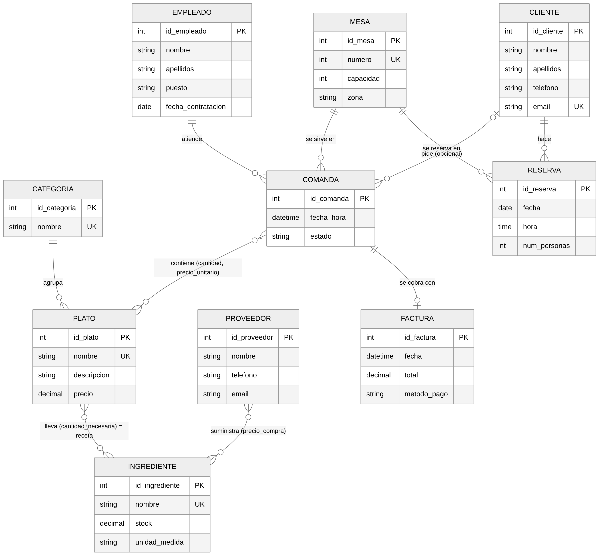

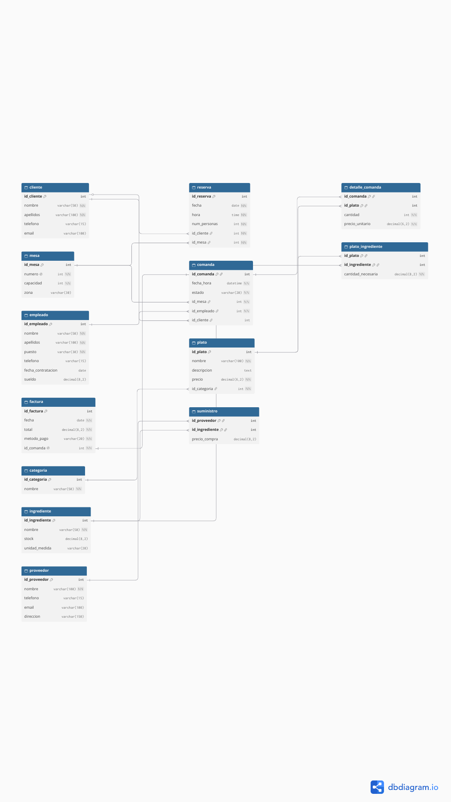

13 tablas y una vista:

| Tabla | Clave primaria | Claves ajenas | Notas |
|---|---|---|---|
| cliente | id_cliente | — | email único |
| mesa | id_mesa | — | número único; zona sala/terraza/barra |
| empleado | id_empleado | — | puesto, sueldo > 0 |
| categoria | id_categoria | — | nombre único |
| plato | id_plato | id_categoria | precio > 0 |
| ingrediente | id_ingrediente | — | stock ≥ 0 |
| proveedor | id_proveedor | — | |
| reserva | id_reserva | id_cliente, id_mesa | una mesa no se reserva dos veces a la misma hora |
| comanda | id_comanda | id_mesa, id_empleado, id_cliente (opcional) | estado abierta/servida/pagada/anulada |
| detalle_comanda | (id_comanda, id_plato) | id_comanda, id_plato | N:M comanda-plato; guarda el precio del momento |
| plato_ingrediente | (id_plato, id_ingrediente) | id_plato, id_ingrediente | N:M, la receta |
| suministro | (id_proveedor, id_ingrediente) | id_proveedor, id_ingrediente | N:M, precio de compra |
| factura | id_factura | id_comanda (única) | 1:1 con la comanda |
| **v_importe_comanda** (vista) | | | importe de cada comanda |

**Normalización**: todas las columnas son atómicas (1FN); las tablas con clave compuesta (detalle_comanda, plato_ingrediente, suministro) solo tienen atributos que dependen de la clave entera (2FN); no hay dependencias entre atributos que no son clave, por ejemplo el nombre de la categoría está en `categoria` y no repetido en `plato` (3FN). El importe de la comanda no se guarda: se calcula con la vista, para que no pueda quedar desactualizado.

Archivos SQL en [`sql/`](../07-bd-raid-copias/sql):

| Archivo | Qué hace |
|---|---|
| [`01-esquema.sql`](../07-bd-raid-copias/sql/01-esquema.sql) | Base `almichain` en utf8mb4, 13 tablas InnoDB con claves, restricciones CHECK, índices y la vista |
| [`02-datos.sql`](../07-bd-raid-copias/sql/02-datos.sql) | Datos de ejemplo ficticios |
| [`03-usuarios.sql`](../07-bd-raid-copias/sql/03-usuarios.sql) | Los 3 usuarios (las contraseñas se pasan al ejecutarlo, no están en el archivo) |
| [`04-consultas.sql`](../07-bd-raid-copias/sql/04-consultas.sql) | 9 consultas de prueba |
| [`05-recuentos.sql`](../07-bd-raid-copias/sql/05-recuentos.sql) | Recuento de filas para comparar antes y después de restaurar |

## Instalación paso a paso
#### 1. VM con tres discos

Instalación base de Ubuntu Server igual que ALMI-ODOO (bloque 05, paso 1) con IP **192.168.0.54** y nombre `almi-bd`, **salvo el cortafuegos**: este servidor no tiene web, así que solo se abre el SSH y solo desde la red del reto:

```bash
sudo ufw default deny incoming && sudo ufw default allow outgoing
for red in 192.168.0.0/24; do sudo ufw allow from $red to any port 22 proto tcp; done
sudo ufw enable
```

Con la VM apagada: **Configuración → Almacenamiento → Controlador SATA → Añadir disco duro → Crear** → `ALMI-BD-raid1`, VDI, 10 GB. Repetir con `ALMI-BD-raid2`.

#### 2. MariaDB segura

```bash
sudo apt install -y mariadb-server
sudo mariadb-secure-installation
```

Se quitan los usuarios anónimos, la base `test` y el acceso remoto de root; root solo entra por el socket local (`unix_socket`). MariaDB escucha solo en `127.0.0.1`.

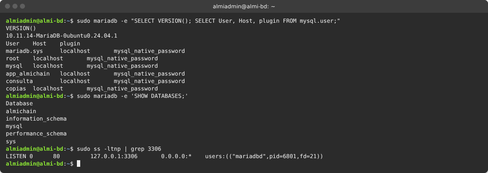

#### 3. RAID 1

Se hace **después** de instalar MariaDB, porque lo que se pone encima del RAID es su carpeta de datos (`/var/lib/mysql`). Los pasos están también en el script [`scripts/crear-raid.sh`](../07-bd-raid-copias/scripts/crear-raid.sh), que comprueba que los discos están vacíos antes de tocar nada y que la copia es idéntica antes de vaciar la carpeta original:

```bash
sudo apt install -y mdadm
sudo mdadm --create /dev/md0 --level=1 --raid-devices=2 /dev/sdb /dev/sdc
cat /proc/mdstat                       # esperar a [UU] y 100 %
sudo mkfs.ext4 -L datos-bd /dev/md0
sudo systemctl stop mariadb
sudo mount /dev/md0 /mnt && sudo rsync -aAX /var/lib/mysql/ /mnt/ && sudo rm -rf /mnt/lost+found
sudo diff -r --brief /var/lib/mysql/ /mnt/ && sudo umount /mnt   # sin salida = copia idéntica
sudo find /var/lib/mysql -mindepth 1 -delete                       # vaciar el original
echo "UUID=$(sudo blkid -s UUID -o value /dev/md0) /var/lib/mysql ext4 defaults,nofail 0 2" | sudo tee -a /etc/fstab
sudo mkdir -p /etc/systemd/system/mariadb.service.d
printf '[Unit]\nRequiresMountsFor=/var/lib/mysql\n' | sudo tee /etc/systemd/system/mariadb.service.d/raid.conf
sudo systemctl daemon-reload
sudo mount /var/lib/mysql && sudo chown mysql:mysql /var/lib/mysql
sudo mdadm --detail --scan | sudo tee -a /etc/mdadm/mdadm.conf
sudo update-initramfs -u
sudo systemctl start mariadb
```

> **Mejor con el script.** Los comandos de arriba hacen el RAID, pero **no** dos cosas que sí hace [`scripts/crear-raid.sh`](../07-bd-raid-copias/scripts/crear-raid.sh) (apartados 7 y 8): el **aviso** cuando falla un disco y el servicio que **arranca el RAID con un solo disco** si falta el otro. Por eso, en un servidor nuevo con los dos discos vacíos, lo recomendado es `sudo ./scripts/crear-raid.sh /dev/sdb /dev/sdc`, que además comprueba que los discos están vacíos.

- `nofail`: si el RAID fallara del todo, el servidor arranca igualmente y se puede reparar por SSH.
- `RequiresMountsFor`: pero **MariaDB no arranca** si el RAID no está montado. Por eso se vacía la carpeta original: si quedaran los datos viejos debajo del montaje, MariaDB arrancaría con ellos sin avisar y el restaurante trabajaría sobre datos antiguos.

**Aviso si falla un disco**: `mdadm` vigila el RAID (servicio `mdmonitor`) y, cuando un disco falla, llama al programa de la línea `PROGRAM` de `/etc/mdadm/mdadm.conf`. El script crea `/usr/local/sbin/aviso-raid.sh` (y reinicia `mdmonitor` para que lo use), que lo apunta en `/var/log/aviso-raid.log`, en el registro del sistema (`journalctl -t aviso-raid`) y en la pantalla de quien esté conectado, como mucho un minuto después del fallo (`mdmonitor` revisa el RAID cada 60 segundos). Sin esto, un disco roto podría pasar semanas sin que nadie se enterara y el RAID dejaría de proteger. El disco del sistema (el de 15 GB) **no** está en el RAID: si falla, se reinstala el servidor y se recupera la base desde el RAID o desde la copia en ALMI-ODOO.

#### 4. Esquema, datos y usuarios

```bash
cd ~/sql
sudo mariadb < 01-esquema.sql
sudo mariadb < 02-datos.sql
sudo ~/scripts/crear-usuarios-bd.sh 03-usuarios.sql
```

[`scripts/crear-usuarios-bd.sh`](../07-bd-raid-copias/scripts/crear-usuarios-bd.sh) pide las tres contraseñas sin enseñarlas (mínimo 12 caracteres) y se las pasa a MariaDB por la entrada estándar, así no quedan en el historial de bash ni se ven con `ps`. [`03-usuarios.sql`](../07-bd-raid-copias/sql/03-usuarios.sql) se para antes de tocar nada si falta alguna contraseña (probado: con `mariadb < 03-usuarios.sql` sin contraseñas sale con código 1 y los usuarios no cambian), usa `QUOTE()` (una comilla en la contraseña no rompe nada) y `CREATE OR REPLACE USER` (sirve también para cambiarlas). El script deja la contraseña de `copias` en `/root/.my.cnf` (600) para las copias automáticas.

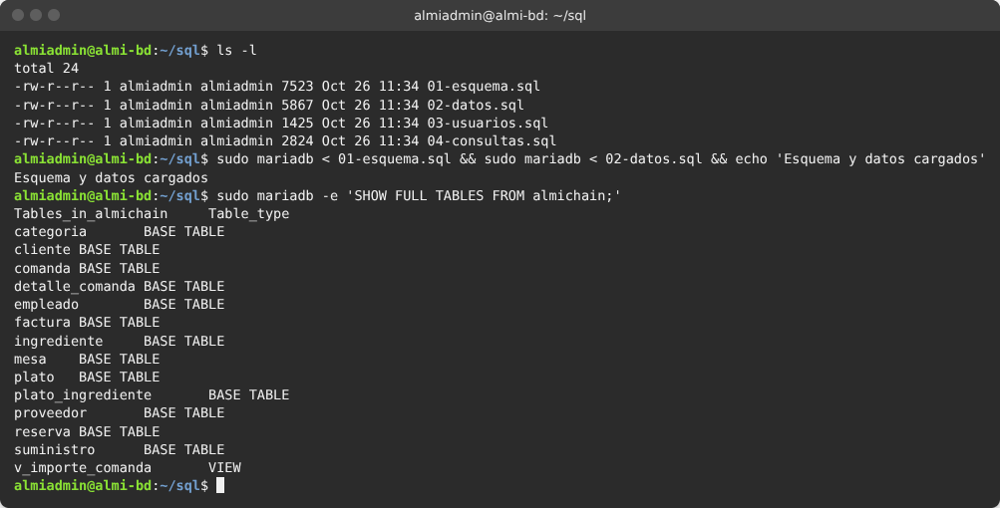


| Usuario | Permisos | Para qué |
|---|---|---|
| `app_almichain` | SELECT, INSERT, UPDATE, DELETE en `almichain.*` | La aplicación: trabaja con los datos, no puede cambiar la estructura |
| `consulta` | SELECT, SHOW VIEW en `almichain.*` | Informes de gerencia: solo lectura |
| `copias` | SELECT, SHOW VIEW, TRIGGER, LOCK TABLES, EVENT en `almichain.*` y SELECT en `mysql.proc` | Lo mínimo que necesita `mariadb-dump` (con `--routines`). No puede leer las demás bases ni `mysql.global_priv`, donde están los hashes de las contraseñas |

Todos solo desde `localhost`.


#### 5. Consultas

Las 9 consultas de [`04-consultas.sql`](../07-bd-raid-copias/sql/04-consultas.sql), ejecutadas con el usuario de solo lectura `consulta`:


El usuario `consulta` no puede borrar ni modificar:


#### 6. Plan de copias

| Qué | Cómo | Cuándo | Retención | Dónde |
|---|---|---|---|---|
| Base `almichain` (MariaDB) | `mariadb-dump --single-transaction` comprimido + huella SHA-256 | Diaria, 02:00 | 7 diarias + 4 semanales (domingo) | ALMI-BD `/var/backups/mariadb` y **copia en ALMI-ODOO** |
| Base y adjuntos de Odoo | `pg_dump -Fc` + `tar` del filestore + huellas | Diaria, 02:30 | 7 días | ALMI-ODOO `/var/backups/odoo` y **copia en ALMI-BD** |
| Configuración y scripts | Repositorio Git | En cada cambio | Historial completo | GitHub |

**Regla 3-2-1**: 3 copias (datos en el RAID + copia local + copia en el otro servidor), en 2 soportes distintos (dos máquinas) y 1 fuera del local (el repositorio para la configuración; para los datos, se recomienda al restaurante un disco externo semanal o un almacenamiento en la nube cifrado).

#### 7. Copias cruzadas automáticas

En **los dos** servidores:

- Usuario `copias` sin contraseña (`passwd -l`) que solo recibe archivos en `/srv/copias-remotas/` (permisos 700).
- Clave SSH `/root/.ssh/copias_ed25519` para enviar. En el `authorized_keys` del otro servidor la clave va limitada a la IP de origen, sin terminal y **solo para escribir en su carpeta** con `rrsync` (viene con rsync en Ubuntu 24.04):

  ```
  command="/usr/bin/rrsync -wo -no-del /srv/copias-remotas/bd/",from="192.168.0.54",restrict ssh-ed25519 …
  ```

 Así, aunque alguien se hiciera con un servidor, desde él **no puede borrar ni leer las copias** que hay en el otro, ni ejecutar órdenes allí. Probado entre las dos VM: la copia normal funciona; `ssh … 'ls /'`, `rsync --delete`, leer y `../` se rechazan.
- A mano. Los archivos del repositorio se llevan a la VM con `git clone` o `scp -r`. En **ALMI-ODOO**, que envía a ALMI-BD:

  ```bash
  sudo ssh-keygen -t ed25519 -N '' -C copias-odoo -f /root/.ssh/copias_ed25519
  sudo cat /root/.ssh/copias_ed25519.pub          # se copia para el otro servidor
  sudo install -m 700 05-erp-odoo/scripts/copia-odoo.sh /usr/local/bin/copia-odoo.sh
  ```

  En **ALMI-BD**, que la recibe:

  ```bash
  sudo useradd -m -s /bin/bash -c 'Copias de seguridad' copias && sudo passwd -l copias
  sudo install -d -o copias -g copias -m 700 /srv/copias-remotas /srv/copias-remotas/odoo /home/copias/.ssh
  echo 'command="/usr/bin/rrsync -wo -no-del /srv/copias-remotas/odoo/",from="192.168.0.53",restrict ssh-ed25519 AAAA…pegar…' \
    | sudo tee /home/copias/.ssh/authorized_keys
  sudo chown copias:copias /home/copias/.ssh/authorized_keys && sudo chmod 600 /home/copias/.ssh/authorized_keys
  ```

  Y lo mismo al revés (clave en ALMI-BD, `copia-bd.sh`, carpeta `bd` y `from="192.168.0.54"` en ALMI-ODOO). En el cron de root de cada uno (`sudo crontab -e`): `0 2 * * * /usr/local/bin/copia-bd.sh` (o `30 2 … copia-odoo.sh`) y la limpieza de abajo. La primera copia se lanza a mano (`sudo /usr/local/bin/copia-bd.sh`) para que `ssh` guarde la clave de host del otro.
- El que recibe las copias es quien borra las viejas: en el cron de root, `find /srv/copias-remotas -type f -mtime +30 -delete` (30 días).
- La primera vez que un servidor envía, guarda la clave de host del otro (`StrictHostKeyChecking=accept-new`); si después cambiara, `ssh` se niega a conectar.
- Contraseña del usuario `copias` de MariaDB en `/root/.my.cnf` (permisos 600).

Script [`scripts/copia-bd.sh`](../07-bd-raid-copias/scripts/copia-bd.sh) en `/usr/local/bin/`, en el cron de root a las 02:00:

## Restaurar una copia
Se simula un desastre: se borra la base de datos entera y se recupera de la copia.


**Tiempo de recuperación (RTO)**: menos de 1 segundo con esta cantidad de datos. **Pérdida máxima de datos (RPO)**: 24 horas (copia diaria).

## Qué hacer si falla un disco
**El RAID con los datos.** [`crear-raid.sh`](../07-bd-raid-copias/scripts/crear-raid.sh) crea el RAID 1 con los dos discos vacíos, copia encima los datos de MariaDB, comprueba la copia, **vacía la carpeta original** (debajo del montaje quedan 0 archivos) y deja MariaDB dependiendo del montaje.


**Prueba A, un disco se rompe con el servidor en marcha.** Se marca `sdc` como roto: el RAID pasa a `[U_]` y la base de datos **sigue funcionando y se puede escribir**. Antes de un minuto llega el **aviso** (registro y mensaje en pantalla).

```bash
sudo mdadm /dev/md0 --fail /dev/sdc
cat /proc/mdstat
sudo mariadb -e "INSERT INTO almichain.cliente (nombre, apellidos, telefono) VALUES ('Prueba', 'RAID', '699999999');"
sudo tail /var/log/aviso-raid.log
```


**Cambio del disco y reconstrucción**: se quita del RAID y se vuelve a añadir; mdadm copia los datos del disco bueno al otro.

```bash
sudo mdadm /dev/md0 --remove /dev/sdc
sudo mdadm /dev/md0 --add /dev/sdc
watch cat /proc/mdstat
```


**Prueba B, arrancar sin un disco.** Con la VM apagada se quita el segundo disco y se arranca: el RAID arranca **degradado** con un solo disco, se monta y MariaDB funciona con los datos. Ubuntu no siempre lo arranca solo cuando falta un disco (se quedaba `inactive`); por eso hay un servicio, `almi-raid-degradado`, que espera 20 s y, si sigue inactivo, lo arranca con el disco que haya, monta los datos y arranca MariaDB.


Después se apaga, se pone un **disco nuevo y vacío** y se añade al RAID:

```bash
sudo mdadm /dev/md0 --add /dev/sdc
```


En VirtualBox es igual: VM apagada → **Configuración → Almacenamiento** → quitar `ALMI-BD-raid2` → arrancar y comprobar → apagar, **Añadir disco duro → Crear** uno nuevo de 10 GB → arrancar y `sudo mdadm /dev/md0 --add /dev/sdc`.

**Copias cruzadas entre las dos VM** (con ALMI-ODOO y ALMI-BD encendidas a la vez en la misma red): cada una envía su copia a la otra y la clave de copias solo puede escribir.


## Solución de problemas
| Problema | Causa | Solución |
|---|---|---|
| El diagrama del equipo y la guía tenían modelos distintos | La guía proponía 15 tablas; el equipo diseñó el suyo | Se implementa el modelo del equipo (13 tablas) |
| Los datos de MariaDB tienen que estar en el RAID desde el principio | Si se instala MariaDB antes del RAID, los datos quedan en el disco de sistema | Se copian con `rsync -aAX` con el servicio parado y se monta el RAID en `/var/lib/mysql` |
| `mariadb-dump` necesita contraseña en cron | cron no puede escribirla | `/root/.my.cnf` con permisos 600 y el usuario `copias` de solo lectura |

# 10. Copias de seguridad de los sistemas operativos

## Objetivo
Un servidor Ubuntu dedicado a copias recoge por SSH los datos de los dos sistemas operativos del equipo del gerente (**Windows 10** y **Debian 13**, en arranque dual) y los guarda en un **RAID 1**. Después replica todas las copias a un **servidor remoto en AWS** creado con **Terraform**. Todo se ejecuta solo cada semana y se ha comprobado que los archivos se pueden restaurar.

Apartado de la rúbrica: **2. SO: copias de seguridad**. Las copias de la base de datos y de Odoo son otra cosa y están en el [bloque 07](../07-bd-raid-copias/README.md).

## Cómo funciona


| Máquina | Sistema | IP | Papel |
|---|---|---|---|
| PC de clase | Zorin OS | 192.168.0.100 | Administración por SSH y Terraform |
| Servidor de copias (`almichaincopia`, VM `copia_seguridad_gerente`) | Ubuntu Server | 192.168.0.52 | Recoge las copias, las guarda en el RAID 1 y las replica |
| ALMI-GERENTE | Windows 10 + Debian 13 en arranque dual | 192.168.0.63 (fija en los dos sistemas) | Origen de los datos. Solo hay un sistema encendido a la vez |
| `almichain-backup-remoto` | Ubuntu Server 24.04 en EC2 | IP elástica | Copia fuera del local |

## Plan de copias
| | Windows 10 | Debian 13 |
|---|---|---|
| **Qué se copia** | `C:\Users\Gerente\Documents` y `Desktop` | `/home/almiadmin` |
| **Qué se excluye** | Los accesos de compatibilidad `Mi música`, `Mis imágenes` y `Mis vídeos` (no son carpetas reales) | — |
| **Tipo de copia** | Completa (`tar` por SSH; Windows no trae rsync) | Incremental con `rsync --link-dest`: cada carpeta parece completa, pero los archivos sin cambios son enlaces duros a la copia anterior y no ocupan espacio otra vez |
| **Frecuencia** | Semanal, martes a las 11:50 | Semanal, martes a las 11:50 |
| **Retención** | Últimas 4 copias (un mes) | Últimas 4 copias (un mes) |
| **Destino local** | `/backups/gerente/win10/AAAA-MM-DD_HHMM/` (RAID 1) | `/backups/gerente/debian13/AAAA-MM-DD_HHMM/` (RAID 1) |
| **Destino remoto** | `/backups_remoto/gerente/` en AWS (espejo de todo `/backups/gerente`) | Igual |

```
/backups/
├── backup.log
└── gerente/
    ├── win10/
    │   ├── 2026-11-04_1031/
    │   └── 2026-11-04_1138/
    └── debian13/
        ├── 2026-11-04_1205/
        └── 2026-11-04_1206/
```

**Regla 3-2-1:**
- **3 copias:** el original en ALMI-GERENTE, la del RAID 1 y la de AWS.
- **2 soportes distintos:** el disco del Gerente y el RAID 1 del servidor de copias (más el disco EBS de AWS).
- **1 copia fuera del local:** AWS.

**Arranque dual:** como solo hay un sistema encendido cada vez, el script prueba primero Windows y, si no responde, Debian. Cada ejecución copia el sistema que esté arrancado. Si el Gerente está apagado, lo anota en el log y aun así replica a AWS lo que ya hay.

**Hora:** el martes a las 11:50 es horario de clase, cuando las VM están encendidas. A las 3:00 de la madrugada estarían apagadas. Al principio se puso el viernes a las 12:00, pero el viernes 6 de noviembre el servidor de copias estaba apagado y no se hizo ninguna copia (el log no tiene ninguna línea de ese día), así que se cambió a una franja en la que seguro hay clase.

**IP fija:** ALMI-GERENTE tiene la `192.168.0.63` fija en Windows y en Debian (cada sistema del arranque dual tiene su propia configuración de red). Con DHCP, el 10 de noviembre cogió la `.57` y el servidor de copias dejó de encontrarlo (`No route to host`).

## Disco redundante (RAID 1)
En VirtualBox se añadieron al servidor de copias dos discos VDI de 25 GB (`sdb` y `sdc`) en el controlador SATA:


```bash
lsblk                                   # sdb y sdc de 25G, vacíos
sudo blkid /dev/sdb                     # sin salida = sin datos
sudo apt install mdadm
sudo mdadm --create /dev/md0 --level=1 --raid-devices=2 /dev/sdb /dev/sdc
cat /proc/mdstat                        # resync hasta [UU]
sudo mkfs.ext4 /dev/md0
sudo mkdir /backups && sudo mount /dev/md0 /backups
sudo chown -R copia:copia /backups
```


**Montaje permanente:** se guarda el array en `mdadm.conf`, se regenera el initramfs y se monta por UUID con `nofail`, para que el servidor arranque aunque falte el RAID.

```bash
sudo mdadm --detail --scan | sudo tee -a /etc/mdadm/mdadm.conf
sudo update-initramfs -u
echo "UUID=$(sudo blkid -s UUID -o value /dev/md0) /backups ext4 defaults,nofail 0 2" | sudo tee -a /etc/fstab
sudo systemctl daemon-reload && sudo mount -a
```


#### Prueba de fallo de disco

Se marca `sdc` como fallido: el RAID sigue funcionando con un disco (`[U_]`) y los datos siguen accesibles. Después se quita, se vuelve a añadir como si fuera un disco nuevo y se reconstruye solo.

```bash
sudo mdadm /dev/md0 --fail /dev/sdc
cat /proc/mdstat                        # sdc[2](F) · [2/1] [U_]
ls /backups/gerente                     # los datos siguen ahí
sudo mdadm /dev/md0 --remove /dev/sdc
sudo mdadm /dev/md0 --add /dev/sdc      # reconstrucción (recovery)
```


Tras reiniciar el servidor, el RAID arranca solo en `[UU]` y está montado en `/backups`:


## Acceso SSH sin contraseña
Las copias se hacen con el usuario sin privilegios **`copia`** del servidor de copias y con una **clave ed25519 distinta para cada destino**. Ninguna contraseña aparece en el script.

```bash
ssh-keygen -t ed25519 -f ~/.ssh/id_ed25519_windows -N ""
ssh-keygen -t ed25519 -f ~/.ssh/id_ed25519_debian  -N ""
ssh-keygen -t ed25519 -f ~/.ssh/id_ed25519_remoto  -N ""
```


**Windows 10.** El servidor OpenSSH de Windows ya estaba activo en el puerto 22 (Windows bloquea el ping, por eso hace falta `nmap -Pn`):


`ssh-copy-id` no funciona con Windows, así que la clave se instala a mano. El usuario `Gerente` **no es administrador** (`whoami /groups | findstr S-1-5-32-544` no devuelve nada), por lo que la clave va en su perfil y no en `C:\ProgramData\ssh\administrators_authorized_keys`:

```bash
scp ~/.ssh/id_ed25519_windows.pub win10:clave.pub     # pide la contraseña una vez
ssh win10
powershell
mkdir $HOME\.ssh -Force
Get-Content $HOME\clave.pub | Add-Content $HOME\.ssh\authorized_keys
Remove-Item $HOME\clave.pub
```

**Debian 13:**

```bash
ssh-copy-id -i ~/.ssh/id_ed25519_debian.pub debian13
```


**Configuración de SSH** ([`config/ssh_config.example`](../08-copias-so/config/ssh_config.example)). Windows y Debian son la misma máquina con la misma IP, así que cada sistema presenta una huella de servidor distinta en la misma dirección. Con **`HostKeyAlias`** cada huella se guarda con su propio nombre (`gerente-win10` y `gerente-debian13`). Las claves privadas tienen permisos 600.


Esto además protege el script: si está arrancado Debian y se conecta a `win10`, SSH detecta que la huella no es la de Windows y **se niega a conectar**, en lugar de copiar el sistema equivocado.


> No hay que borrar la huella con `ssh-keygen -R` cuando sale este aviso: si se hiciera, la siguiente conexión guardaría la huella de Debian como si fuera la de Windows.

## Copia local
El script [`scripts/backup_gerente.sh`](../08-copias-so/scripts/backup_gerente.sh) se instala en `/usr/local/bin/backup_gerente.sh` (con `chmod +x`). Hace tres cosas:

1. **Detecta qué sistema está encendido** y lo copia: Windows con `tar` por SSH (completa) o Debian con `rsync --link-dest` (incremental). `BatchMode=yes` hace que, si algo pidiera contraseña, falle en vez de quedarse esperando, y `ConnectTimeout=5` evita que se cuelgue con el sistema apagado.
2. **Retención:** borra las copias más antiguas y deja las 4 últimas de ese sistema.
3. **Réplica remota:** sincroniza todo `/backups/gerente` con AWS.

Cada paso deja una línea `OK`, `ERROR` o `AVISO` en `/backups/backup.log`.


**Windows:** copia correcta, con `Desktop` y `Documents` y sin los accesos de compatibilidad.


**Debian:**


**Incremental:** la primera copia de Debian ocupa 32 KB y la segunda solo 8 KB (carpetas y metadatos), porque los archivos sin cambios son enlaces duros a la anterior.


**Retención:** en `win10` solo quedan las 4 copias más recientes (11:38, 11:40, 11:42 y 11:44). La primera, la de las 10:31, la borró el script automáticamente al hacerse la quinta.


#### Problemas encontrados y cómo se resolvieron

| Problema | Causa | Solución |
|---|---|---|
| `nmap` dice que ALMI-GERENTE está apagado | Windows bloquea el ping y nmap no escanea si no le contesta | `nmap -Pn` |
| La clave no llegaba a `C:\Users\Public` | La ruta con `C:/` en `scp` no se interpretaba bien | Enviarla a la carpeta del usuario: `scp ... win10:clave.pub` |
| `ssh-copy-id` a Debian pedía la contraseña de `Gerente` | El alias `debian13` tenía puesto el usuario de Windows | `User almiadmin` en el bloque de Debian |
| Aviso *REMOTE HOST IDENTIFICATION HAS CHANGED* | Misma IP, dos sistemas con huellas distintas | `HostKeyAlias` por sistema |
| `scp` falla con `Mi música`, `Mis imágenes` y `Mis vídeos` y la copia de Windows sale como `ERROR` | Son accesos de compatibilidad que deniegan la lectura, y `scp` no permite excluir rutas | Cambiar `scp` por `tar` por SSH con `--exclude "Documents/Mi*"` |
| Avisos `Ignoring unknown extended header keyword 'SCHILY.fflags'` | El `tar` de Windows añade metadatos que el de Linux no conoce | `--warning=no-unknown-keyword` |
| `integer expression expected` en el script | `PIPESTATUS` se sobrescribe con el primer `[ ]` | `set -o pipefail` y comprobar la tubería entera en el `if` |
| `rm: Permission denied` al borrar copias viejas | Las carpetas de Windows llegan de solo lectura | `chmod -R u+w` antes de borrar (también en la retención) |
| Cron una hora desfasado | El servidor estaba en UTC | `timedatectl set-timezone Europe/Madrid` y reiniciar cron |
| Con el Gerente apagado no se replicaba nada a AWS | El script salía con `exit 0` antes de la réplica | Quitar el `exit 0`: se anota `AVISO` y se sigue |


## Copia remota en AWS
El servidor remoto se crea con **Terraform** ([`terraform/`](../08-copias-so/terraform)), en la misma cuenta de AWS Academy que la web. Crea 4 recursos:

| Recurso | Para qué |
|---|---|
| `aws_key_pair` | Importa la clave pública `id_ed25519_remoto.pub` del usuario `copia` (no hace falta ningún `.pem`) |
| `aws_security_group` | Solo SSH (22) y solo desde la IP pública del aula, que detecta sola con `checkip.amazonaws.com` |
| `aws_instance` | Ubuntu 24.04, `t2.micro`, disco de 10 GB. Al arrancar instala `rsync` y crea `/backups_remoto` |
| `aws_eip` | IP elástica: no cambia aunque el lab apague y encienda la instancia |

```bash
# En el PC de clase, con las credenciales del Learner Lab en ~/.aws/credentials
cd 08-copias-so/terraform
cp terraform.tfvars.example terraform.tfvars
# Clave pública traída directamente del servidor de copias:
sed -i "s|^clave_publica.*|clave_publica = \"$(ssh copia@192.168.0.52 cat .ssh/id_ed25519_remoto.pub)\"|" terraform.tfvars
terraform init
terraform plan      # Plan: 4 to add
terraform apply
# Añadir el alias "remoto" al ~/.ssh/config del servidor de copias:
terraform output -raw ssh_config | ssh copia@192.168.0.52 "cat >> ~/.ssh/config"
```

`terraform.tfvars` no se sube al repositorio (está en el `.gitignore`).


El script replica con `rsync -aH --delete`: `-H` conserva los enlaces duros de las copias incrementales (si no, en AWS ocuparían como copias completas) y `--delete` hace que el remoto sea un espejo, así que la retención también se aplica allí.


## Automatización
```bash
sudo timedatectl set-timezone Europe/Madrid
sudo systemctl restart cron
crontab -e        # como usuario copia, no root: las claves están en su home
```

```
50 11 * * 2 /usr/local/bin/backup_gerente.sh
```

([`config/crontab.txt`](../08-copias-so/config/crontab.txt)). Primero, para comprobarlo sin esperar una semana, se puso un rato `*/2 * * * *`: el log muestra ejecuciones a las 11:38, 11:40, 11:42 y 11:44 del 4 de noviembre que **lanzó cron solo**.


El log cuenta toda la historia: los `ERROR local win10` del primer script, la primera copia buena (10:31), las ejecuciones de cron, las copias de Debian y la primera réplica `OK remoto` (12:41).

#### Ejecución semanal real (10 de noviembre)

Con el Gerente arrancado en Windows y ya con la IP fija, se comprueba que el servidor de copias entra sin contraseña:


Se programa la copia semanal para los **martes a las 11:50**:


> El comentario de encima de la línea se quedó con el texto antiguo ("viernes a las 12:00"); lo que manda es la línea `50 11 * * 2`.

Antes de las 11:50, el log no tiene ninguna ejecución de ese momento. La última es la de las 10:20, de una prueba anterior del cron con el Gerente todavía sin IP fija: `AVISO ALMI-GERENTE apagado`.


A las 11:51, sin lanzar nada a mano:

```bash
journalctl -u cron --since "11:45" | grep backup_gerente
tail -3 /backups/backup.log
ls /backups/gerente/win10
```


- El registro del sistema muestra que **cron** lanzó el script como usuario `copia` a las **11:50:01**: `CRON[1738]: (copia) CMD (/usr/local/bin/backup_gerente.sh)`.
- El log tiene `OK local win10` a las 11:50:02 y aparece la carpeta `2026-11-10_1150`.
- **Retención:** la copia de las 11:38 del 4 de noviembre ha desaparecido; quedan solo las 4 últimas.
- `ERROR remoto`: ese día el Learner Lab no tenía crédito y la EC2 estaba apagada. El script registra el fallo y la copia local se hace igualmente: es la limitación prevista (ver [Limitaciones](#limitaciones-y-mejoras)).

## Restaurar una copia
#### Desde la copia remota (AWS)

Simula que se ha perdido el servidor de copias entero: el archivo se trae desde AWS y se compara su huella con la de la copia local.

```bash
scp remoto:/backups_remoto/gerente/debian13/2026-11-04_1217/pedidos.txt /tmp/
cat /tmp/pedidos.txt
sha256sum /tmp/pedidos.txt /backups/gerente/debian13/2026-11-04_1217/pedidos.txt
```

Las dos huellas SHA-256 son **idénticas** (`a8dbc8c1…a1ef8`):


#### En el propio Gerente (prueba adicional)

La restauración validada es la de AWS: la más exigente, porque recupera los datos aunque se haya perdido el servidor de copias. Para restaurar directamente en el Gerente desde el RAID, el procedimiento es este:

**Debian:**
```bash
ULTIMA=$(ls -1d /backups/gerente/debian13/20* | tail -n1)
rsync -a "$ULTIMA/pedidos.txt" debian13:/home/almiadmin/
ssh debian13 "sha256sum ~/pedidos.txt"; sha256sum "$ULTIMA/pedidos.txt"
```

**Windows:**
```bash
ULTIMA=$(ls -1d /backups/gerente/win10/20* | tail -n1)
scp "$ULTIMA/Documents/pedidos.txt" win10:Documents/pedidos.txt
sha256sum "$ULTIMA/Documents/pedidos.txt"
ssh win10 "certutil -hashfile Documents\pedidos.txt SHA256"   # mismo valor
```

# 11. Presupuesto

Precios con IVA incluido. El detalle, con los enlaces, está en `presupuesto/README.md`.

| Concepto | Qué incluye | Total |
|---|---|---|
| Hardware | PC y monitor del gerente, 2 mini PC con pantalla táctil para los TPV, 2 cajones, 2 lectores, 2 impresoras de tickets, arcade stick, papel y cables | 2.075 € |
| Software | 3 licencias de Windows 10 Pro (el resto es gratuito: Debian, Ubuntu Server, Odoo, LibreOffice, MAME y Arduino IDE) | 138 € |
| **Total** | | **2.213 €** |

Aparte, la **línea de fibra** (Movistar Fibra 600 Mb, capítulo 6): 24,90 €/mes el primer año (298,80 €) y 35,00 €/mes después.
